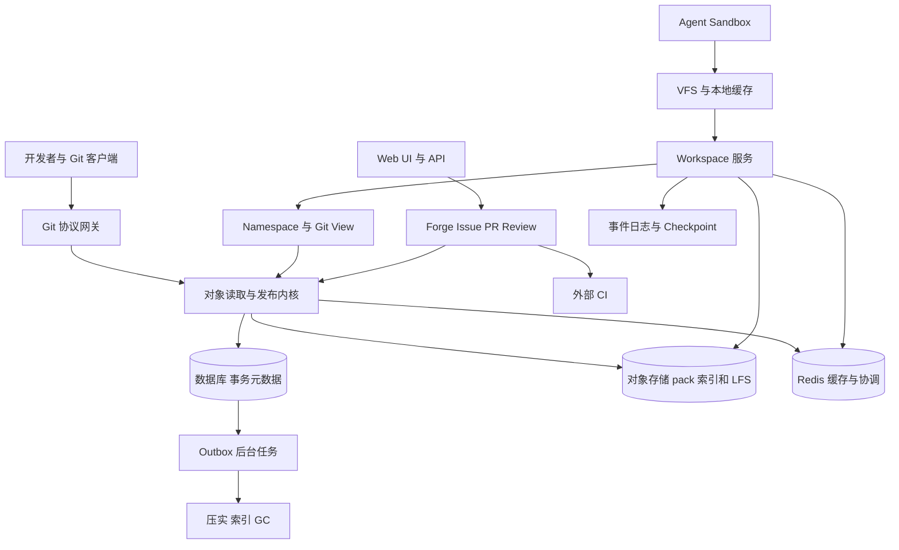

# 总体目标与技术架构

> 历史来源快照：本文中的“最新/当前/优先级”仅指归档日期。现行规范见 [状态服务设计](12-state-services.md) 和 [实施计划](implementation-plan.md)，不再要求旧 GitFS 演进或旧版本升级。

> 状态：目标架构与早期建议；当前权威边界以实现状态和最新路线为准。
> [设计目录](README.md) · [实现状态](implementation-status.md) · [来源与完整归档](source-page.md)

<!-- BEGIN SOURCE BODY -->
这是一份面向多 AI Agent 和大型 monorepo 的 Git 平台设计方案。目标是在兼容标准 Git 客户端、Issue、PR、LFS 与外部 CI 的同时，把公司多个仓库组织成统一虚拟文件树，让隔离的 Agent 工作区能够实时记录修改，并支持按目录导出 Git 视图。

核心选择：**公司 Namespace 负责组织，Workspace 负责实时编辑，Git 负责版本交换和发布。** 首期以成熟 Git 实现验证工作区，Pando 风格的存储内核并行原型化；不把所有仓库、分支和编辑写入同一个全局 HEAD。下文的实现细节是建议方案，性能数字与产品边界需实测和确认。

# 一 目标和非目标

## 产品目标

- 公司级统一文件树：把多个仓库挂载到路径，并允许选择部分目录形成 Git 仓库视图。

- Agent sandbox 通过 VFS 使用文件；变更实时可见、可持久恢复，并保留独立工作区。

- 支持标准 Git 客户端、Issue、PR、LFS、Web UI；CI/CD 接入外部服务。 CI 的重复 clone/fetch 通过只读镜像卸载，构建输入固定到准确 Git OID。

- 不同分支的 push 尽量独立并行，同分支通过条件更新防覆盖。

- 优先轻量部署和 Rust 实现，支持大仓库、按需取文件与内容复用。

## 非目标

一期采用 Rust 后端、PostgreSQL 和对象存储，单机缓存及消息队列默认使用进程内实现；分布式部署可换 Redis 与 Kafka 类消息队列，不绑定特定对象存储供应商。暂不建设前端或完整 CI 平台。

## 设计边界

Git 兼容是协议、对象和客户端行为的兼容，不要求内部采用传统裸仓库目录结构。实时追踪工作区修改不等于每次写文件都创建 Git commit。

# 二 总体架构

建议以 Rust 模块化单体开始：Git Gateway、ObjectReader、Workspace、Forge API、权限与后台任务可在一个进程中部署，按实际瓶颈拆分。数据库保存 refs、权限、事务和持久任务状态；对象存储保存不可变 pack、索引、LFS 和工作区快照；Redis 用于可重建的热点缓存、限流、短期协调及通知，本地 SSD 缓存热数据和构建产物。单机开发可使用本地持久对象目录，但必须和缓存目录分开。Redis 不作为 refs、快照发布或任务成功的唯一事实源：故障时缓存失效、临时协调和通知可能中断，系统从数据库和持久 outbox 恢复；关键发布仍由数据库事务和版本校验保证。

**三种身份：**Namespace 是逻辑路径与所有权映射；Workspace 是固定基础版本加私有修改；Git View 是一个可被标准 Git 客户端访问的仓库及其提交图。一个 Namespace 可有多个 View，但 View 不是互相覆盖的权威副本。

# 三 公司级 Namespace 与 Git View

## 路径与所有权

例如将仓库挂到 /services/search、/libraries/query、/platform/protocols，再将其中的服务和依赖组合成任务视图。每个可写 canonical 路径必须归属一个 owner 和版本流；初版以原仓库为 owner，日后按组件调整。权限检查在 canonical 路径和来源仓库执行，不能因为路径出现在视图中就自动获得访问权。

Namespace 可用于浏览最新状态，但可执行 Workspace 必须固定 BaseVector，例如 search@a1、query@b7、protocols@c3。扩展范围时显式固定新增来源版本，避免构建时混入不同时间的接口和实现。

## 视图定义

Git View 应记录 view_id、epoch、包含和排除路径、路径重写、来源 owner、对象格式、历史策略及权限。修改映射规则创建新 epoch 或显式迁移，不能悄悄重写已发布历史。路径冲突、重叠映射与子模块需在创建时验证；初版拒绝不确定的跨 owner 写入。

一次工作区编辑只更新自己的 overlay 和事件，不同步重建所有视图。维护来源路径到长期视图的反向索引；冷门视图按需物化。

# 四 Workspace 与实时 VFS

## 状态模型

Workspace 记录 workspace_id、namespace_version、BaseVector、overlay_root、timeline_id、读写范围及状态版本。工作区内容是固定基础树加私有 COW overlay，fork 共享不可变基础和未变化树节点，之后独立写入。文件内容采用内容寻址；二进制修改按整体替换。初版采用单写者加 expected_version，多个 Agent 默认各自 fork，显式合并；不先引入全局 CRDT。

## 文件访问

Linux 优先构建 VFS 原型，可评估 FUSE 和内核接口；工作区本地缓存目录元数据与热文件，批量预取树和 blob。首次 open 未命中时 hydrate，读写本地 overlay，后台上传增量。需要明确 mmap、文件锁、symlink、权限位、大小写、inode、watcher、rename、断网及构建工具的兼容范围；不能假设一次 stat 对应一次远程请求可接受。

每次修改产生按 workspace 有序的变更记录，事件内容与大 blob 分离；批量上传并在服务端确认持久后标记为远端已保存。展示本地保存、远端持久、Checkpoint 可恢复、Git 分支发布、ChangeSet 集成等不同状态。时延与丢失窗口需通过实验设定，不能把本地写成功直接视为跨机器可恢复。

## 忽略文件与路由

按用户要求，未跟踪且匹配 .gitignore 的文件默认落 sandbox 原生文件系统，适用于缓存和构建产物。**tracked 优先于 ignore**：已经跟踪的文件后来匹配 .gitignore 仍应继续追踪。实现需维持独立的路径路由状态，并处理：

- 未跟踪文件被 git add 或 add -f：验证权限和内容后提升为可追踪状态。

- .gitignore 改变、tracked 文件移除索引、目录移动或跨层 rename：显式迁移或保留旧路由直到一致完成，禁止静默丢文件。

- 本地 ignored 文件默认不保证跨机器恢复；可为用户选择的缓存设计独立同步策略，不能误称属于 Git 快照。

- 大目录匹配采用缓存与增量失效；防止 ignore 规则造成安全策略绕过。

## 快照与恢复

Checkpoint 固定 overlay 根、事件前沿、BaseVector 和必要内容引用；先保证依赖对象可读再发布快照。跨设备恢复代码、可获得的会话与工具记录、环境描述，不承诺恢复进程内存、socket、凭证或正在运行的外部命令。外部副作用不可自动重放；使用操作 ID 和明确执行状态。

必须有 checkpoint barrier：冻结版本或使用可靠文件系统快照、变更日志校验并重试；逐文件遍历正在被写入的目录不能自动保证一致快照。

# 五 Git 语义与历史

## 工作区、暂存与提交

明确区分 HEAD、index 和 working tree。实时文件事件只是工作区过程历史，不自动改变 index 或生成 commit。git add 选择 index 内容，commit 根据固定 index 快照创建 tree 和 commit；push 发布 ref。原生 Git CLI 可通过标准协议操作导出视图，VFS 初期不承诺透明支持全部本地 .git 行为，必须通过兼容矩阵逐项验证。

Delta 风格的 Timeline 记录可获得的消息、工具结果、文件编辑和 checkpoint，使用 actor 与计数器及因果父节点标识，不假定可获得模型内部推理。分别使用 DeltaId、SnapshotId、CheckpointId、ChangeSetId 和 Git OID，避免评论变化改变代码身份。CRDT 收敛不等于代码语义正确，二进制、删除与移动冲突须显式处理。

## 三种历史策略

1. **原仓库视图**：目录结构不变，保留原 commit OID、父关系和签名。

2. **长期历史投影**：将子目录投影为稳定 Git DAG，持久化 (view_epoch, source_commit) 到 projected_commit 映射。一个源提交可能不改变视图而折叠，合并提交裁剪必须保持正确 ancestry 和 merge-base。固定时间、作者和父映射，保证重复生成确定性。

3. **任务快照视图**：多来源组合从固定组合基线生成 root commit，后续保留任务历史；早期来源历史回原仓库或平台查询。不要把它称为完整历史的 shallow clone。

修改 tree 或 parents 必然改变 OID，原提交签名不再覆盖投影提交；保存 provenance，必要时平台对投影另行签名。首次完整投影可能遍历大量祖先，depth=1 不自动消除生成成本。长期视图增量预建，临时任务默认快照优先。

## 推送与集成

标准 Git push 首先发布视图自己的任务分支，成功后其他标准客户端必须能 fetch 同一原始 commit；它不意味着所有源仓库 main 自动更新。集成时对固定视图基线做 diff，反向映射至 canonical 路径，针对各 owner 当前版本做三方合并、冲突检测及权限检查。禁止以投影树覆盖全部公司树。组合 main 初版保护，由审阅和 ChangeSet 流程更新。

# 六 Pando 风格 Git 存储内核

参考 [OpenAI Scaling Git at OpenAI](https://openai.com/index/scaling-git-at-openai/) 的不可变 pack、分支独立协调、版本依赖和压实思想，但其增强客户端优化不等于标准客户端均支持。数据库、Redis 和对象存储不是现成 Git 服务，对象存储也不能直接当 POSIX 裸仓库挂载。

## 核心实体与不变量

数据库维护 repositories、refs、ref_versions、object_views、representations、packs、index_segments、push_attempts、leases 和 outbox。分开 Git commit ancestry、ref 更新历史、物理 pack 依赖图；依赖引用固定版本而非移动的 main。

不可变对象先持久可读，短事务后发布 ref。不同 ref 不共享仓库级业务锁；同 ref 条件更新 expected old OID，并以服务端 generation 防 ABA。Git branch 是数据库中的 ref 记录。数据库的写入、事务日志和连接资源仍是共享吞吐域；后期按租户/仓库分片，单超大仓库跨分片属于专项。Redis 可做缓存和临时协调，但不能代替数据库 CAS 或作为发布事实源。

## Push

1. 鉴权、保护规则、配额；接收 pack 到隔离区，有界限制解压、delta 深度、CPU、内存和临时盘。

2. 校验对象 hash、delta base、图连通性及依赖；thin pack 在发布前补齐 base。物理 delta 依赖和提交图历史依赖是两回事。

3. 持久化 pack、idx 和固定依赖 manifest，并验证跨节点可读。

4. 短事务重验权限和策略版本，CAS 目标 ref，写 ref_version 和 outbox。多个 ref 的 atomic push 仅在真正全成全败时才对客户端广告。

5. 提交成功后返回；索引、统计、压实和 webhook 异步执行。避免每次更新共享 repository manifest 或全库计数行。

对象存储写入成功而数据库事务失败会产生孤儿，保留期后回收；数据库提交而回包丢失时以 ref 和操作回执核对，不能盲目重复外部动作。对象存储与数据库不构成分布式事务；不允许已发布 ref 指向缺失对象。必须按实际供应商验证新对象跨节点可见性、一致性、缓存和故障行为，不能假定所有实现相同。

## Fetch 和 ObjectReader

固定 wants/haves、权限、representation 和依赖，生成 FetchPlan 并持有 lease。通用路径输出合法 inline pack；不能把多个 pack 字节直接拼接。仅双方协商支持时启用 packfile-uris，其他客户端回退标准路径。普通客户端需要目标 ref 真实 tip，不能靠隐藏其他 refs 假装实现 Pando 的 explicit haves 优化。[Git 协议 v2](https://git-scm.com/docs/gitprotocol-v2)

ObjectReader 提供 resolve_ref、read_commit/tree/blob、merge_base、diff_trees；先查 pack index 与本地缓存，缺失时对象存储 range read 和 delta 重建。新增 pack 自带可立即读取的索引，全局聚合索引只是加速层，不可作为发布可见性的前置条件。缓存按安全域、固定对象和过滤参数隔离。

## Compaction 与 GC

压实生成新 representation，不更改用户 Git OID 或 ref。旧表示要等 fetch、工作区、checkpoint、push 和恢复窗口的 lease 释放后才能删除。GC roots 包括 refs、PR、CI、快照、备份、保留期和在途操作；先做孤儿清理，经过故障测试后再启用历史 GC。数据库恢复窗口必须与对象保留窗口一致。

# 七 一致性 跨仓发布与 CI

- 单 ref 在主写库 CAS，旧值不符拒绝；固定 commit 与 manifest 不可变。

- 单 PostgreSQL 分片可用事务提供多 ref 原子发布，也可通过 repeatable read 或显式 snapshot token 固定读取；不同请求不默认承诺同一时刻视图。写后读走主库或等待可验证版本屏障。

- 平台掌握全部参与 ref 时，事务外准备对象和 CI，短事务内按固定顺序校验并更新参与 refs、ChangeSet 和 outbox；只协调参与项。

- 若 GitHub 或 Forgejo 等外部服务仍是各自权威源，无法用本地数据库事务让多个远端原子提交。使用可观察状态、幂等重试和补偿，明确为非原子。

- Merge Queue 绑定不可变 base/head、候选提交、策略版本和 CI 结果；CI 不持有主分支锁。目标或 head 改变后重新验证，旧成功结果不能批准新代码。

- 外部事件通过 outbox 至少一次投递，消费端幂等；普通任务分支 push 不依赖 webhook、搜索或外部 CI 可用。

# 八 Forge LFS 与安全

Issue、Task、Thread、ChangeSet、不可变 revision、Review、Checks、Merge Queue 分离建模。PR revision 固定 base/head OID、BaseVector、diff 基线与 checks；评论可锚定路径与上下文，但外部 Git 中任意 rename 不保证永远可追踪。

LFS 使用标准 Batch API 与 pointer；大对象直传对象存储，验证 hash 和 size 后才标记 ready。发布前校验新增 pointer 内容可用，下载按仓库权限授权；LFS 锁如未实现须明确说明。[Git LFS 规范](https://github.com/git-lfs/git-lfs/blob/main/docs/spec.md)

授权按租户、仓库、ref、路径、任务及操作区分，Agent token 限时限域；分支写权限、会话读取和执行凭证是不同权限。隐藏 refs、sparse checkout 和内容 hash 都不是安全边界。pack 复用必须在同授权域；日志和事件不得泄露凭证。下载直链通常是 bearer token，需短时效并控制泄露；具体签名和访问策略依对象存储实现确定。

# 九 性能与资源预算

最大风险不是文件树概念本身，而是放大与共享热点：每个文件操作远程 RPC、全仓 ref 广告、每个 blob 一次数据库写入、构建扫描触发大规模 hydration、投影历史反复重算、单个热点目录 tree 重建、共享索引或仓库计数行竞争、压实抢占前台资源。

针对措施：本地目录与内容缓存、批量 RPC、按需预取、不可变索引段、按 view 路径反向索引、热路径有界并发及后台预算。建立单个 push、fetch、Diff、VFS hydrate、compaction 的独立 CPU、内存、带宽和临时盘限额；连接数与重计算并发分开。Git tree 的目录条目重建成本与目录规模有关，不能保证所有导出为 O(log N)。

示例容量假设：1,000 活跃 Agent 每秒各写 2 批事件，每批 2 KB，约 4 MB/s 或 345.6 GB/日，未计压缩、索引和复制。这只是规划估算，必须通过真实工作负载修正。重点记录 P50/P95/P99、对象读取放大、缓存命中率、DB 锁等待、峰值 RSS、临时盘、冷启动和恢复时间。

# 十 实施路线和验收

## 双线推进

**工作区线**：先用成熟 Git 服务和 partial clone/sparse checkout 建立基线，验证三仓库映射、私有 overlay、忽略文件分流、实时事件和跨设备 checkpoint，再引入真正的 VFS。保持 VFS 可选。

**存储内核线**：并行制作 Pando 风格原型，先验证 Git 协议正确性、独立 ref CAS、pack 依赖和崩溃恢复；与成熟 Git 基线比较。只有正确性和性能证据支持时，才替换热路径。之后逐步建设长期历史投影、增量索引、压实、GC 和跨仓集成。

## 核心验收场景

1. 以三个固定来源创建组合 Workspace，Agent 修改两个 owner 的文件而不 commit。

2. 从 Checkpoint fork 第二 Agent；双方隔离，一方机器退出后在另一机器恢复已确认状态和过程。

3. 忽略文件落本地，tracked 优先；测试 add -f、规则变化、rename、断电及跨层迁移。

4. 导出普通 Git 任务分支，未修改 Git CLI clone/fetch 后 git fsck 成功；冲突变更不能静默覆盖。

5. 两个不同 ref 并行 push；同 ref 竞争只有符合条件者成功；push 成功后另一节点立即 fetch 完整对象。

6. atomic 多 ref 中途失败全无更新；覆盖 force push、删除再创建、thin pack、上传中断、提交后回包丢失、compaction/GC 与 fetch 并发。

7. 固定候选通过外部 CI 后集成；外部权威仓库场景明确非原子。

8. 恶意 pack、越权 OID 猜测、LFS 缺失、凭证泄漏和备份恢复均有测试。

## 待决定事项

首版部署位置与资源预算；Linux VFS 先行还是先 sparse worktree；Git CLI 本地 index 与 VFS 的兼容等级；虚拟视图默认历史策略；路径 owner 的治理；跨仓集成的一致性范围；工作区持久化延迟和可接受丢失窗口；CI 与身份提供方；历史投影策略及签名证明。

# 参考资料

- [OpenAI Scaling Git at OpenAI](https://openai.com/index/scaling-git-at-openai/)

- [Git receive-pack 与 quarantine](https://git-scm.com/docs/git-receive-pack)

- [Git partial clone](https://git-scm.com/docs/partial-clone)

- [Git sparse checkout](https://git-scm.com/docs/git-sparse-checkout)

- [PostgreSQL 事务隔离](https://www.postgresql.org/docs/current/transaction-iso.html)

- Git 平台与虚拟 Workspace 讨论（私有历史讨论；链接未公开）

- 实时同步 VFS 讨论（私有历史讨论；链接未公开）

两段历史对话中的用户需求均已纳入；部分历史助手回复不可读取，因此未将其中无法核实的细节视作既定决定。
<!-- END SOURCE BODY -->
