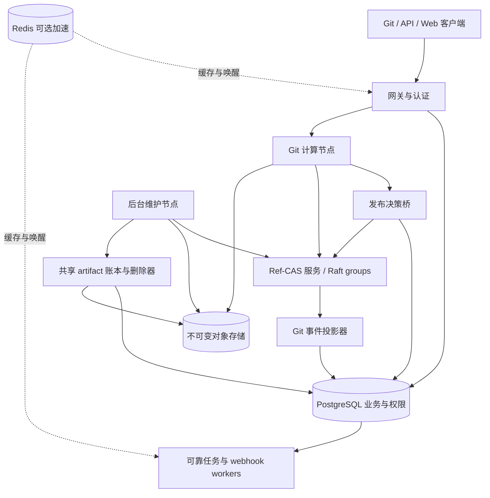
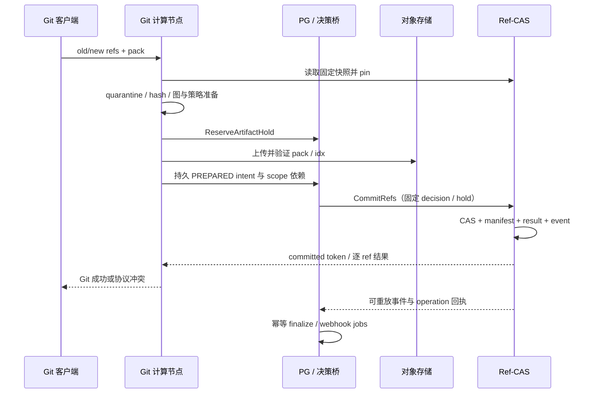

# Rootyard 状态服务设计：PostgreSQL、Redis 与 Raft Ref-CAS

状态：设计提案，尚未实现或生产验收。日期：2026-11-08。代码核对基线：`d689bf8062a73cfadbc0a72abf3f1546d992e09c`。

本设计由主代理结合用户指定的 `gpt-6-astra` 架构专家只读审查整理。它定义后续实现的建议边界；当前代码默认 GitFS 是迁移来源，**用户最新目标取消持久 bare Git 后端，内容统一存入 Apache OpenDAL™ 抽象的 Blob Storage**。本轮不修改生产代码，不将已有本地测试扩大为多主机保证。第 01—11 章及 source-page 是历史设计来源快照；本章是新增提案，不修改归档。实施本提案时须同步更新路线、运行契约和实现状态。

## 1. 决策摘要

推荐分离三类状态，而不是把 PostgreSQL 表按数据结构搬到其他系统：

- **PostgreSQL：关系型业务与跨服务工作流。** 用户、权限、Issue/PR、Review/Check、CI/Workspace 业务记录、管理操作及可靠任务保留在 PG。V1 还保留共享物理对象的全局保留账本。
- **Redis：可丢失的加速状态。** 版本化查询缓存、失效/任务唤醒、近似调度信号、预热去重、软限流。清空 Redis 不能改变已提交代码、权限、对象保留或业务结果。
- **Ref-CAS：Git 元数据发布权威。** 单仓 refs、HEAD、不可变 pack 描述的引用集合、版本、操作回执、提交事件、读取/保留根及发布 fencing。提供 `PgRefStore` 与 `RaftRefStore` 两种实现；同一仓库同一时刻只有一种实现拥有写入权威。
- **Apache OpenDAL Blob Storage：全部持久内容。** pack、idx、manifest 正文、加速索引、LFS、Workspace/checkpoint 内容、事件归档和备份正文统一走 OpenDAL；大对象不进入 Redis 或 Raft 日志。本地 Git 视图和缓存可随时重建，不是恢复权威。

第一阶段保留 PG 在线认证和一次性发布决策签发。因此启用 Raft 不代表 Git 写入完全脱离 PG，也不自动带来 GitHub 的吞吐。

**用户明确的部署约束（按最新要求收敛）：轻量单机 + 全 Blob 内容层。** 单机为一个 Rootyard 进程、PostgreSQL、内存缓存/唤醒和 OpenDAL Blob Storage；不要求 Redis、独立 Ref-CAS、Kafka 或 Vault。多机使用相同业务模块，将 Git 元数据后端替换为远程 Ref-CAS、缓存/唤醒替换为 Redis，Blob 层保持不变。业务 PG 继续保留。Blob 可以是已有托管服务，也可以是用户部署的兼容服务；“轻量单机”不再解释为没有持久 Blob 依赖。内存不能保存唯一的已确认代码、任务或 checkpoint。

GitHub 文章只披露了复制日志、多数副本提交与 Ref-CAS，没有明确披露其共识算法。本章的 Raft 是 Rootyard 的实现选择。

术语：**GitFS 是旧存储后端名称，不是网络协议。** 新架构单机用 PG 保存 refs，多机用 Ref-CAS 保存 refs，两个模式的内容都用 OpenDAL Blob。标准 Git receive/upload-pack 可使用临时 bare 视图，但这些目录没有持久权威。客户端继续使用已支持的标准 Git 协议；内部替换不要求定制客户端，也不暗示当前 Rootyard 已实现 SSH transport。

## 2. 当前事实、瓶颈与不能直接替换的部分

| 当前证据 | 事实及设计影响 |
| --- | --- |
| [Pando publish](https://github.com/jihuayu/rootyard/blob/d689bf8062a73cfadbc0a72abf3f1546d992e09c/src/pando_gateway/publish.rs) | PG 事务同时更新 refs、pack_ids、generation、发布保护、操作回执和 outbox，事务中还有授权、分支策略与 LFS 校验。拆分必须重建一致性协议。 |
| [publication admission](https://github.com/jihuayu/rootyard/blob/d689bf8062a73cfadbc0a72abf3f1546d992e09c/src/storage/ref_publication.rs) | exact-ref 锁允许部分准备工作并行，但最终仍进入整仓 advisory lock 和本地 write mutex。 |
| [Pando publish](https://github.com/jihuayu/rootyard/blob/d689bf8062a73cfadbc0a72abf3f1546d992e09c/src/pando_gateway/publish.rs) | `FOR UPDATE OF s` 锁单仓状态行，每次更新共享 pack_ids、ref_generation 和 operation_sequence；仅替换 SQL 驱动不会消除瓶颈。 |
| [read leases](https://github.com/jihuayu/rootyard/blob/d689bf8062a73cfadbc0a72abf3f1546d992e09c/src/storage/read_leases.rs) | 流生命周期占用 PG 事务/advisory lock，代码当前有进程级 8 个 data lease 槽、4 个 publication 槽；这是保护边界，也是规模限制。 |
| [snapshot](https://github.com/jihuayu/rootyard/blob/d689bf8062a73cfadbc0a72abf3f1546d992e09c/src/pando_gateway/snapshot.rs) | 每请求重建临时 Git 视图，当前上限为 256 packs、4096 refs；全部 pack 水化与 fsck 也是独立成本，换 Raft 不会自动解决。 |
| [remote retention](https://github.com/jihuayu/rootyard/blob/d689bf8062a73cfadbc0a72abf3f1546d992e09c/src/pando_gateway/retention.rs) | reserve 锁 singleton storage authority，是跨仓热点；物理 artifact 按 authority/tenant/namespace/hash 共享，不能仅凭某个仓库不再引用就删除。 |
| [Pando maintenance](https://github.com/jihuayu/rootyard/blob/d689bf8062a73cfadbc0a72abf3f1546d992e09c/src/storage_lifecycle/pando.rs) | 删除谓词检查所有相关 manifest；共享对象的全局保留是实质性跨仓约束。 |
| [events](https://github.com/jihuayu/rootyard/blob/d689bf8062a73cfadbc0a72abf3f1546d992e09c/src/events.rs)、[dispatch](https://github.com/jihuayu/rootyard/blob/d689bf8062a73cfadbc0a72abf3f1546d992e09c/src/dispatch.rs) | PG 是可靠事件/领取状态来源；已有 Redis/Kafka 是唤醒适配。Redis 现有适配只支持受控 loopback RESP2，不是已完成远程 Redis 产品。 |
| [auth](https://github.com/jihuayu/rootyard/blob/d689bf8062a73cfadbc0a72abf3f1546d992e09c/src/auth.rs)、[browser sessions](https://github.com/jihuayu/rootyard/blob/d689bf8062a73cfadbc0a72abf3f1546d992e09c/src/web/session.rs) | 每次校验 token、有效期、角色，浏览器还依赖父 token；这些撤销语义不能被 TTL 缓存悄悄替代。 |
| [merge](https://github.com/jihuayu/rootyard/blob/d689bf8062a73cfadbc0a72abf3f1546d992e09c/src/pulls/merge.rs)、[journal](https://github.com/jihuayu/rootyard/blob/d689bf8062a73cfadbc0a72abf3f1546d992e09c/src/journal.rs) | GitFS 原生 ref 和 PG 不共享事务。函数注释中的 atomic 不能解释为 Git/PG/事件三者真正原子。 |
| [GC root inventory](https://github.com/jihuayu/rootyard/blob/d689bf8062a73cfadbc0a72abf3f1546d992e09c/src/storage_lifecycle/retention.rs)、[migration 127](https://github.com/jihuayu/rootyard/blob/d689bf8062a73cfadbc0a72abf3f1546d992e09c/migrations/127_gc_admission_fence.sql) | PR、CI、Workspace、checkpoint、ChangeSet 和 sandbox 都可能保留 Git 对象。只搬 refs 会遗漏保留根。 |
| [remote objects](https://github.com/jihuayu/rootyard/blob/d689bf8062a73cfadbc0a72abf3f1546d992e09c/src/storage/remote_objects.rs)、[LFS storage](https://github.com/jihuayu/rootyard/blob/d689bf8062a73cfadbc0a72abf3f1546d992e09c/src/lfs/storage.rs)、[checkpoints](https://github.com/jihuayu/rootyard/blob/d689bf8062a73cfadbc0a72abf3f1546d992e09c/src/workspaces/checkpoints.rs) | 当前缺 endpoint 可回退 Local，LFS 有本地就绪，checkpoint 有 local_complete/local_filesystem_only；目标必须取消这些 local-only durable ACK。 |
| [encrypted objects](https://github.com/jihuayu/rootyard/blob/d689bf8062a73cfadbc0a72abf3f1546d992e09c/src/storage/encrypted_objects.rs)、[Cargo](https://github.com/jihuayu/rootyard/blob/d689bf8062a73cfadbc0a72abf3f1546d992e09c/Cargo.toml) | 当前内容加密强制 Vault，未引入 OpenDAL/Raft，Kafka 仍是普通依赖；轻量启动与依赖拆分需要实际实现。 |

以上是当前代码事实：默认 GitFS 仍是本地卷权威，可选 Pando 网关已进入服务代码。目标则收敛为 PG/Ref-CAS 元数据 + OpenDAL Blob 内容；旧 GitFS 仅作为显式导入来源，不再新增长期运行形态。

## 3. 状态归属与替换矩阵

“移至 Ref-CAS”指启用新后端后的权威归属；历史 PG 表可以保留为投影或迁移来源，但不得继续独立接受权威写入。

| 状态/功能 | 当前主要位置 | V1 权威归属 | Redis 用法 | 决策 |
| --- | --- | --- | --- | --- |
| 用户、组织、团队、成员关系 | PG | PG | 公共展示字段缓存；授权结果须版本验证 | 保留 PG |
| token、browser session、父 token、撤销 | PG | PG | 不保存原始密钥；V1 不以缓存命中放行 | 保留 PG |
| 内部请求 anti-replay nonce、执行凭证使用记录 | PG | PG，或明确迁入相应权威 group | 不用可淘汰 Redis key 证明从未使用 | 保留持久防重放 |
| 仓库身份、名称唯一性、配额、计费 | PG | PG | 查询缓存/软用量；硬配额须持久预留 | 保留 PG |
| Issue、comment、PR、Review、Check | PG | PG | 带业务版本的列表/详情缓存 | 保留 PG |
| 分支保护、可信 check、LFS lock | PG | PG，决策桥约束发布 | 提示失效；不能凭缓存证明可发布 | 保留 PG |
| Pando refs、HEAD、ref version | PG | Ref-CAS | 固定版本快照缓存 | 提取 |
| 单仓 serving pack 集合与 manifest 引用 | PG | Ref-CAS | 不可变描述缓存 | 与 refs 一起提取 |
| pack manifest 正文、摘要、对象格式 | PG/对象存储 | Ref-CAS 固定摘要/地址；正文不可变存储 | 有界缓存 | 内容可外置，引用不可异步补写 |
| authority/storage/backend epoch | PG | Ref-CAS 执行 gate；PG 管理请求和目录投影 | 带 epoch 路由缓存 | 按仓交接，禁止双权威 |
| 读取快照、发布验证 pin、持久保留根 | PG/卷 | Pando 新后端为 Ref-CAS | 只作续租唤醒/观测 | 不能换成 Redis 锁 |
| 旧 GitFS 文件锁、journal、卷 fencing | 卷/PG | 仅遗留导入/下线期间保留保护 | 无正确性职责 | 不再作为新架构部署后端 |
| publication intent、权限决策 scopes | 尚无本提案协议 | PG + Ref-CAS 明确分工 | 无 | 新增跨服务桥 |
| Git 操作终态与提交事件 | PG | Ref-CAS 原子产生；PG 可查询投影 | 唤醒，不保存唯一副本 | 分离 Git 事件源与业务事件源 |
| Issue/PR 等纯业务 outbox | PG | PG，同业务事务 | 唤醒 | 不搬到 Ref-CAS |
| webhook 投递、重试、死信 | PG | PG | 可选 ready hint | 保留 PG，至少一次 |
| CI/maintenance/sandbox job 状态与领取 | PG | PG | 优先级/活跃信号、唤醒 | 初期不迁队列权威 |
| CI 凭证撤销、job attempt 与完成 fence | PG | PG；对象保护根登记 Ref-CAS | 不以 Redis 心跳批准结果 | 保留 PG |
| LFS 业务元数据、锁、发布验证 | PG/对象存储 | PG + 持久 hold | 热点数据缓存 | 不随 refs 表直接搬迁 |
| Workspace timeline/checkpoint/Namespace | PG/对象存储/本地 | 业务在 PG，Git 依赖根在 Ref-CAS | 在线状态、预热 | 不把 checkpoint 变成易失状态 |
| pack/idx/manifest/LFS/Workspace/checkpoint/备份字节 | 卷/对象存储 | OpenDAL Blob | 小对象缓存可选，大 pack 不进入 Redis | 不保留权威 bare Git 目录 |
| 共享 artifact registry、全局引用/删除权 | PG | PG（V1） | 无 | 跨仓去重不能单仓判删 |
| compaction 任务计划与租约 | PG | 任务在 PG；发布/claim fence 在 Ref-CAS | 单飞提示 | 执行可重试，发布须验证 fence |
| shard placement、租户调度 | PG | PG 请求；Ref-CAS gate 为执行权威 | 路由/负载提示 | Redis 不授予 writer 资格 |
| 搜索、统计、准备好的 archive | 派生状态 | 可重建索引/对象存储 | 适合缓存 | 不参与提交正确性 |
| 备份 cut、保留根、恢复 incarnation | PG/对象存储 | PG+Ref-CAS 配对恢复契约 | 全部可清空 | 必须升级备份格式 |

## 4. 目标拓扑与部署形态



- **轻量单机 `standalone`（必须交付）：** 一个 Rootyard 进程 + PG + 原生 Git + OpenDAL Blob。`PgRefStore` 在进程内调用，cache/wake 使用 memory，可靠 workers 可内置；没有持久 bare Git 仓库，不启动独立 Raft/Redis/Kafka/Vault/FUSE/集群控制器。
- **多机 `distributed`：** 业务 PG + 开源 Raft 库驱动的 Ref-CAS + Redis cache/wake + 相同 OpenDAL Blob 层 + 计算/维护节点。Kafka、外部 KMS、独立任务系统按需启用。
- 开发单节点 Raft 只能验证接口与恢复，不能标记 HA；生产建议三个投票副本分布在独立故障域，资格以真实故障演练为准。
- Redis、PG 和 Raft 不必同时作为第一阶段强制依赖。Redis 故障不得触发自动切换 refs 权威。

| 可替换职责 | 单机实现 | 多机实现 | 不变契约 |
| --- | --- | --- | --- |
| Git 元数据事务 | 进程内 `PgRefStore` | RPC `RaftRefStore` / Ref-CAS | CAS、原子多 ref、快照 pin、幂等、取消、epoch |
| 查询缓存 | 有界 `MemoryCache` | `RedisCache`，可加本地 L1 | 可丢失、按安全域/版本隔离、有界内存 |
| 唤醒 | 进程内 `MemoryWake` | `RedisWake` | 唤醒可丢，PG 扫描/RefStore 重放恢复 |
| 不可变对象字节 | `OpenDalBlobStore` | 同一 `OpenDalBlobStore`，可选不同 provider | 不可变 key、摘要、持久性确认、generation、防旧删除 |
| 可靠任务与业务 | PG + 内置 workers | PG + 独立 workers | 幂等、领取 fence、重启可恢复 |

单机→多机只迁移元数据 authority、切换 cache/wake 实现，不必搬移已经在同一 Blob provider 的内容。旧 GitFS 导入和 PG→Ref-CAS 是不同交接，须走第 16 节。provider 变化必须复制校验完整闭包并切换固定定位，不能只改 endpoint。单机内存缓存/后台并发有上限；Rust 依赖和二进制/空闲内存需量测，不宣传未经验证的轻量预算。

接口独立选择：启用 Redis 不要求 Raft，Blob provider 选择也不要求 Redis。PG 可将同库步骤合并成短事务，外部保证仍与 RPC 实现相同。OpenDAL `memory` 仅供隔离测试；`fs` 不属于本次生产目标，也不作为缺少 Blob 配置时的 fallback。

### 4.1 OpenDAL Blob 层与能力门槛

Rootyard 保留薄的领域接口 `BlobStore`（不可变 key、摘要、hold、artifact receipt），存储驱动统一使用 Apache OpenDAL 的 `Operator`/流式 reader/writer 及成熟 layers。删除重复的手写 S3 签名、HTTP/multipart/重试实现；不能让 Git、LFS、Workspace 各自绕过抽象写独立文件权威。

| 能力 | 发布要求 | 缺失时处理 |
| --- | --- | --- |
| 完整 PUT/流式写、完成确认、按 key GET | 必须；只在完成并校验后签发 durable receipt | 不能 ACK Git/checkpoint durable 成功 |
| read-after-write、覆盖/删除一致性 | provider 合同和跨计算节点实测均满足受支持模式 | 不合格 provider 不开放发布；stat 成功不是一致性证明 |
| 不可变写/条件创建 | 优先 native conditional create；否则使用从不复用的 attempt/generation 唯一 key，PG/Ref-CAS 决定引用归属 | 禁止先 stat 再覆盖同一个 content key；禁止原地更新 manifest |
| range read | 规划按对象/分块读取时需要 | V1 可受限完整 GET，标明冷读成本，不伪装已经支持高效随机访问 |
| 长度、独立 SHA-256、端到端校验 | 应用流式 hash/下载校验；provider checksum 可辅助 | ETag 不作为通用内容摘要 |
| 大对象/multipart、abort、重试 | 按 provider 上限配置，超时与取消有界 | 失败保留可回收 orphan；不盲目重试不可重放 stream |
| DELETE 幂等与版本/固定 key | 按精确 generation/版本删除，不依赖可变路径 | 没有可证明安全 claim 时停止删除 |
| LIST/rename/presign | 不是发布正确性的必需能力 | LIST 不当 inventory；不模拟 POSIX rename 原子事务；私有 pack 不直发 bearer URL |

OpenDAL capability 声明、layer 支持和实际服务行为分别核验，不把某个 S3 endpoint 的验证推广给所有 provider。首批认证 S3 兼容（含真实服务测试）与 Azure Blob；其他支持由同套契约逐项开放。Capability 缺失必须在启动/配置验收时明确拒绝或选择已声明的安全降级，不静默退到 memory/fs。

命名空间至少含 tenant、storage authority、object generation、namespace 和唯一 publication/attempt identity；是否保留物理去重由第 12 节账本决定。抽象不赋予跨租户按 digest 读取的权限。OpenDAL TLS、凭证刷新、重试/超时/并发/日志层都要配置，禁止把 URL 凭证/私有对象 key 原样写日志。

全部持久内容都走此层：Git pack/idx/MIDX/bitmap、manifest 正文、LFS、Workspace dirty blobs/checkpoint、archive、事件归档和备份文件。PG/Ref-CAS 只保存元数据与固定内容引用。真实编辑工作树可在活动节点本地存在，但 UI 必须区分未提交本地工作和已确认 Blob checkpoint；本地写成功不能冒充远端保存成功。

**元数据持久性的边界：** PG 数据/WAL、Raft vote/term/WAL/状态机按数据库与所选 Raft 存储库的持久性契约运行，允许其专用持久卷；Raft snapshot 与归档可以通过 OpenDAL 保存到 Blob。这些不是持久 bare Git。V1 不把普通对象存储挂成 POSIX/WAL 设备；如果将来要消除所有元数据节点磁盘，须另立 disaggregated log/数据库方案，不能用 OpenDAL 接口替换 fsync 就宣称安全。

### 4.2 优先复用开源库

| 职责 | 首选/候选 | 自研边界 |
| --- | --- | --- |
| Blob access | Apache OpenDAL | 仅领域 key/receipt/hold/验证，复用 provider、认证、流式 IO 和 layers |
| Raft 共识 | OpenRaft 首选；raft-rs 作为备选对照 | 只实现领域状态机、存储/网络适配；不自研选举、复制或成员变更算法 |
| Raft 本地存储 | RocksDB 等成熟持久引擎及适配 | 原子 batch、fsync、恢复/损坏处理，不能使用示例内存 storage 上线 |
| Redis | 成熟 Rust Redis 客户端 | 只实现缓存键、安全域与业务降级；不扩写自制 RESP/TLS/Cluster 客户端 |
| 内存缓存 | moka 等有界成熟缓存，或已充分受控实现 | 版本/权限隔离与内存预算，不复制权威状态 |
| Git 协议/pack 校验 | 原生 Git 优先，gix/libgit2 等按兼容矩阵评估 | 领域发布适配；不为去除 bare 权威而重写整套 Git 协议/pack 引擎 |
| 加密与密钥 | 成熟 AEAD 库 + 可替换 KeyProvider/云 KMS SDK | 不自研密码算法；明确密钥生命周期和 provider 保障 |

引入依赖前验证许可证、维护状态、MSRV、编译/运行开销、格式升级、故障行为和供应链。锁定版本，不把 latest API 或示例复制视为生产实现。单机只初始化所需模块；Raft、Redis、Kafka、FUSE 等可用 feature/部署拆分避免固定后台开销。

当前 Vault 强依赖必须从轻量内容路径解耦：基本 Blob profile 采用明确的 provider-managed encryption 合同（无需 Vault）；需要应用层 envelope encryption 时，使用现有成熟算法与独立 KeyProvider，并明确配置、恢复与密钥备份。不能静默关闭已启用加密或把明文 data key 与密文一起放 Blob 当作保护。旧加密对象的读取/导入保留其 key provider 依赖，完成迁移后才能移除。

### 4.3 临时 Git 视图和计算节点

V1 保留原生 Git 兼容性，用固定 refs/manifest 重建临时 bare 视图，cache 命中仅减少下载。缓存未命中即从 OpenDAL hydrate 并校验；临时目录按 tenant/repo/operation 隔离，限制 CPU、内存、临时盘、pack 数与期限，禁止任意 hooks/alternates/外部凭证。

成功发布仅以 PG/Ref-CAS + Blob receipt 为依据。清空整个计算节点缓存/会话目录后，换进程、换空目录，仍能仅靠 PG/Ref-CAS 与 Blob 恢复全部已确认 Git OID、LFS 和 checkpoint。缓存删除要尊重活动本地文件引用；native Git 子进程遗留不能再次成为权威 writer。

## 5. 系统不变量

1. 一个 `repository_id + history_incarnation` 在任一时刻只有一个 refs 发布权威。
2. 可见 ref 指向的完整 Git 对象闭包已持久可读，并被 serving pack 集合及跨仓 artifact hold 保护。
3. 同仓 refs 变化、pack 集合增量、操作终态和 Git 提交事件原子可见。
4. 同一 ref 按 expected old OID CAS；原生 Git 不提供 ref version，不能声称天然防止 A→B→A 的 ABA。自有 API 可附 expected_version。
5. atomic push 的所有 refs 全成全败；普通多 ref push 必须准确返回 accepted subset，不把协议失败伪装为成功。
6. 完整声明的权限/规则/检查/LFS 依赖在发布决策有效期间受保护；变更成功返回前必须完成旧决策终态屏障。
7. 已提交但回包丢失是结果未知；按稳定 operation_id 查询，不盲目补偿 refs。
8. pin、备份根和未解析的 publication hold 不能因 Redis 丢失或普通 TTL 到期而失去保护。
9. 每个执行者的 epoch/fence 由最终接受副作用的服务校验；锁超时和进程自觉退出不是充分 fencing。
10. Redis 清空只影响延迟、软限流和可用性；不会改变提交、授权或删除判定。
11. 派生 PG/Redis 投影可以滞后，但不得被当作最新 refs 或物理删除资格的依据。
12. 保留集合不完整、历史 incarnation 不匹配或跨服务结果未知时，停止破坏性维护，优先泄漏可回收空间。

## 6. Ref-CAS 的数据模型与接口

### 6.1 权威状态

以 repo 为事务单元保存以下小元数据，字节正文留在对象存储：

| 实体 | 关键字段/语义 |
| --- | --- |
| RepositoryGate | repo_id、tenant_id、object_format、backend、history_incarnation、authority_epoch、group_epoch、state、HEAD |
| RefRecord | ref_name、oid/tombstone、ref_version；有序前缀索引检查 `foo` 与 `foo/bar` 冲突 |
| PackMembership | pack_id、manifest_digest、固定对象地址及代、加入/退役版本；按 pack 增量存储 |
| RepositoryVersion | repo_revision、manifest_revision、roots_revision、object_epoch；命令只更新相关项 |
| OperationResult | issuer_incarnation、issuance_sequence、operation_id、request_digest、终态、逐 ref 结果、commit token |
| PublicationDecision | op_id、依赖版本、允许的精确 refs/pack/closure、主体身份、有效期与 gate epoch；一次性消费 |
| ReadPin / RetentionRoot | pin_id、owner、固定 OID/manifest/pack、purpose、generation、生命周期与续租 fence |
| MaintenanceClaim | 分片、claim_generation、输入 packs、owner；替换时必须匹配 |
| CommitEvent | 稳定 event_id、操作与 actor 摘要、changes、revision、pack 增量；与结果同次提交 |

不要给每个 Git blob 写一行；索引和图检查在数据面完成。也不要每次复制整份 pack 数组、扫描所有 refs 或更新全局仓库计数器。

### 6.2 API 草案

以下是语义契约，不是已实现路由或 Rust ABI。

| API | 语义 |
| --- | --- |
| `CheckVersion(repo, known, min_commit_token?)` | 线性化比较；未变化返回小响应，变化返回版本/增量游标 |
| `ReadSnapshot(repo, selector, consistency, min_commit_token?)` | 同一版本的 refs、HEAD、manifest 描述；需要远端读取时原子创建 pin |
| `RenewPin / ReleasePin` | 校验 pin generation；丢失续租资格后不继续启动远端读取 |
| `CommitRefs(command)` | 同仓原子发布 refs、pack 增量、结果、事件，消费决策 |
| `GetOperation(issuer, op_id)` | 线性化查询；可返回 committed/rejected/cancelled/pending/unknown，unknown 不能等同 aborted |
| `CancelDecision(issuer, seq, op_id, digest)` | 未出现也持久写取消记录；与 CommitRefs 在同 group 排序 |
| `RegisterRoot / ReleaseRoot` | 持久保留/释放精确对象闭包；与 GC 判定共享顺序 |
| `ClaimMaintenance / CommitPackReplacement` | 验证 claim、输入集合、图检查凭据和相关版本；只发布固定产物 |
| `RetirePacks / ReleaseArtifactHold` | 先完成 Ref-CAS 安全退役，再向 PG 物理保留账本交接；不可直接删共享对象 |
| `WatchCommits(cursor)` | 可重放事件；断线重连、重复投递、超出保留期明确 resync |
| `FreezeRepository / Export / Import / Activate / RetireAuthority` | 运维专用，受认证、epoch 和可恢复状态机保护 |

`CommitRefs` 至少携带：repo/tenant、所有 authority epochs、issuer/operation/digest、已提交 PG decision 的受信证明、准确 old/new refs、pack receipt 与持久 hold 标识、验证所依据 object_epoch/pin、atomic/accepted-subset 模式。客户端不能自行伪造“已校验”“已授权”。

```text
CommitRefs:
  validate operation identity and terminal/dedup state
  validate repository gates and one-shot decision
  validate all touched refs and namespace/prefix constraints
  validate durable pack/hold receipts and validation epoch
  atomically:
    add pack memberships
    update accepted refs and relevant revisions
    consume decision
    persist operation result + commit events
  return stable commit token + per-ref results
```

重型 hash、fsck、连通性、LFS pointer 解析和网络 IO 在事务外完成，以精确输入和版本绑定的受信验证结果入命令；Raft apply 内不运行 Git、查询 PG、调用对象存储、读取本机时钟或生成随机数。

同一请求重复提交相同 digest 返回原结果；相同 ID 不同 digest 拒绝。先查终态再检查当前 gate，允许旧 epoch 已成功操作在新 epoch 下被查询，但绝不因此重放副作用。

### 6.3 回执、幂等与日志裁剪

commit token 包含 history_incarnation、authority_epoch、group_id、group_epoch、log position 和 repo_revision，不把不同 group 的裸 log index 作全局比较。

Raft snapshot 必须保存去重结果、取消 tombstone、issuer 的封闭 issuance cutoff 及未终结决策。只有证明某段 issuance 已封闭且不可能再被合法提交后，才裁剪详细记录；老请求返回 `OperationExpired`/需查询归档，而不是重新执行。长期审计正文可归档到对象存储，摘要与去重边界仍须可靠保存。租约到期不自动释放未知操作的跨服务 hold。

issuer 可使用独立持久 lane，避免所有发行者争用一个 PG 全局序号行；每个 lane 的顺序、封闭 cutoff 与恢复 incarnation 分别维护。对外请求仍绑定稳定 operation_id。新 group/新后端继承仓库 operation_sequence 高水位，或升级 PG 投影唯一键与排序契约；不能把 group log index 直接塞入现有跨后端 sequence 字段后从零开始。

cutoff 不等于“最大已见 seq”：PG 序号可有洞、事务可乱序。封闭 `lane ≤ N` 必须先持久停止该范围继续发行，解析已分配未提交的 PG 事务，对所有已发行 seq 在相关 group 取得终态/取消，并由 group 确认拒绝旧范围，再裁剪明细。V1 在此闭合协议验收前不启用 tombstone/dedup 的自动裁剪；保留与背压预算必须覆盖这段运行期。

## 7. Raft 分组、并发、读取与运维

- 一个仓库的所有 refs、manifest membership、roots、decision 和 GC metadata 放入同一 group。小仓共享 group，热点仓可独占 group；通过显式目录映射迁移，不使用 `hash(repo) % live_node_count`。
- V1 不按 ref 把单仓拆到多个 group。跨 group atomic push 和 ChangeSet 需要额外事务协议，不属于普通 Raft 原生能力。
- 同 group 有一个有序日志和 leader；Raft 不是多 leader 并行执行器。准备工作在计算节点并行，group 内用有界批量、流水线、增量命令减少成本。增加 group 能扩多个仓库，未证明能无限扩一个仓库。
- `RaftRefStore` 作为确定性状态机，候选实现库为 Rust OpenRaft，持久日志和状态机存储候选为 RocksDB；锁定兼容版本、MSRV、升级/恢复格式、fsync 契约后才引入。复用库不等于已解决存储损坏、快照和运维。
- etcd 可作为语义原型/对照实现，不能直接推导其适合高频 refs 或无上限事件存储。PG 适配器仍是有效部署选项。
- 成功回包要求多数副本按选定持久性契约记录，并且结果已在服务状态机应用。不得仅凭 leader 内存写入 ACK。
- 强一致读取使用成熟库支持的 ReadIndex/等价 quorum barrier 并等待本地 applied index。仅“读 leader”不够，旧 leader 在网络分区中可能不知道自己失去资格。
- 追随者只提供显式 stale read 或达到有效读取屏障后的读取。浏览的 bounded staleness 是独立契约，缺乏可验证时间/复制进度时不能宣称满足界限。
- 默认 Git 入口强一致；CI 固定 OID 入口须提供 pin/closure 就绪证明。写后读以 commit token 等待对应 group 进度。
- 少数派不接受权威写入；没有 quorum 时返回 unavailable/unknown。Redis 和 PG 投影不能接管写入。
- 成员变化通过库的安全 membership 协议；先 learner 同步，再变投票配置，限制同时重配置数量。禁止独立 bootstrap 旧磁盘生成第二个同身份集群。
- `group_epoch` 表示服务 authority/迁移的逻辑世代，不等于 Raft leader term 或普通成员配置编号；常规换主不使所有合法 hold/decision 自动失效。
- 日志、快照和成员身份使用 mTLS、节点身份和独立管理权限；快照包含租户私有 refs，应加密并校验。
- 维护、快照传输、slow follower、watch backlog 均有字节与并发预算；背压优先拒绝新工作，不能无限积压内存。
- 不在 V1 自行设计并行 apply、跨 ref 共识或单仓多 group。先测量 log append、持久化和 apply 的真实瓶颈。

## 8. Redis 的完整契约

### 8.1 可迁入与可加速的内容

| 用途 | 键/结构示意 | 丢失与失效处理 |
| --- | --- | --- |
| 固定 Git 对象预览、tree/diff | tenant/repo/object_format/OID/filter_version | 鉴权后使用，miss 回源；OID 本身不是权限 |
| refs/manifest 快照 | history/authority/repo/revision | 强读先从 RefStore 确认版本；Redis 的 latest 指针仅为提示 |
| Issue/PR 展示 | tenant/repo/entity/version/view | 业务版本控制；读取需最新时回 PG |
| 路由目录 | repo/group_epoch/authority_epoch | 服务端验证 epoch；旧路由刷新重试 |
| 查询负缓存 | 安全域/规范化 query | 短 TTL，仅可保守拒绝/回源，不能负缓存跨租户复用 |
| webhook/事件 ready hint | env/worker_class/channel | PG 扫描、Ref-CAS watch 重放修复掉消息 |
| cache hydrate/预热单飞 | tenant/repo/pack/attempt | `SET NX` + owner 条件释放只减少重复工作；实际落盘使用原子文件与内容校验 |
| 软限流 | tenant/principal/route/window | Lua/原子命令；本地应急上限，记录降级；不作为计费/硬配额 |
| 在线 Agent、节点负载、进度 | env/node/workspace/heartbeat | advisory，有 TTL；不授予写入资格或证明任务完成 |

Redis 单飞锁过期后允许多执行者并存，最终产物发布必须通过权威 CAS/fence。同名键 owner 不匹配不能删除别人的锁。

### 8.2 不迁入 Redis 的权威内容

refs、manifest 权威指针、发布幂等终态、撤销事实、PR merge 决策、CI job 完成权、artifact hold、GC 根、备份完成状态、存储 writer lease/fence 和必须执行的唯一任务记录都不使用普通 Redis 作为唯一来源。

Redis `WAIT`、AOF、Sentinel/Cluster 和 Lua 能改善不同方面，但不能把默认异步复制自动变成我们要求的线性化权威服务。Redis Streams 也不和 PG/Raft 业务变更共享原子提交；V1 不迁移可靠队列到 Streams。

若将来选择 Redis 作为 session store，就必须单独接受持久性、全局撤销和恢复语义变化；本设计不选择该方案。

### 8.3 隔离、安全、容量与降级

- 缓存 key 必含环境/缓存 schema/history incarnation/租户安全域；不得使用原始 token、cookie、签名 URL 作为 key 或值。只存所需摘要与展示数据。
- 加密 pack/LFS 大正文保留本地磁盘或对象存储/CDN；Redis 只存有界小内容和定位信息。每类值、批次、命令和总内存设上限。
- 缓存实例允许 eviction；软限流与在线状态可单独实例，避免被大缓存挤掉。即便设 noeviction，也不能将 Redis 提升为强一致权威。
- 远程部署需要生产级客户端、TLS、ACL、连接池、超时、重连、批处理与凭证注入；不得直接扩展现有 loopback 明文适配并宣称可用。
- Redis 故障：缓存回源但受并发限制与熔断保护；ready hint 改周期扫描；预热允许受限重复；在线状态标为未知。
- 对滥用防护可以 fail-closed，对普通浏览可使用严格本地保底。**严格全局计费/硬配额**保留 PG/Ref-CAS 持久预留；Redis 丢 key 后不能重新赠送额度。
- 先发布权威状态，再失效/更新缓存。事件丢失靠版本核验和 TTL 修复；权限撤销不能只靠这条缓存失效链。

## 9. PostgreSQL 与 Ref-CAS 的权限/策略决策桥

### 9.1 为什么需要显式协议

PG 查询权限后立刻调用 Raft，仍可能在两步之间撤权。签名 JWT 加短 TTL 也不能表达“撤销成功后旧授权不再发布”。PG 已提交而 Raft 未提交、Raft 已提交而 PG 回包未知是必须处理的正常故障状态。

V1 选择 **PG 在线决策 + 持久 intent + scope gate + Ref-CAS 单次消费/取消**。它不提供跨存储 ACID，但给出可验证的发布/变更顺序。宁可在故障时保持管理操作 pending，也不解除未解析决策的保护。

### 9.2 新增 PG 概念表

这些是设计实体，具体 SQL 需实现时生成 migration；不是把现有表名当作已存在能力。

- `decision_scopes(scope_kind, scope_id, version, state, change_id)`：`OPEN → CLOSING → OPEN`，持久门禁。
- `publication_intents(op_id, issuer_incarnation, issuance_seq, digest, repo_id, group_id, authority_epoch, state, canonical_command, not_after)`。
- `publication_intent_scopes(op_id, scope_kind, scope_id, observed_version)`：不把所有 operation ID 塞入同一个 scope 数组。
- `decision_change_operations(change_id, scope_set, intended_change, progress, terminal_receipts)`：权限/规则变更的可恢复协调记录。
- `ref_projection_offsets(group_id, history_incarnation, cursor)` 与稳定 event_id 唯一索引。
- `artifact_holds(hold_id, generation, artifact_identity, issuer/op, state)`：第 12 节的跨存储保护账本。

scope 至少覆盖 token、父 token/session、user、组织成员/团队、repo access、分支策略、相关 PR/check/review、LFS lock/availability、仓库生命周期和 authority 迁移。**没有规则/没有锁也是决策依赖**：用稳定 scope 防止新增行 phantom，不能只锁已有业务行。所有影响这些事实的 API、CLI、后台 worker 和迁移路径都必须被 scope gate 约束；通过 DB 约束/trigger、受限数据库写角色和单一模块入口防绕过。

intent 分别记录 `remote_outcome` 与 `finalize_state`。Ref-CAS 已 COMMITTED 但 PG 尚未收尾的 REF_COMMITTED/FINALIZING 记录仍属 scope 的未终结 intent；只有业务 finalizer 完成才标 FINALIZED，不能因先保存远端终态就将其从变更扫描中排除。

### 9.3 普通发布

1. 并行接收 pack、校验 Git 闭包、上传字节，先取得持久 artifact hold。校验以固定 OID/manifest 为输入，不持有 PG 事务等待上传。
2. PG 短事务按固定顺序共享锁所有 scope，要求 OPEN；重新认证主体、有效期、写权限、保护规则、精确 CI/check/review 与 LFS 约束。
3. 在同一 PG 事务创建不可变 intent、完整 scope 关联和固定 command digest，提交。scope 同时允许多个发布者登记，不增加全局独占锁或序号行热点。
4. 可信 bridge 只能读取**已提交** intent，再向固定 group 安装/提交 decision；不得在 PG COMMIT 前发出可执行授权。安装与 CommitRefs 可以合为一个幂等命令。
5. Ref-CAS 验证 gate、old refs、decision、hold receipts 和验证版本，原子发布。准备期依赖 pack 的 pin 一直保留到终态明确。
6. PG finalizer 按 Ref-CAS 回执更新 intent、PR/审计投影等，释放业务决策依赖；Git 成功响应以 Ref-CAS 提交为准。PG finalize 失败不推翻已提交 refs。
7. 没有明确结果时查询 `GetOperation`；需要放弃时发 `CancelDecision` 并取得终态后再释放保护。普通超时只能触发处理，不能证明取消成功。

每次 CommitRefs 仍以 command expected old OID 为最终依据；PG decision 不保证 refs 不变。scope 变更会按照下一节取消决策，不能悄悄修改已签发 command 内容。重新准备必须使用新 operation，先解析旧 operation。

### 9.4 撤权、策略收紧及业务依赖变更

1. 变更事务独占锁目标 scope，设置 CLOSING 并记录 change operation。它与 intent 登记的共享锁互斥，阻止新的 intent，并在同事务固定已发行未终结 intent 的集合。
2. 向这些 intent 的固定 group 调用 `CancelDecision`。即便某 intent 尚未注册，也必须留下取消 tombstone，阻止延迟的 Register/Commit。
3. Commit 与 Cancel 在各自 group 排序：Commit 先则返回已提交回执；Cancel 先则后续发布必拒绝。变更开始不意味着之前获准的操作立即消失。
4. 对所有 intent 得到已提交/已拒绝/已取消的明确终态后，先完成其中先行 COMMITTED 操作对受影响 PG 业务记录的 finalizer。随后在 PG 短事务重新核验变更请求的 expected_version，再完成业务变更、增加 scope version、记录结果并 OPEN；此时才返回变更成功。若先行 merge 已改变 PR，请求原本的 close/update 应返回版本冲突，不能覆盖 merge。
5. group 不可达或结果未知时保留 CLOSING，API 返回可查询的 pending operation（例如 202），reconciler 自动续办。不能因超时清掉 scope，也不能返回撤销已完成。

全局 token/user 撤销依赖全局主体 scope 的 intent registry，而不是扫描“当前属于这个人的仓库”。新仓、团队绑定、父 session 等也必须经过相关 scope，所以不会漏掉并发新增仓。扇出成本取决于未决操作，必须有背压、索引和可观察进度。

已消费 intent 的内部 finalizer 在 CLOSING 时仍可凭终态回执收尾；它不能发行新 decision。finalizer 按 intent/receipt 和期望业务版本幂等推进，change operation 必须等待相关业务收尾，不能只等待 Ref-CAS 终态。否则迟到 merge finalizer 会覆盖后来的 PR 状态，或撤销与 finalizer 相互等待形成死锁。纯投影/展示缓存不要求在这一步全部追平。

管理变更本身按固定顺序锁全部 scope，只能从 OPEN 进入 `CLOSING(change_id)`，或以相同 change_id 幂等重入；遇到其他 change 的 CLOSING 时回滚本次全部占用，不能覆盖 owner 或留下半套屏障。finalize/reconcile 用 `(change_id, observed_version)` CAS，旧 worker 不能替新变更 OPEN。expected_version 冲突时记录 change rejected，并安全释放只属于自己的 scope，避免永久冻结。

### 9.5 到期、时钟和兼容边界

decision 绑定 token/parent token 的最早到期时间和自身 not_after，旧 PREPARED 不能无限期作为新授权。最终 publication admission 由受信 bridge/leader 重新核验时间；使用受控时钟上界 `now + uncertainty < not_after`，时钟不确定度超限或 issuer 历史不匹配时拒绝。

apply 只使用命令中已验证的固定时间和已排序状态，不读取每个副本自己的墙钟。**旧 leader 已准入的命令可能在换主/长分区后才提交；携带旧 timestamp 不证明实际提交时仍未到期。** V1 定义的是最终准入时有效，已准入未决操作可随后终结，不承诺精确墙钟瞬时截止或已准入读取流立即中断。

这是必须单独通过的兼容闸门：与当前 PG `finish_tx` 提交前检查逐项比较，确定允许的未决窗口、超时取消行为和对外到期说明。若要求“实际提交时刻严格早于绝对到期”，V1 不满足，不能切流；需要更强时间/协议设计。Raft 逻辑 tick 不能代替真实 token 到期。

### 9.6 故障恢复和成本

| 故障点 | 恢复行为 |
| --- | --- |
| PG intent 事务回滚 | 无可安装授权；上传字节是被 hold 保护的孤儿，按明确 abort 回收 |
| PG 已提交、未注册 Raft | intent 可重放；若 scope 已 CLOSING，Cancel tombstone 阻止晚到注册 |
| Raft 注册/提交超时 | 保持 pending，按 operation 查询或取消；不释放 hold |
| Raft 已提交、PG 未 finalize | 由回执完成 PG 收尾，refs 不补偿回滚 |
| 撤销过程中 PG/bridge 崩溃 | CLOSING 与逐 intent 进度持久；恢复继续，未完成不报成功 |
| PG 历史回退/备份恢复 | 旧 issuer incarnation 全部失效；按第 15 节配对恢复，不能继续旧 issuance |

此桥仍产生每次发布的短 PG 事务，并可能因管理变更阻塞部分用户。目标是移除整仓长锁与把 Git 元数据隔离为可替换服务，不在 V1 宣称完全 PG-free。将来若要进一步移出认证热路径，必须另立身份/策略分发和撤销屏障设计。

## 10. 主要请求流程

### 10.1 Push



持久 hold 必须在可能被删除器触达之前建立；上传、验证、PG intent 失败各自有幂等恢复路径。Native receive-pack 在临时视图返回的本地 ok 不能直接透传，必须等待权威发布结果。atomic 与非 atomic accepted subset 的处理必须保持标准 Git 的逐 ref 回包语义。

### 10.2 Fetch / browse

1. PG 在线认证及当前权限检查；查询 RefStore 版本和固定读取快照。
2. 原子获得对应 manifest/closure 的 pin；从本地缓存或对象存储水化，下载首次落盘验证长度、摘要和加密元数据。
3. 发现 refs 与后续 RPC 跨 HTTP 请求时，使用受授权的固定读取会话或足够保留的 wants；不能每 RPC 任意切换快照导致发现后的对象消失。
4. 每个 RPC 重新授权。缓存依然按 repo 安全域隔离，不向用户直接暴露可能含超范围对象的物理 pack URL。
5. 续租失败后停止新的远端读取并中止请求；若完整持有本地不可删除副本，可显式切换为本地引用生命周期，释放远端 pin 后继续。

减少 pack 全量物化、复用暖 Git 视图、MIDX/bitmap、range read 和按对象读取是独立性能工作。先保持正确性，不借 Ref-CAS 改名宣称冷请求成本已经下降。

### 10.3 PR 合并

PG 业务增加 `merging/pending` intent，固定 PR version、head/base OID、策略/check/review/LFS 依赖；merge commit 在事务外构造并持久化。Ref-CAS 发布携带 decision，并以 old base OID CAS。

Ref-CAS 成功后 PG 幂等完成 merged 状态和业务 outbox；失败则按明确终态回到可重试状态。查询 pending PR 必须查 operation 或等待投影屏障，不能同时展示“已合并”但 refs 未提交。返回包含最终 PR 数据的成功响应要等 PG finalize，或返回 pending 查询句柄。

这不是 PG PR 状态与 Raft refs 的跨库原子事务。已提交后遇到 PG 错误只能 roll-forward，不能把可能已经被其他 push 更新的 base ref 改回去。Review 撤回、Check 可信绑定变化和 PR close/update 都要经过 scope 协议。

### 10.4 CI、Workspace 与保留根

创建流程：PG 写 pending intent → Ref-CAS RegisterRoot 成功 → PG 激活 CI pin/checkpoint/job 引用。中途崩溃可留多余根，不能先公布业务记录却未保护 Git 对象。

删除流程：PG 停止新使用并等待已发行读取/作业资格终结 → Ref-CAS ReleaseRoot → PG 完成删除。根 ID、generation 和业务 request digest 绑定，迟到释放不能删除新根。普通作业心跳可以在 Redis 展示，领取/完成仍由 PG lease generation 校验。

跨仓 submodule/Namespace/BaseVector 固定每仓 OID 和对应根，失败则保持 pending。V1 不承诺跨 group 原子 ChangeSet；现有调用若要求强原子，必须留在原后端、拒绝该组合或另行实现明确的事务协调，不能静默降级。

## 11. 事件、可靠队列和 PG 投影

- Git 提交事实来自 Ref-CAS，同一次 CommitRefs 产生 immutable event；Issue/comment 等业务事件仍与 PG 业务事务提交。
- 投影器消费 `(history_incarnation, group_id, cursor)`，同一 PG 事务写 event_id、审计/refs 投影、webhook jobs 并推进 offset。崩溃后至少一次重放，用唯一约束幂等。
- 事件按 group 有序；同仓迁 group 通过 handoff cursor 对接。不制造全平台总序；需要因果时携带 operation/commit token。
- Redis Pub/Sub/Kafka 只加速 wake。watch reconnect 或 PG 扫描是恢复手段；HTTP SSE 面向 Agent 可用可靠游标恢复，不能把 Pub/Sub 作为历史。
- 日志截断前必须满足事件消费/备份保留策略，或把完整事件段可靠归档并校验。慢投影器不得永久无限占用 leader 内存；超出窗口返回可验证 resync/归档入口。
- refs 当前视图可从快照重建，逐次 webhook/audit 历史不能仅靠当前 refs 重建；二者保留策略分别定义。
- PG 投影丢失不丢 refs，但 PG 业务本身不一定可由 Git 事件恢复。权限、PR、job 等仍需 PG 备份。
- Webhook/外部 CI 的副作用为至少一次，使用稳定 delivery/event ID；发送后进程崩溃可能重复，不承诺跨外部端点 exactly-once。
- PG 不可用时未决操作可查询 Ref-CAS，但 V1 停止新发布决策及新在线认证；不得用 Redis 缓存继续授予写入。

## 12. 共享物理 artifact 的保留桥

### 12.1 V1 选择

保留当前跨仓去重与 PG 全局 artifact registry/删除权威。Ref-CAS 管单仓逻辑 pack 引用与 roots，PG 管物理字节是否还被任何仓库/备份/未决操作保留。二者以精确 `hold_id + hold_generation + artifact_identity` 交接。

不能只把当前 `pando_publication_fences` 的一小时 lease 直接拿来跨服务使用：服务可能中断更久，Raft 已引用的对象不能在 PG 投影滞后时失去保护。V1 新 hold 在明确终态前持久保留；TTL 仅触发 reconcile，不触发释放。

### 12.2 获取与发布

1. PG 原子检查 artifact state/generation 并创建唯一 hold；涉及多个物理对象（pack、idx、cipher、envelope、LFS 等）必须保护完整依赖集合。未注册历史对象保持不可删。
2. 若 artifact 已被 claim 删除，禁止复用同物理 key；重新上传到新的 object generation 路径。
3. 上传验证完成后生成受信 receipt，绑定 tenant、repository_id、history_incarnation、authority/group epoch、artifact identity、manifest digest、owner operation 和 hold generation。每个 hold 只允许一个确定的 repo/group 权威消费；同物理对象被其他仓库使用必须另建独立 hold，PG 再聚合这些 hold。
4. Ref-CAS 可消费该 receipt 建立 serving/snapshot/root 保护。PG reconcile 把 pending hold 标为 attached；**即使 attach 投影丢失，原 pending hold 仍保护字节**。
5. decision 取消后，必须先在 Ref-CAS 永久拒绝该 receipt 的未来使用，再释放 PG hold。

group handoff/后端切换不直接复制可执行的旧 hold receipt：先取得绑定新权威的新 hold，验证 closure、在目标安装保护，再凭旧源 seal/退役回执释放旧 hold。若要实现 hold 所有权转移，必须另有 PG 原子 owner-generation 交接协议；V1 选择重建新 hold，允许暂时双重保留。不得让 group A 的退役回执释放 group B 仍在消费的同一个 handle。

source seal 仅证明禁止新发布，不等于旧所有引用已解除。旧 reader/validation pins 必须 drain；持久业务/备份根须在目标建立新保护，或继续持有旧 hold。只有旧源 serving membership/相关根完成安全退役后才发可释放回执，不能凭 seal 直接清掉仍被旧快照使用的 hold。

### 12.3 退役与删除

1. Ref-CAS 执行 `RetireClosure(hold_id, generation)`：验证不再属于 serving/snapshot/pin/backup/未决验证根，持久标记此 handle 不可再用于未来引用，输出退役回执。
2. PG 按精确 handle 幂等 release；不能用“刚才读到没引用”作为异步释放依据，否则迟到的 release 可能删掉复活引用。
3. 同一 manifest 若再次使用，须 AcquireHold 得到新 handle/generation。旧 release 无法清除新 hold。
4. PG 对所有仓库和备份聚合检查，且没有 unresolved publication/restore/root intent，才允许 mark/claim/delete。mark 与新 hold 建立按物理 artifact 行协调。
5. 实际 DELETE 使用旧 claim 固定的 generation 路径；对象 key 不复用，迟到 DELETE 不能触达重上传的新路径。

对 Raft 仓库，删除器不能继续只 join 历史 `pando_repository_states.pack_ids` 判保留；新 hold ledger 才是该部分的物理保护来源。PG-Pando/Raft-Pando 及遗留导入的所有 producer 均完成接入、回填和故障验收前，禁止为新后端启用远端物理删除。

### 12.4 进一步拆分的选择

未来若全局 PG artifact 账本成为瓶颈，可选：按 tenant/安全域分片账本；为新数据采用 repo-scoped 物理 key 放弃跨仓去重；或建立独立 Artifact-CAS 服务。第三种仍需跨 group hold 协议，不能让 Ref-CAS 单仓事务假装解决全局引用计数。

当前 singleton authority 锁需要单独优化：正常分配按 artifact key/不可变版本协调，只有 authority 轮换才走全局管理屏障。必须保持 late DELETE 和恢复安全；“改成 Redis 自增/锁”不符合要求。该优化不以启用 Raft 为前提。

## 13. Compaction、GC 与读取保护

压实是物理表示重组，GC 是删除无根对象，两者分开验收。

### 13.1 在线压实

- 按 pack hash 分维护 shard，PG 任务分配执行者，Ref-CAS 记录 claim generation。输入是固定 pack 集合，不扫描所有仓库写入热路径。
- worker 从对象存储读取，生成少量更大 pack，独立校验输出与输入的 Git 对象集合完全相同，并取得持久 artifact holds。
- `CommitPackReplacement` 比较输入 membership/claim generation，添加输出并退役选定输入；并发 push 新 pack 保留，不要求复制整个 manifest 数组。
- 新 pack 可按大小分层继续合并；单 pack、每层、待处理段和临时盘有上限。具体阈值由负载测试确定。
- 旧输入只在所有读取/验证/备份/根保护解除后走第 12 节 hold 退役。允许重复计算，不允许旧 worker 用过期 claim 发布。

### 13.2 Reachability GC

- GC 固定 refs、PR/CI/Workspace/checkpoint/ChangeSet/sandbox 保留根、读取/验证 pins、pending publications、备份与恢复窗口，取得 root cut 和 object_epoch。
- 在事务外做可达性分析和新 pack 构造；最终发布比较相关 roots_revision、object_epoch、ref/manifest 前提。新增根不能在旧 GC plan 外被悄悄删除。
- V1 采用保守版本冲突重做；若持续写入造成 GC 饥饿，先只做保留全部对象的压实，或通过明确的短期 drain 获取维护窗口，不跳过校验。
- root 变更和删除资格在 Ref-CAS 中有序。已 retirement 的 handle 不可直接复活；新根只能引用仍受保护的对象，或先按新 generation 上传并发布。
- 删除对象存储 listing 不是权威 inventory；列表缺失不能证明对象无引用。解析失败、roots producer 未迁移、PG/Raft cut 不匹配时停止 GC。
- V1 pin 优先可靠显式释放。若启用时间租约，必须设计受控时间推进、失联/换主行为和客户端中止时限，不能让慢旧客户端在失效 pin 下继续远端读取。
- KMS envelope/key version 是依赖闭包的一部分；备份/旧 manifest 仍需要的密钥不能提前销毁。

## 14. 路由、计算扩容和物理 fencing

- Pando-Raft 模式的计算节点是可替换执行者，节点本地盘是可验证缓存；Ref-CAS 的提交资格决定 refs 权威。无需对每次 push 分配整仓唯一计算 writer。
- 目录可缓存在 Redis，但 Ref-CAS 校验 history/authority/group epochs。迁移状态机须暂停新 intent、解析在途 intent、冻结旧 group，再激活新 group。
- membership 变更只改变 group 副本成员；仓库从 group A 搬到 B 是另一套 handoff，不能混用 log index 或省略 source retire。
- 计算节点故障可能留下已上传未引用 pack，保持 hold 后 reconcile；不丢已提交 refs。替换节点从固定状态和对象存储重建。
- 旧 GitFS 只在导入前作为 source 存在；导入必须停写并阻止旧进程继续改源卷，确保源 cut 可信。新架构无需持久 bare Git 卷复制，但仍须 fence 旧 metadata writer、对象删除凭证和管理 authority。
- 现有一主机 process-session fence、PG HA profile 和跨主机物理资格分别保留原范围。本提案不关闭 #26/#43/#44，也不把本地 1/2/4 节点报告当生产分布式认证。

## 15. 备份、恢复与灾难恢复

### 15.1 V1 使用协调停写备份

不能把任意时间的 `pg_dump`、各 group snapshot 和 bucket listing 拼成一致备份。V1 延续保守停写方式，并扩充配对契约：

1. 建立持久 backup operation，PG 停止新 decision、root/业务保留变更和 authority 迁移；所有直接 PG/CLI writer 也必须遵守屏障。
2. 暂停新远端读取会话、删除器、artifact release 和所有 pack replacement；drain 现有 reader/validation pins，排空所有旧 decision，得到明确 Ref-CAS 终态并完成必要的 PG finalizer；未知则备份保持 pending。除本 backup 操作建立的专用保护外，冻结 Ref-CAS 全部元数据 mutation，包括快照 pin 创建/续租/释放及维护发布，避免取 cut 后保留集合继续变化。
3. 为每个 group 的仓库集合固定快照 cut 和持久 backup roots；全组 cut 形成 vector，不假装存在跨 group 单 LSN。
4. 在停止新跨域变化后取得 PG exported snapshot，记录同一 backup_id、group/index vector、projection offsets、issuer cutoff 和完整 authority 映射。
5. 复制 PG dump、Raft snapshot/恢复所需 log tail、全部被保留 pack/idx/cipher/envelope/LFS/Workspace closure、配置及 key-version 引用。Raft snapshot 的 pins/hold handles 与 PG 账本必须可对账。
6. 验证长度/摘要/闭包、schema/protocol 版本和独立恢复可用性后，最后发布不可变 backup manifest。对象缺失、未知操作未解析或 dump 不匹配则不标 complete。
7. backup 完成后才释放运行屏障；归档保留根直到备份到期且删除协议完成。失败的备份也有明确 abort/reconcile，不能盲目释放仍被归档引用的对象。

所有备份正文（含 PG dump、Raft snapshot/log 归档）经 OpenDAL 上传校验，最终 immutable backup manifest 最后发布；本地目录只作可重建 staging，不是备份唯一保存位置。不依赖 Blob 目录 rename。源码/配置与可用 key 引用也要版本绑定；不能仅备份密文而丢失解密条件。

### 15.2 恢复

- 恢复到隔离实例，先验证 PG 与全部 Raft cuts 属于同一 backup manifest，拒绝混合时间点、缺 group、重复 repo authority 和不匹配 schema。
- PG 独立 PITR 到过去、Raft 独立回退到过去，都不是可直接上线的恢复。必须协调冻结、重建 intents/holds/事件边界，或从配对归档恢复。
- 生成新的 history/cluster/issuer/storage incarnation；旧 decision、worker/maintenance claim、CI capability、browser session、路由与缓存 token 全部失效。不能仅重置整数 epoch 到 1。
- 原部署先物理或凭证 fencing。旧进程仍可访问同 bucket/旧 key 时，单改 PG 或 Raft authority ID 不能撤销其 DELETE 权限。
- V1 恢复使用隔离的新对象命名空间，并重写/复制 closure 定位到新 generation；旧删除器不能触达恢复后的对象。若使用不可变归档副本恢复，先验证其 bytes 和所需加密密钥可用。
- 清空 Redis；重建派生 refs/路由缓存和 PG 投影。验证全部 OID closure、原生 clone/fetch、PR pending 收尾、CI 撤销和 GC fail-closed 后，才开放服务。
- 三副本 Raft 防单节点故障，不是备份、跨区域 DR 或零 RPO 的证明。RPO/RTO 由实际备份周期、对象存储合同与恢复演练决定。

在线跨存储备份作为后续专项，必须先设计有未决 operation 的一致 cut、root barrier 和归档 log replay；不包含在 V1 切换前承诺中。

## 16. PG → Raft 迁移、混合后端与回滚

### 16.1 每仓迁移状态机

```text
PG_ACTIVE
  → SHADOW_COPY
  → FREEZE_ISSUANCE
  → DRAIN_AND_RECONCILE
  → EXPORT_VERIFY
  → SOURCE_SEALED
  → TARGET_ACTIVATED
  → ROUTE_PUBLISHED
  → RAFT_ACTIVE
```

- SHADOW_COPY 只复制/比较，不接受目标权威写入；禁止双写 refs 来“保同步”。
- FREEZE 后阻止新 intent、root/policy 变化和新读取会话；drain reader/validation pins，冻结 pin/manifest 元数据变化后才导出 cut。持久业务/备份 roots 必须随目标新 hold 重绑定，未完成则继续保留旧保护。已发行 decision 仍固定旧 group，由 commit/cancel 解析；迁移不能中途把它们重定向到新 group。
- EXPORT 包括 refs/HEAD、对象格式、pack/holds、pins/retention roots、operation/dedup/cancel、issuer cutoff、待重放事件及其 cursor。只复制当前 refs 不够。
- SOURCE_SEALED 是持久拒写事实；目标只能凭绑定 snapshot digest/旧 epoch 的 seal receipt 在更高 authority_epoch 激活。中间可短暂不可用，不能两边都可写。
- PG 路由记录是目录。路由更新失败时目标保持已激活而旧源保持 sealed；通过恢复继续发布目录。陈旧缓存走旧源也只能被拒绝。
- Raft 切换前须验证所有消费者和根 producer 的 backend 路由。CI integration 当前对 GitFS 有显式限定，不能只改 storage_backend 字段就宣称兼容。

### 16.2 回滚与故障点

目标未激活时，证明 target 无可执行权威且取消 import operation 后，可用新 epoch 重新开放 PG。激活后回滚必须反向冻结、排空、导出**包含新提交**的全部状态、验证并封存 Raft，再启用更高 epoch 的 PG；内容仍留 Blob，不回退成持久 bare Git。

SOURCE_SEALED 后进程崩溃：恢复查 migration operation 与目标激活状态，只向一个方向完成。TARGET_ACTIVATED 后失去回包：查询幂等 operation，不能盲目重开源。旧源磁盘/PG 备份不能绕过 seal 自行启动。

单仓 group A → B handoff 使用同样原则。membership 重配置不等于 authority handoff；双方 cursors 显式衔接。未知迁移状态阻止 GC 和新的发布决策。

### 16.3 混合后端

PG-Pando 与 Raft-Pando 可以按仓共存，内容均走 OpenDAL Blob。旧 GitFS 仅在导入窗口按旧边界存在，不作为新的部署选项。事件来源标记 backend、history_incarnation、authority_epoch，适配成统一事件查询；同一 op 只能有一个来源产生终态。旧 PG `git_operations` 可保存 Raft 投影，但不得独立重写 Ref-CAS 结果。

遗留 GitFS 导入须复制并验证全部对象/refs、未决操作、保留根和事件边界，得到 Blob durable receipts 与 PG 元数据后才报告迁移完成。导入成功后清除运行依赖并封存旧源；不能把临时目录恢复成新的权威。PR/CI/Workspace/ChangeSet 能力必须路由到统一 Blob 发布路径，禁止静默回旧 GitFS 文件写入。

## 17. Rust 模块与可实施工作包

建议新增模块是边界建议，实施时再决定 crate 拆分，不为接口抽象引入无用途微服务。

```text
src/ref_store/
  contract.rs       # command / snapshot / commit token / errors
  pg.rs             # PgRefStore
  raft_client.rs    # RaftRefStore RPC client
src/publication_bridge/
  scopes.rs         # complete dependencies + change gate
  intents.rs        # stable operation identity / decision issuance
  reconcile.rs      # pending / cancel / finalization
src/artifact_holds/
  registry.rs       # PG shared physical-byte retention
  reconcile.rs
src/blob_store/
  opendal.rs        # unified Operator + capability / stream / receipt
  key_provider.rs   # explicit encryption profile / mature crypto + SDK
refcas-service/     # deployment boundary; path illustrative
  state_machine/   # deterministic commands / dedup / roots
  raft_runtime/    # durable WAL / snapshots / membership
  api/             # authenticated bounded RPC
  events/          # resumable event export
```

| 工作包 | 修改触点 | 完成条件 |
| --- | --- | --- |
| W0 基线与状态审计 | publish/snapshot/ref_publication/read_leases、真实 workload | 分出锁等待、Git CPU、PG/对象 IO、连接和维护成本 |
| W1 RefStore 契约与 PG 适配 | pando_gateway、browse transactions、Git 接入 | 统一稳定 op_id；单仓原子性、pin、幂等与错误语义测试通过 |
| W1-B OpenDAL Blob 抽象与开源依赖 | remote_objects、BlobStore、Cargo features、provider 契约 | 删除手写 provider 协议，能力门槛/重试/验证/凭证与真实服务测试通过；无 fs/memory fallback |
| W1-C 全内容 Blob 发布与密钥解耦 | pack_store、LFS、Workspace/checkpoint、backup、KeyProvider | 所有 durable ACK 以 Blob+metadata 为准；不再依赖持久 bare Git 或强制 Vault；旧对象有显式迁移 |
| W1-L 轻量单机组合 | config/application、RefStore/Cache/Wake/BlobStore、内置 workers、安装文档 | 一个 Rootyard 进程+PG+Blob，memory cache/wake；不连接 Redis/Ref-CAS/Vault；清空计算目录后已 ACK 数据/任务可恢复 |
| W2 Redis 适配 | dispatch、browse/web、mirror hints | TLS/ACL/有界缓存与全丢失降级；无需 Raft 前置 |
| W3 决策桥与业务 mutation gate | auth/members/orgs/pulls/checks/lfs/web/CI | 全 producer 清单、DB 防绕过、Cancel 先注册等竞态验证 |
| W4 逻辑 roots 与物理 hold 桥 | retention/storage_lifecycle/workspaces/CI/backup | 所有 root producer 覆盖、跨仓 artifact 防删与 ABA 测试 |
| W5 Ref-CAS 核心服务 | 新服务与 transport/config | durable quorum、原子 apply、ReadIndex、snapshot、去重/取消持久性 |
| W6 PG 事件投影 | events/webhooks/forge/ref-index | 丢回包与投影崩溃重放，无重复业务效果 |
| W7 PR/CI/Workspace 集成 | merge、CI authority/source pin、Namespace | pending 状态与收尾、权限/保留依赖完整，无旧后端绕过 |
| W8 迁移与备份 | transition/backup/sharding | 单权威切流/反向迁移、配对新部署恢复、旧 incarnation 拒绝 |
| W9 维护与规模 | compaction、GC、热点 group、限流 | 真实多故障域长稳与对比基准；破坏性删除独立上线 |

`PgRefStore` 可以先包住当前协议保证行为，再逐步减少整仓锁。实现适配器不能把现有长连接 advisory lock 改名后当作解耦完成。抽象中的 PG decision/hold 依赖必须显式呈现，不能藏在“通用 KV put”之后。

当前 PG 后端尚不满足本章全部新接口：V1 完整契约要求 PG 在短事务中固定 refs/manifest 并持久登记 pin，建立稳定 operation result/cancel 与 epoch 校验。锁和 pin 表变化必须与现有 GC/backup writer 同步升级。过渡适配器只用于兼容回归，不能借接口同名宣布两种后端已可互换；通过相同契约套件后才允许 S4 切换。

## 18. 分阶段交付与开关

| 阶段 | 范围 | 出口条件 | 默认写权威 |
| --- | --- | --- | --- |
| S0 | 本设计、基线测量、root/decision producer 清单 | 契约和兼容边界明确 | 原后端 |
| S1 | 轻量单机、RefStore + PG + OpenDAL Blob、memory cache/wake、稳定 op_id、旧 GitFS 导入；Redis 可独立加入 | 无持久 bare Git/可选组件的真实单机回归、清空计算目录恢复、未知结果收尾通过 | PG-Pando |
| S2 | 三节点实验 Ref-CAS、故障模型、只读 shadow 比较 | quorum/读取/幂等/取消/快照验证，不对外权威写 | 原后端 |
| S3 | decision scopes、artifact holds、roots、PR/事件、协调备份 | 全 producer 接入且故障组合通过 | 原后端 |
| S4 | 少量 Pando 仓库单权威切换 | stock Git 全流程、撤销、迁移回滚、新部署恢复 | 按仓 Raft，远端删除关闭 |
| S5 | 多故障域运行、多个 group、热点迁移、维护横向扩展 | 真实并发/故障/容量/成本报告 | 逐仓灰度 |
| S6 | 远端破坏性 GC、后续在线备份/更细粒度拆分 | 各专项独立验收，不以 S5 自动放行 | 按仓配置 |

配置概念：`deployment.mode=standalone|distributed`、`ref_store.driver=postgres|raft`、`cache.driver=memory|redis|disabled`、`wake.transport=memory|poll|redis|kafka`、`blob.driver=opendal`、`blob.service=s3|azblob|经过认证的其他服务`、`artifact_registry.driver=postgres`。这些是待实现的配置模型，不是当前二进制已接受的参数。

默认组合：standalone = postgres/memory/memory/OpenDAL Blob/内置 workers；distributed = raft/redis/redis/OpenDAL Blob/可独立 workers。单机启动不得构造未启用的 Redis/Ref-CAS/KMS 客户端或运行其健康检查；Blob 配置缺失应明确拒绝，不能像当前 remote_objects 路径一样隐式 Local fallback。多进程不能把每进程内存当共享总线，可靠工作仍周期扫描 PG。配置不一致明确拒绝；refs 后端选择由持久仓库 authority 控制，不由请求级 fallback 或单个实例配置私自覆盖。

开关失败时不能“Raft 连不上自动写 PG”。Redis 连接失败可按第 8 节降级；Ref-CAS 权威故障必须保持不可用/未知。remote-delete 对 Raft 仓库的开关独立于旧 PG-Pando 已验收模式。

## 19. 性能、容量、背压与可观测性

### 19.1 基准矩阵

同样的硬件、Git/PG 版本、对象存储与数据集，对比：当前实现、优化后的 PgRefStore、RaftRefStore；Redis 开/关单独变化。至少覆盖：

- 多仓均匀写；单仓不同 ref 并行写；单 ref 高冲突；atomic 多 ref。
- 小 pack 高频、较大 pack、冷/暖 fetch、未变版本读取、refs 数/pack 数增长。
- 写入带来的 CI/read fan-out、compaction backlog、GC 与前台竞争。
- 权限变更/全局撤销、PG bridge finalize 滞后、跨仓 artifact 去重压力。
- 正常、丢一个 voter、慢盘、网络分区、Redis 全丢失和 PG 故障恢复。

指标：端到端 p50/p95/p99、ACK 后 OID 完整率、冲突率、PG 锁等待/事务/连接占用、Raft append/quorum/apply 延迟、leader fsync/磁盘、object-store bytes/延迟、冷启动、pack/root/hold 数、GC 延迟、内存和临时盘峰值、每成功发布成本。

不引用 GitHub 的内部测试数字作为本项目目标或达成证据。S0 设定代表性 workload、延迟预算和成本目标后冻结验收参数；Raft 若收益不足，可以继续部署 PG 适配器。

### 19.2 预算与过载

每 repo/tenant/group 设 push/fetch/验证并发、命令字节、ref 数、pack 增量、pins/intent/hold 数、watch backlog、维护 CPU/网络/临时盘预算。输入过大在上传/准备前尽早拒绝；达到 pending 上限拒绝新 intent，不丢已有结果。

最大未决 decision 窗口和回执保留窗口配置化并通过兼容闸门。超时发取消并查询；quorum 不可达时可能持续 pending，不能为了释放容量伪造失败。由运维可恢复性和磁盘容量支撑这条承诺。

### 19.3 运行观测

新增或细分指标：`decision_pending`、`decision_closing_age`、`decision_cancel_lag`、`raft_commit_apply_gap`、`projection_lag`、`artifact_unresolved_holds`、`snapshot_pin_age`、`gc_block_reason`、`redis_fallback`、`authority_mismatch`。指标按固定维度聚合；私有 repo/user 不作为无界公开 label，详细关联放访问受控的 operation 日志。

告警应给出可执行 reconcile/恢复入口和 operation ID，区分慢但安全与保留保护丢失；不能用告警脚本自动跳过 epoch、强制释放 hold 或 force-bootstrap 新集群。

## 20. 必须通过的验证

测试用于验证状态机不变量与跨服务行为，不只逐行模拟实现。系统测试使用真实 PG、真实三 voter 进程和真实对象存储；单物理机结果明确标注其范围，多故障域资格另测。

| 编号 | 场景 | 必须观察到的结果 |
| --- | --- | --- |
| V01 | 同 ref 并发、不同 ref、atomic/普通多 ref | CAS 冲突准确；无丢更新；逐 ref 结果正确 |
| V02 | 创建/删除、HEAD、prefix、SHA-1/SHA-256 | 标准 Git 行为与命名约束；不混对象格式 |
| V03 | quorum commit 后丢回包/杀进程 | 同 op 同 digest 返回原结果，异 digest 拒绝 |
| V04 | Cancel 在 Register 之前、Commit/Cancel 竞态 | 唯一终态；晚到授权无法复活 |
| V05 | PG intent COMMIT 前后、Raft commit 前后逐点杀进程 | 无未提交 PG grant 可执行；未知不释放保护；可收尾 |
| V06 | 全局 token/父 token 撤销与新仓/团队授权并发 | 撤销成功后无旧决策可发布；不漏新增 scope |
| V07 | 无规则→新增规则、无 LFS lock→加锁、review/check 撤回 | phantom 受 gate；旧 decision 被取消或排在变更前 |
| V08 | token 到期、时钟偏差/倒退、旧 proposal 延迟提交 | 达到明确 admission 契约；不误称严格 commit-time 到期 |
| V09 | leader 少数派、停多数、旧 leader 复活 | 不双写；线性化读不使用无资格旧 leader |
| V10 | fsync/ENOSPC/损坏、snapshot install 崩溃 | 不 ACK 未持久提交；损坏不静默丢结果 |
| V11 | membership change、group handoff 中断 | 无双权威；恢复继续；旧 group epoch 拒绝 |
| V12 | 先快照后 pin 的竞态探针 | 实际 API 原子捕获+pin，GC 无窗口 |
| V13 | 新 root/push 与 GC、慢 reader 续租失败 | 新根不丢对象；旧 reader 按契约中止或用本地副本 |
| V14 | 跨仓共享最后引用、延迟 attach、超一小时中断 | 持久 hold 保护字节；不能仅靠租约超时删除 |
| V15 | RetireClosure 后复用、旧 release/DELETE 晚到 | 新 handle/新路径不被旧副作用触达 |
| V16 | 压实与并发 push、旧 worker claim | 新 pack 不丢；旧 claim 不能发布；对象集合等价 |
| V17 | PG projector effect 前后崩溃、事件重放/截断 | PG 效果幂等；历史可恢复；超窗明确 resync |
| V18 | Redis 清空/分区/重启/丢 wake | 权威结果、撤销、roots 和可靠任务不变；有界降级 |
| V19 | PR merge 成功但 PG finalize 失败、后续 push | pending 可收尾；不把新 ref 回滚 |
| V20 | CI/submodule/checkpoint/ChangeSet producer | 精确 OID 和完整 roots；不绕旧 backend |
| V21 | 迁移每阶段 SIGKILL、切换后新写再回滚 | 单权威；反向迁移保留所有已 ACK OID |
| V22 | PG/Raft 混合时间点恢复、旧 issuer/GC claim | 混配拒绝；旧凭证/副作用拒绝；新命名空间可读 |
| V23 | 新部署配对恢复后 stock Git 与业务全流程 | closure fsck、权限、PR/CI、浏览器撤销和事件恢复 |
| V24 | 长稳、大量 intent/pin/holds/事件与管理撤销 | 背压有界；无静默丢失；维护与恢复可推进 |
| V25 | standalone 一个 Rootyard 进程+PG+OpenDAL Blob，阻断 Redis/Ref-CAS/Vault 等可选服务；清空全部计算缓存/临时视图 | Git/API/Web、选定 PR/LFS/CI 任务持久化、备份恢复可用；已 ACK 对象只靠 PG+Blob 恢复；记录空闲内存/线程/连接/启动时间基线 |
| V26 | 相同业务契约分别跑 memory/PG/Blob 与 Redis/Ref-CAS/同Blob；单机迁多机再回 PG 元数据模式 | 结果一致、权限/保留保护相同；保留已 ACK OID 与业务数据；无持久 bare Git 回退和双权威 |
| V27 | OpenDAL S3 与 azblob 能力/流式/条件写/错误/中止/一致性测试；篡改/截断/晚到DELETE | 不合格 provider 明确拒绝，确认内容完整后才 ACK；不以ETag或LIST代替摘要/清单 |
| V28 | 缺 Blob 配置、memory/fs 误配置、无Vault的基本profile、加密对象导入与恢复 | 禁止本地权威fallback；基本profile正常发布；启用加密不静默降级，key依赖可恢复 |

另对确定性状态机用属性/历史测试验证线性化、去重、前缀冲突和 mark/retire 不变量；对 authority handoff、scope cancel 与跨存储 hold 协议建议用小状态模型检查。产品通过测试仍不能替代物理卷/厂商持久性合同。

## 21. 已作选择与实施前需冻结的参数

**本设计的推荐选择：** standalone = PG/内存/OpenDAL Blob，多机可替换开源 Raft Ref-CAS/Redis，内容层始终 OpenDAL Blob；取消持久 bare Git 后端，本地只有可丢缓存/临时视图；PG 保留业务/权限/可靠工作流；Redis 可丢；Ref-CAS 支持 PG/Raft；一仓一 group；V1 在线 PG decision bridge；共享 artifact 删除权威留 PG；协调停写备份；单权威逐仓迁移；跨 group 原子 ChangeSet 暂不新增。

以下是具体实施前的工作项，不以缺少答案阻止本轮设计交付，也不允许实现时悄悄忽略：

| 待冻结项 | 默认方向 | 何时必须决定 |
| --- | --- | --- |
| 真实负载/延迟/成本预算 | 先测当前与优化 PG，再测 Raft | S0/S1 |
| Raft/本地存储库及版本 | OpenRaft + durable embedded store 候选，验证版本/MSRV/升级 | W5 引入依赖前 |
| group 数量、热点判定、故障域 | 小仓共享，热点独占，3 voter 起步 | S2/S5 |
| 到期语义/最大未决窗口 | admission-time；不接受则停止切换 | S3→S4 兼容闸门 |
| event/receipt/issuer cutoff 保留 | 基于备份、最大断线和重试窗口，裁剪后拒旧重放 | S3/S4 |
| scope 粒度与所有 mutation 入口 | 先保守主体/仓库范围，性能实测后细化 | W3 完成前 |
| shared artifact 长期方案 | V1 PG hold ledger；后续按安全域分片 | W4；移出 PG 前另立 ADR |
| 管理变更在 group 故障时的可用性 | pending/fail-closed，允许可观察冻结 | 对外开放 S4 前 |
| RPO/RTO、备份周期与密钥保留 | 由独立恢复演练决定 | S4 前 |
| 跨 group 强原子 ChangeSet | 保留能力限制；未来单独协调协议 | 使用新后端承载该功能前 |

## 22. 设计审查记录与来源

用户指定的 Astra 专家在同一代码基线上只读审查，确认本章的 scope CLOSING/CancelDecision 方向可行，并重点提出：整仓提交锁、全局 artifact authority 锁、跨仓共享物理对象、取消 tombstone 的生命周期、PR 非跨库原子性、token admission-time 到期边界、RetireClosure 防 ABA。以上已纳入正文。设计实现与生产资格仍待第 20 节验证。

最终复审结论：**设计层审查通过，未发现阻塞文档交付的剩余协议矛盾。** 复审确认 change_id 屏障归属、先行 PG finalizer、未终结 intent 分类、issuer cutoff 闭合、原子 snapshot pin、单消费者 hold 及备份/迁移 drain 的修订。审查限于静态设计和当前代码事实；未实现或运行新协议，不代表 Raft 库、PG SQL 隔离、跨故障域或生产资格验收。

用户后续补充的 Blob-only/OpenDAL/开源库优先约束已由 Astra 再审并纳入：取消新架构持久 GitFS 后端、保留临时 native Git 视图、单机 PG/内存/Blob、多机 Ref-CAS/Redis/同Blob、元数据 WAL 与内容层区分、显式 KeyProvider，以及 LFS/checkpoint/备份的 local-only durable ACK 改造。最新约束优先于本轮早期讨论的 LocalObjectStore/本地持久目录部署方案。

官方依据（读取于 2026-11-08；以下是原则参考，不是本项目性能证据）：

- [GitHub：Inside GitHub’s new Git storage architecture](https://github.blog/engineering/architecture-optimization/inside-githubs-new-git-storage-architecture/)：不可变对象与 refs 协调分离、Ref-CAS 与后台维护。
- [Raft 原论文](https://raft.github.io/raft.pdf)：复制状态机、共识、成员变更及安全读取所需条件。
- [OpenRaft 文档](https://docs.rs/openraft/latest/openraft/)：候选库、状态机/快照/成员管理；其 API/存储升级需独立评估。
- [Apache OpenDAL Rust API](https://opendal.apache.org/docs/rust/opendal/) 与 [Capability](https://opendal.apache.org/docs/rust/opendal/struct.Capability.html)：统一 Operator、provider 与层的实际能力门槛。
- [raft-rs](https://docs.rs/raft/latest/raft/) 与 [Redis Rust client](https://docs.rs/redis/latest/redis/)：优先复用的开源候选，具体版本/格式与持久性需独立验证。
- [etcd API guarantees](https://etcd.io/docs/v3.6/learning/api_guarantees/)：线性化 KV、watch 与结果未知等接口边界的参考。
- [Redis replication](https://redis.io/docs/latest/operate/oss_and_stack/management/replication/)：默认异步复制，WAIT 不使 Redis 集群自动成为强一致 CP 系统。
- [Redis Pub/Sub](https://redis.io/docs/latest/develop/pubsub/)：至多一次、断线可丢消息，因此只作提示。
- [Redis key eviction](https://redis.io/docs/latest/develop/reference/eviction/)：缓存可丢失与内存淘汰行为。
- [PostgreSQL transaction management](https://www.postgresql.org/docs/current/tutorial-transactions.html)：事务与短提交边界；不将跨服务 RPC 包装成同一 PG 事务。

相关现有契约：[当前架构](https://github.com/jihuayu/rootyard/blob/d689bf8062a73cfadbc0a72abf3f1546d992e09c/docs/architecture.md)、[可靠性](https://github.com/jihuayu/rootyard/blob/d689bf8062a73cfadbc0a72abf3f1546d992e09c/docs/reliability.md)、[跨进程 workers](https://github.com/jihuayu/rootyard/blob/d689bf8062a73cfadbc0a72abf3f1546d992e09c/docs/cross-process-workers.md)、[Pando 远端保留](https://github.com/jihuayu/rootyard/blob/d689bf8062a73cfadbc0a72abf3f1546d992e09c/docs/pando-remote-retention.md)、[备份恢复](https://github.com/jihuayu/rootyard/blob/d689bf8062a73cfadbc0a72abf3f1546d992e09c/docs/backup-restore.md)、[分期路线](https://github.com/jihuayu/rootyard/blob/d689bf8062a73cfadbc0a72abf3f1546d992e09c/docs/design/08-roadmap.md)。


