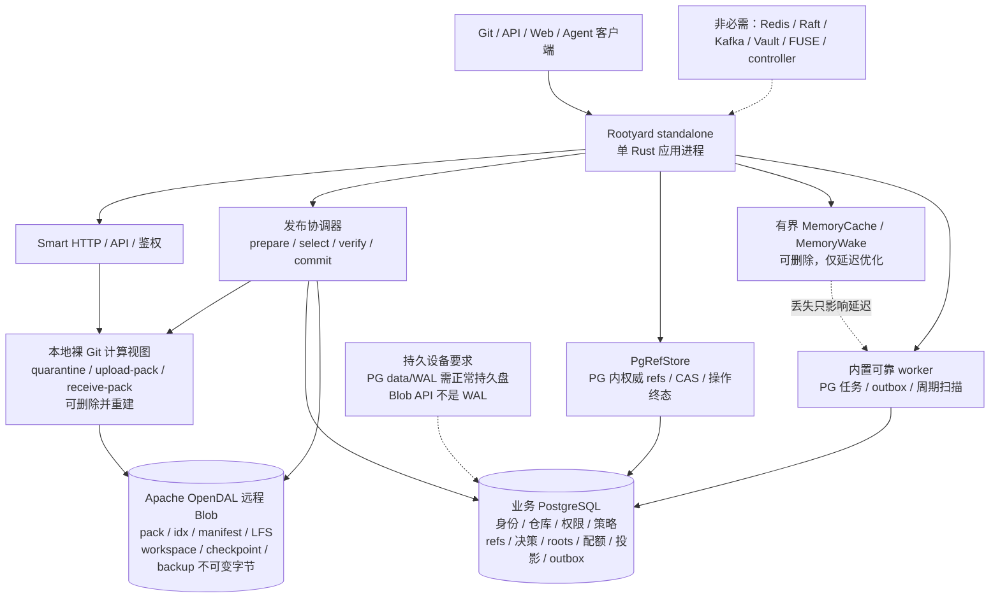
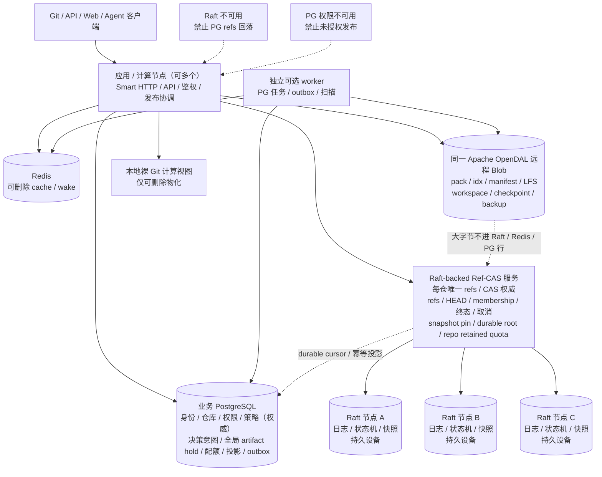
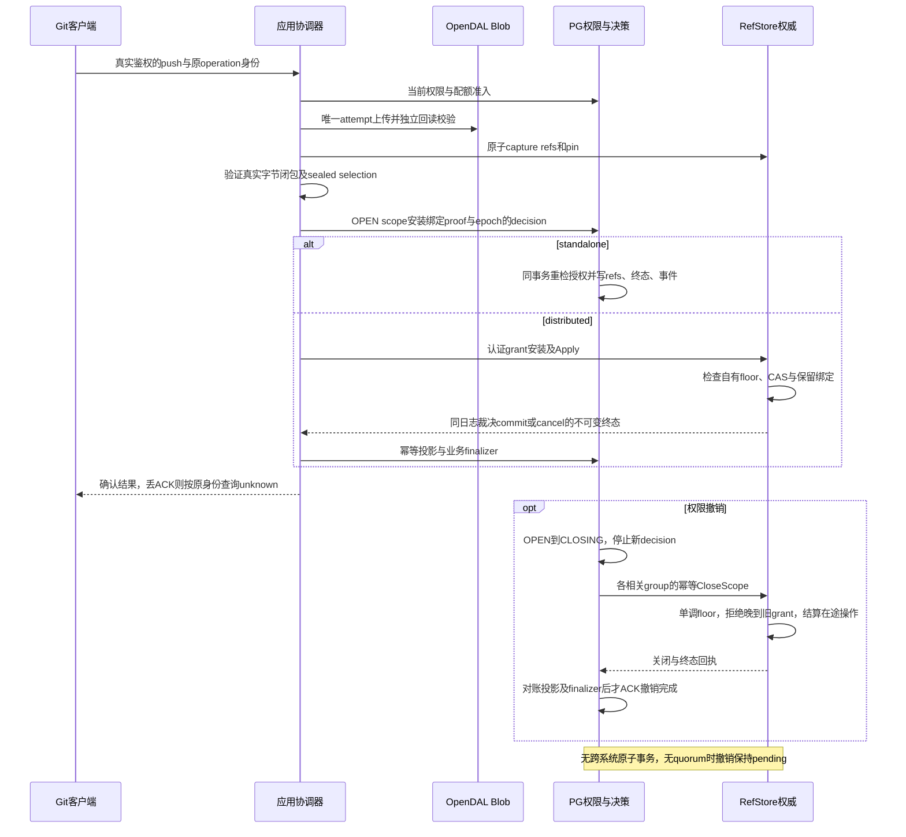
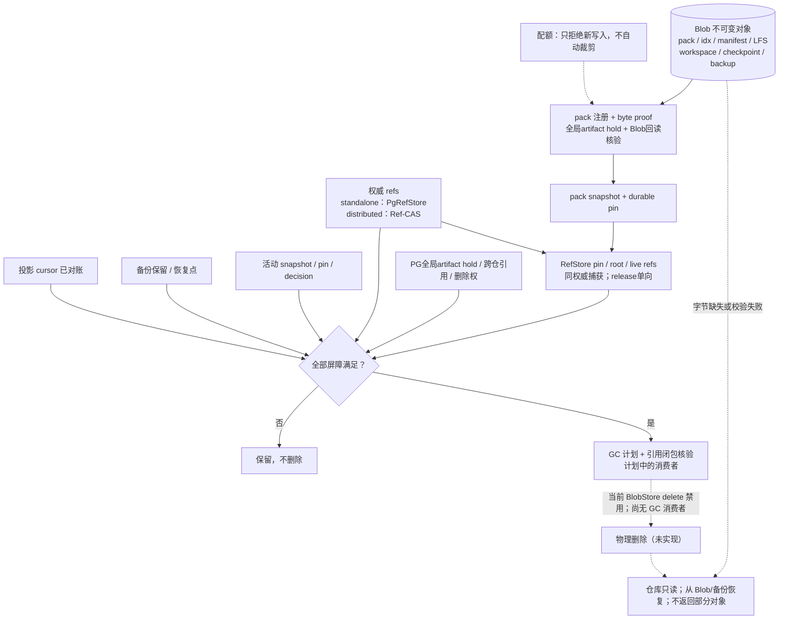
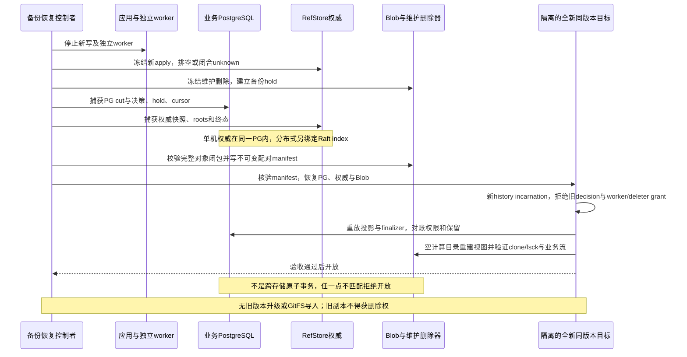

# Rootyard 当前目标架构图

五张图替换旧 GitFS/Pando/Patroni 演进图。它们定义尚未发布项目的新装目标，**不表示运行时已激活**。实际候选能力见 [实现状态](implementation-status.md)，协议见 [状态服务](12-state-services.md)，任务见 [实施计划](implementation-plan.md)。历史来源图只保留在摘要校验的原文归档中，不再作为当前 diagrams 源文件。

## 单机：目标形态，尚未激活

[Mermaid 源文件](diagrams/fresh-standalone.mmd)

## 分布式：目标形态，尚未交付

[Mermaid 源文件](diagrams/fresh-distributed.mmd)

## 发布与撤销：待接入共同服务协议

[Mermaid 源文件](diagrams/publication-decision.mmd)

## 对象保留与GC：默认禁止物理删除

[Mermaid 源文件](diagrams/retention-gc.mmd)

## 配对备份与全新同版本恢复：待实现

[Mermaid 源文件](diagrams/fresh-restore.mmd)

