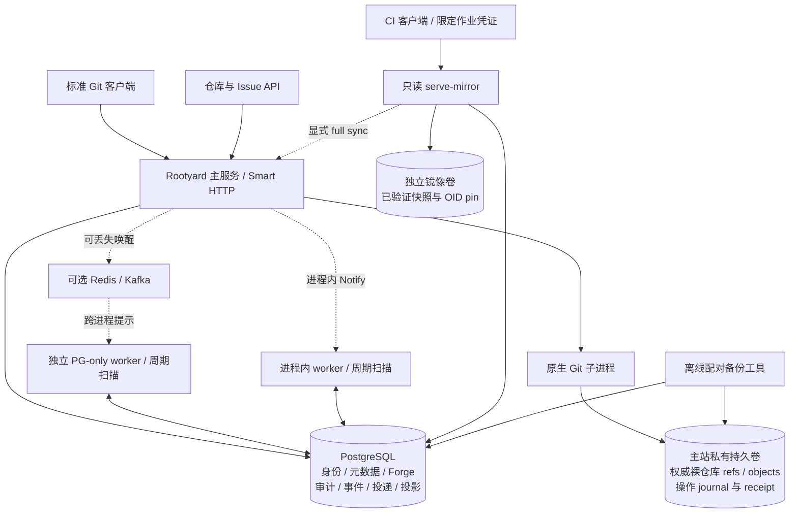
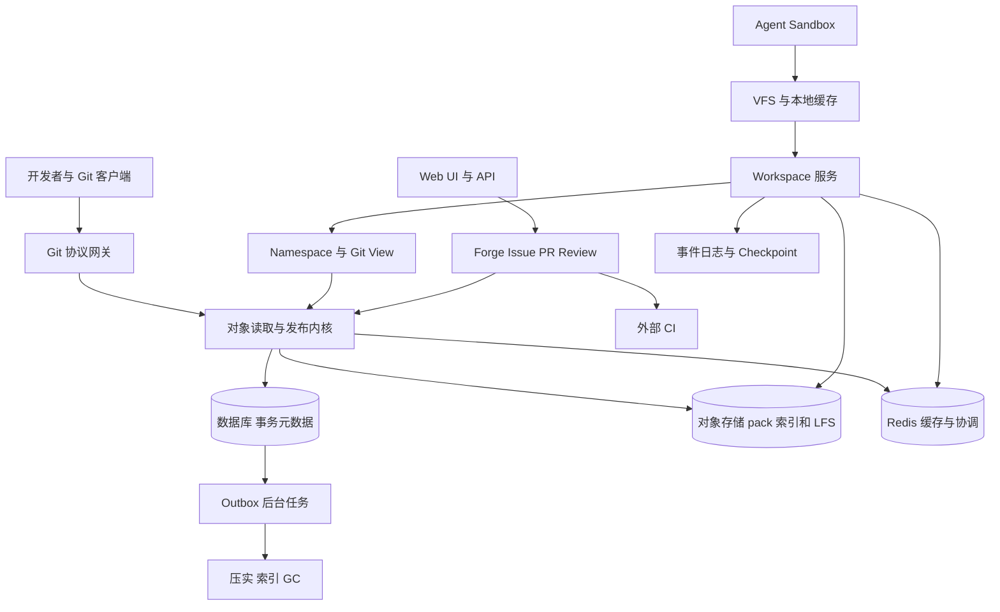
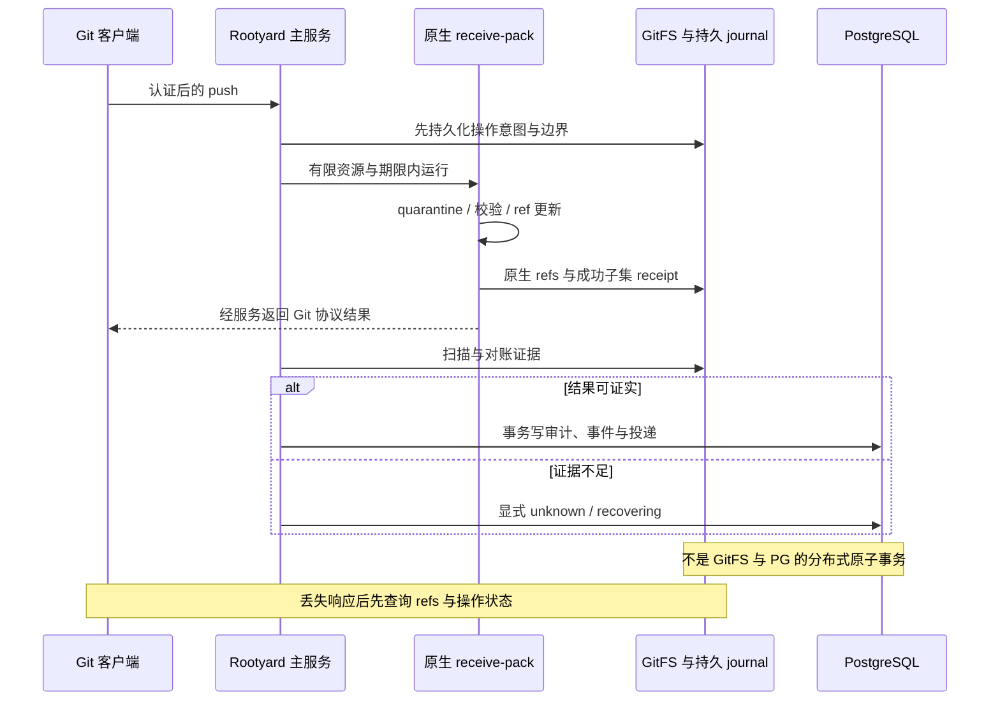
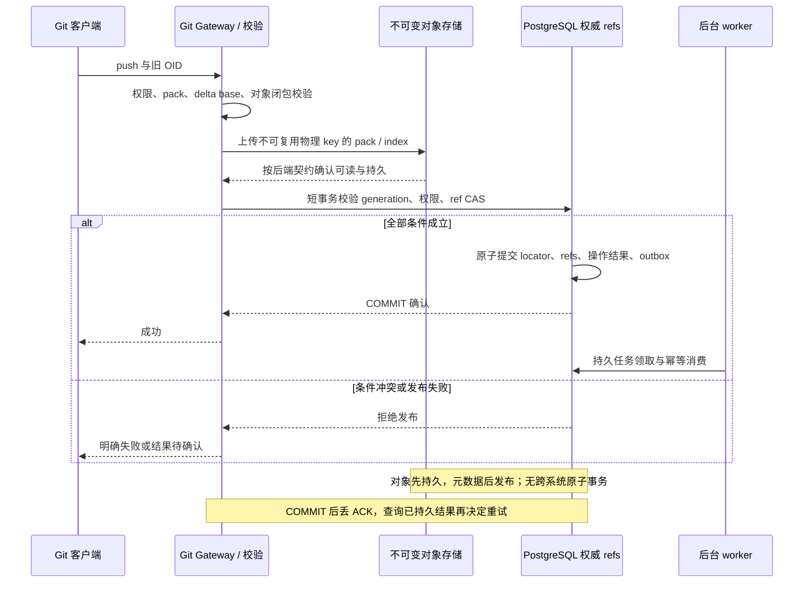
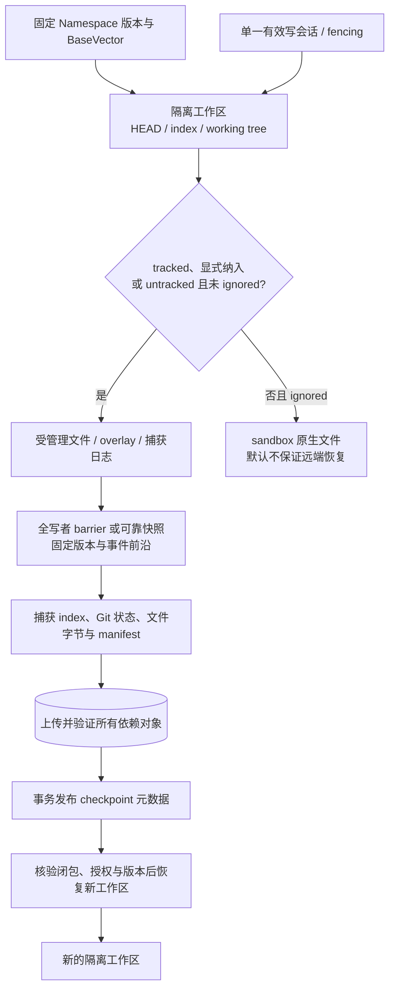
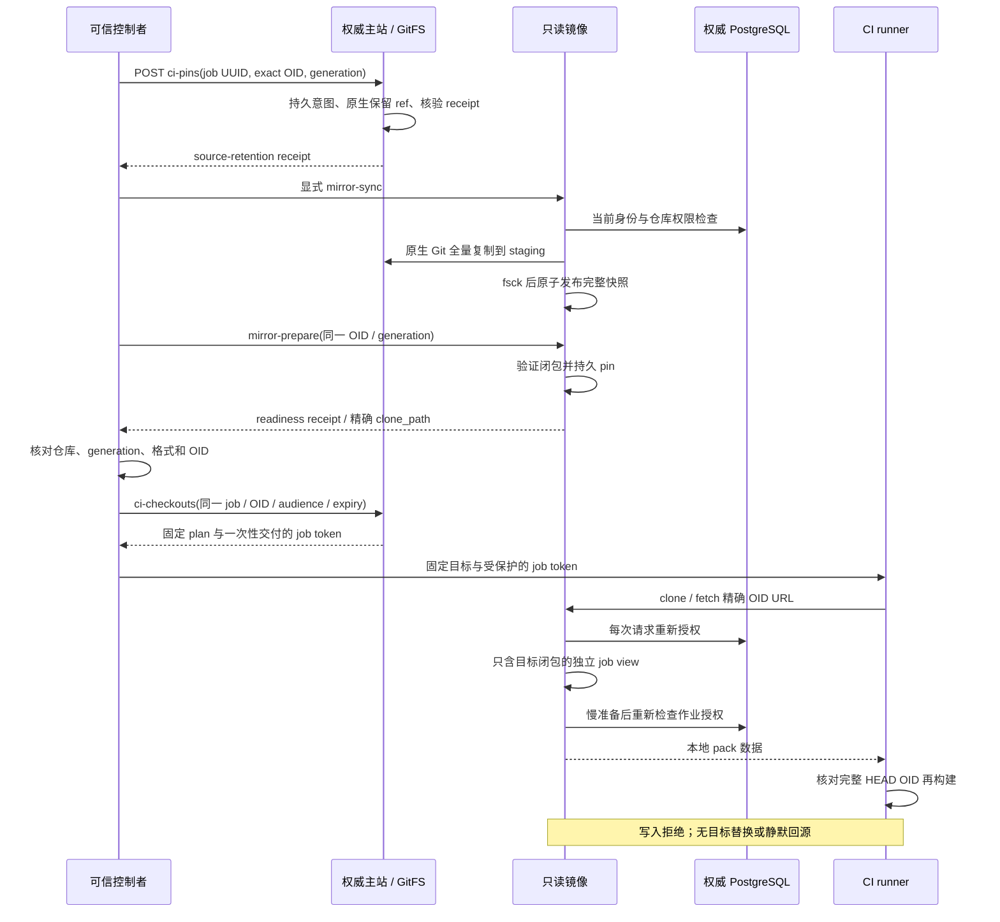
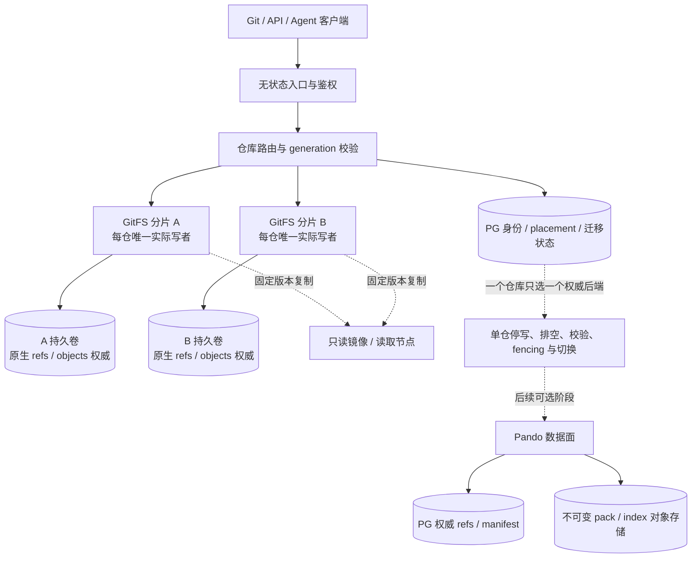

# Rootyard 架构图

这些图把当前实现和目标设计分开。除第二张为原 Page 图，其余是根据已链接的代码契约或设计整理的新图。图中的箭头表示依赖或调用，不表示所有步骤位于同一事务。

[设计目录](README.md) · [实现状态](implementation-status.md) · [分期路线](08-roadmap.md)

## 当前默认服务

按基线代码与实现契约整理。GitFS refs/objects 是默认服务权威；PG 持久事件不把这两种存储合成一个事务。参见 [ADR 001](../architecture.md)、[可靠性](../reliability.md)、[worker](../cross-process-workers.md) 与 [镜像](../ci-mirror.md)。

[Mermaid 源文件](diagrams/current-service.mmd)

## 完整目标架构

这是设计 Page 原有 Mermaid 图，保持原文。它表示长期目标，不是当前已部署组件清单。图中的对象存储、Workspace、Namespace、PR/LFS 及独立协调能力仍有计划或实验部分；单机模式不要求 Redis。参见 [总体设计](01-overview.md) 与 [最新路线](08-roadmap.md)。

[Mermaid 源文件](diagrams/target-overview.mmd)

## 当前 GitFS push 与证据

按实现契约整理的成功路径与不确定结果边界。Git 的 ref 更新和后续 PG 导入不共享原子提交，receipt 只记录成功子集；不能从客户端断线推断未写入。参见 [操作证据契约](../reliability.md)。

[Mermaid 源文件](diagrams/gitfs-push.mmd)

## Pando 目标发布协议

从目标存储契约整理。独立 Pando lab 已验证其中一些本地 pack/PG 路径，但不等于真实对象存储、完整 GC/幂等和迁移已交付。参见 [存储契约](02-git-storage.md) 与 [Pando lab](../../experimental/pando/README.md)。

[Mermaid 源文件](diagrams/pando-publication.mmd)

## Workspace 目标 checkpoint

从 Workspace/VFS 设计整理。当前实验只有调用方静止下的本地完整副本，不能据此宣称本图的全写者 barrier、COW 或跨节点恢复已实现。参见 [Workspace 目标契约](03-workspace-vfs.md) 与 [实验边界](../workspace-foundation.md)。

[Mermaid 源文件](diagrams/workspace-checkpoint.mmd)

## 当前 CI source pin 与只读镜像

按当前实现整理。两个 receipt 必须由可信控制者匹配，full sync 是显式动作。已有绑定目标、镜像 audience 与到期时间的 job token；仍无自动调度/回源、pin GC 或已准入长传输的即时撤销。参见 [CI 实现契约](../ci-mirror.md)；完整目标见 [第 11 章](11-ci-read-mirrors.md)。

[Mermaid 源文件](diagrams/ci-mirror-checkout.mmd)

## 分布式目标与权威边界

从横向扩容设计整理，尚不是当前默认服务部署。GitFS 接管必须隔离旧写者真实卷访问；PG 租约到期本身不足以保护卷。PG refs 是另一个后端阶段，不能和 GitFS 同时作为同仓 refs 权威。参见 [横向扩容](07-distributed-scaling.md)。

[Mermaid 源文件](diagrams/distributed-target.mmd)

