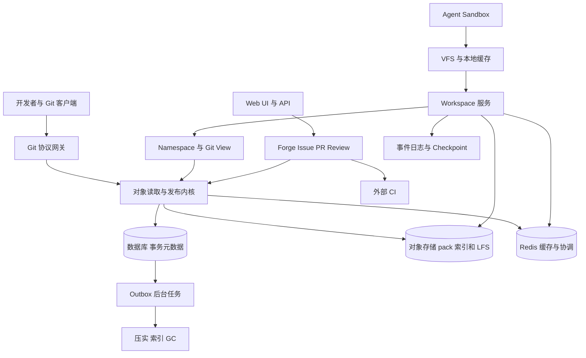

# Rootyard Git 平台技术设计与实施路线

> 设计原文归档。快照日期：2026-11-04；Page 最后更新：2026-11-04T01:28:10.845333Z；来源版本：9。
> 本文件包含历史建议、后续修订与实验记录，不代表全部已实现。先读 [状态与优先级](README.md) 和 [实现状态](implementation-status.md)。
> 两条私有历史对话仅保留引用标题。其他正文按原顺序保留。

<!-- BEGIN SOURCE BODY -->
这是一份面向多 AI Agent 和大型 monorepo 的 Git 平台设计方案。目标是在兼容标准 Git 客户端、Issue、PR、LFS 与外部 CI 的同时，把公司多个仓库组织成统一虚拟文件树，让隔离的 Agent 工作区能够实时记录修改，并支持按目录导出 Git 视图。

核心选择：**公司 Namespace 负责组织，Workspace 负责实时编辑，Git 负责版本交换和发布。** 首期以成熟 Git 实现验证工作区，Pando 风格的存储内核并行原型化；不把所有仓库、分支和编辑写入同一个全局 HEAD。下文的实现细节是建议方案，性能数字与产品边界需实测和确认。

# 一 目标和非目标

## 产品目标

- 公司级统一文件树：把多个仓库挂载到路径，并允许选择部分目录形成 Git 仓库视图。

- Agent sandbox 通过 VFS 使用文件；变更实时可见、可持久恢复，并保留独立工作区。

- 支持标准 Git 客户端、Issue、PR、LFS、Web UI；CI/CD 接入外部服务。 CI 的重复 clone/fetch 通过只读镜像卸载，构建输入固定到准确 Git OID。

- 不同分支的 push 尽量独立并行，同分支通过条件更新防覆盖。

- 优先轻量部署和 Rust 实现，支持大仓库、按需取文件与内容复用。

## 非目标

一期采用 Rust 后端、PostgreSQL 和对象存储，单机缓存及消息队列默认使用进程内实现；分布式部署可换 Redis 与 Kafka 类消息队列，不绑定特定对象存储供应商。暂不建设前端或完整 CI 平台。

## 设计边界

Git 兼容是协议、对象和客户端行为的兼容，不要求内部采用传统裸仓库目录结构。实时追踪工作区修改不等于每次写文件都创建 Git commit。

# 二 总体架构



建议以 Rust 模块化单体开始：Git Gateway、ObjectReader、Workspace、Forge API、权限与后台任务可在一个进程中部署，按实际瓶颈拆分。数据库保存 refs、权限、事务和持久任务状态；对象存储保存不可变 pack、索引、LFS 和工作区快照；Redis 用于可重建的热点缓存、限流、短期协调及通知，本地 SSD 缓存热数据和构建产物。单机开发可使用本地持久对象目录，但必须和缓存目录分开。Redis 不作为 refs、快照发布或任务成功的唯一事实源：故障时缓存失效、临时协调和通知可能中断，系统从数据库和持久 outbox 恢复；关键发布仍由数据库事务和版本校验保证。

**三种身份：**Namespace 是逻辑路径与所有权映射；Workspace 是固定基础版本加私有修改；Git View 是一个可被标准 Git 客户端访问的仓库及其提交图。一个 Namespace 可有多个 View，但 View 不是互相覆盖的权威副本。

# 三 公司级 Namespace 与 Git View

## 路径与所有权

例如将仓库挂到 /services/search、/libraries/query、/platform/protocols，再将其中的服务和依赖组合成任务视图。每个可写 canonical 路径必须归属一个 owner 和版本流；初版以原仓库为 owner，日后按组件调整。权限检查在 canonical 路径和来源仓库执行，不能因为路径出现在视图中就自动获得访问权。

Namespace 可用于浏览最新状态，但可执行 Workspace 必须固定 BaseVector，例如 search@a1、query@b7、protocols@c3。扩展范围时显式固定新增来源版本，避免构建时混入不同时间的接口和实现。

## 视图定义

Git View 应记录 view_id、epoch、包含和排除路径、路径重写、来源 owner、对象格式、历史策略及权限。修改映射规则创建新 epoch 或显式迁移，不能悄悄重写已发布历史。路径冲突、重叠映射与子模块需在创建时验证；初版拒绝不确定的跨 owner 写入。

一次工作区编辑只更新自己的 overlay 和事件，不同步重建所有视图。维护来源路径到长期视图的反向索引；冷门视图按需物化。

# 四 Workspace 与实时 VFS

## 状态模型

Workspace 记录 workspace_id、namespace_version、BaseVector、overlay_root、timeline_id、读写范围及状态版本。工作区内容是固定基础树加私有 COW overlay，fork 共享不可变基础和未变化树节点，之后独立写入。文件内容采用内容寻址；二进制修改按整体替换。初版采用单写者加 expected_version，多个 Agent 默认各自 fork，显式合并；不先引入全局 CRDT。

## 文件访问

Linux 优先构建 VFS 原型，可评估 FUSE 和内核接口；工作区本地缓存目录元数据与热文件，批量预取树和 blob。首次 open 未命中时 hydrate，读写本地 overlay，后台上传增量。需要明确 mmap、文件锁、symlink、权限位、大小写、inode、watcher、rename、断网及构建工具的兼容范围；不能假设一次 stat 对应一次远程请求可接受。

每次修改产生按 workspace 有序的变更记录，事件内容与大 blob 分离；批量上传并在服务端确认持久后标记为远端已保存。展示本地保存、远端持久、Checkpoint 可恢复、Git 分支发布、ChangeSet 集成等不同状态。时延与丢失窗口需通过实验设定，不能把本地写成功直接视为跨机器可恢复。

## 忽略文件与路由

按用户要求，未跟踪且匹配 .gitignore 的文件默认落 sandbox 原生文件系统，适用于缓存和构建产物。**tracked 优先于 ignore**：已经跟踪的文件后来匹配 .gitignore 仍应继续追踪。实现需维持独立的路径路由状态，并处理：

- 未跟踪文件被 git add 或 add -f：验证权限和内容后提升为可追踪状态。

- .gitignore 改变、tracked 文件移除索引、目录移动或跨层 rename：显式迁移或保留旧路由直到一致完成，禁止静默丢文件。

- 本地 ignored 文件默认不保证跨机器恢复；可为用户选择的缓存设计独立同步策略，不能误称属于 Git 快照。

- 大目录匹配采用缓存与增量失效；防止 ignore 规则造成安全策略绕过。

## 快照与恢复

Checkpoint 固定 overlay 根、事件前沿、BaseVector 和必要内容引用；先保证依赖对象可读再发布快照。跨设备恢复代码、可获得的会话与工具记录、环境描述，不承诺恢复进程内存、socket、凭证或正在运行的外部命令。外部副作用不可自动重放；使用操作 ID 和明确执行状态。

必须有 checkpoint barrier：冻结版本或使用可靠文件系统快照、变更日志校验并重试；逐文件遍历正在被写入的目录不能自动保证一致快照。

# 五 Git 语义与历史

## 工作区、暂存与提交

明确区分 HEAD、index 和 working tree。实时文件事件只是工作区过程历史，不自动改变 index 或生成 commit。git add 选择 index 内容，commit 根据固定 index 快照创建 tree 和 commit；push 发布 ref。原生 Git CLI 可通过标准协议操作导出视图，VFS 初期不承诺透明支持全部本地 .git 行为，必须通过兼容矩阵逐项验证。

Delta 风格的 Timeline 记录可获得的消息、工具结果、文件编辑和 checkpoint，使用 actor 与计数器及因果父节点标识，不假定可获得模型内部推理。分别使用 DeltaId、SnapshotId、CheckpointId、ChangeSetId 和 Git OID，避免评论变化改变代码身份。CRDT 收敛不等于代码语义正确，二进制、删除与移动冲突须显式处理。

## 三种历史策略

1. **原仓库视图**：目录结构不变，保留原 commit OID、父关系和签名。

2. **长期历史投影**：将子目录投影为稳定 Git DAG，持久化 (view_epoch, source_commit) 到 projected_commit 映射。一个源提交可能不改变视图而折叠，合并提交裁剪必须保持正确 ancestry 和 merge-base。固定时间、作者和父映射，保证重复生成确定性。

3. **任务快照视图**：多来源组合从固定组合基线生成 root commit，后续保留任务历史；早期来源历史回原仓库或平台查询。不要把它称为完整历史的 shallow clone。

修改 tree 或 parents 必然改变 OID，原提交签名不再覆盖投影提交；保存 provenance，必要时平台对投影另行签名。首次完整投影可能遍历大量祖先，depth=1 不自动消除生成成本。长期视图增量预建，临时任务默认快照优先。

## 推送与集成

标准 Git push 首先发布视图自己的任务分支，成功后其他标准客户端必须能 fetch 同一原始 commit；它不意味着所有源仓库 main 自动更新。集成时对固定视图基线做 diff，反向映射至 canonical 路径，针对各 owner 当前版本做三方合并、冲突检测及权限检查。禁止以投影树覆盖全部公司树。组合 main 初版保护，由审阅和 ChangeSet 流程更新。

# 六 Pando 风格 Git 存储内核

参考 [OpenAI Scaling Git at OpenAI](https://openai.com/index/scaling-git-at-openai/) 的不可变 pack、分支独立协调、版本依赖和压实思想，但其增强客户端优化不等于标准客户端均支持。数据库、Redis 和对象存储不是现成 Git 服务，对象存储也不能直接当 POSIX 裸仓库挂载。

## 核心实体与不变量

数据库维护 repositories、refs、ref_versions、object_views、representations、packs、index_segments、push_attempts、leases 和 outbox。分开 Git commit ancestry、ref 更新历史、物理 pack 依赖图；依赖引用固定版本而非移动的 main。

不可变对象先持久可读，短事务后发布 ref。不同 ref 不共享仓库级业务锁；同 ref 条件更新 expected old OID，并以服务端 generation 防 ABA。Git branch 是数据库中的 ref 记录。数据库的写入、事务日志和连接资源仍是共享吞吐域；后期按租户/仓库分片，单超大仓库跨分片属于专项。Redis 可做缓存和临时协调，但不能代替数据库 CAS 或作为发布事实源。

## Push

1. 鉴权、保护规则、配额；接收 pack 到隔离区，有界限制解压、delta 深度、CPU、内存和临时盘。

2. 校验对象 hash、delta base、图连通性及依赖；thin pack 在发布前补齐 base。物理 delta 依赖和提交图历史依赖是两回事。

3. 持久化 pack、idx 和固定依赖 manifest，并验证跨节点可读。

4. 短事务重验权限和策略版本，CAS 目标 ref，写 ref_version 和 outbox。多个 ref 的 atomic push 仅在真正全成全败时才对客户端广告。

5. 提交成功后返回；索引、统计、压实和 webhook 异步执行。避免每次更新共享 repository manifest 或全库计数行。

对象存储写入成功而数据库事务失败会产生孤儿，保留期后回收；数据库提交而回包丢失时以 ref 和操作回执核对，不能盲目重复外部动作。对象存储与数据库不构成分布式事务；不允许已发布 ref 指向缺失对象。必须按实际供应商验证新对象跨节点可见性、一致性、缓存和故障行为，不能假定所有实现相同。

## Fetch 和 ObjectReader

固定 wants/haves、权限、representation 和依赖，生成 FetchPlan 并持有 lease。通用路径输出合法 inline pack；不能把多个 pack 字节直接拼接。仅双方协商支持时启用 packfile-uris，其他客户端回退标准路径。普通客户端需要目标 ref 真实 tip，不能靠隐藏其他 refs 假装实现 Pando 的 explicit haves 优化。[Git 协议 v2](https://git-scm.com/docs/gitprotocol-v2)

ObjectReader 提供 resolve_ref、read_commit/tree/blob、merge_base、diff_trees；先查 pack index 与本地缓存，缺失时对象存储 range read 和 delta 重建。新增 pack 自带可立即读取的索引，全局聚合索引只是加速层，不可作为发布可见性的前置条件。缓存按安全域、固定对象和过滤参数隔离。

## Compaction 与 GC

压实生成新 representation，不更改用户 Git OID 或 ref。旧表示要等 fetch、工作区、checkpoint、push 和恢复窗口的 lease 释放后才能删除。GC roots 包括 refs、PR、CI、快照、备份、保留期和在途操作；先做孤儿清理，经过故障测试后再启用历史 GC。数据库恢复窗口必须与对象保留窗口一致。

# 七 一致性 跨仓发布与 CI

- 单 ref 在主写库 CAS，旧值不符拒绝；固定 commit 与 manifest 不可变。

- 单 PostgreSQL 分片可用事务提供多 ref 原子发布，也可通过 repeatable read 或显式 snapshot token 固定读取；不同请求不默认承诺同一时刻视图。写后读走主库或等待可验证版本屏障。

- 平台掌握全部参与 ref 时，事务外准备对象和 CI，短事务内按固定顺序校验并更新参与 refs、ChangeSet 和 outbox；只协调参与项。

- 若 GitHub 或 Forgejo 等外部服务仍是各自权威源，无法用本地数据库事务让多个远端原子提交。使用可观察状态、幂等重试和补偿，明确为非原子。

- Merge Queue 绑定不可变 base/head、候选提交、策略版本和 CI 结果；CI 不持有主分支锁。目标或 head 改变后重新验证，旧成功结果不能批准新代码。

- 外部事件通过 outbox 至少一次投递，消费端幂等；普通任务分支 push 不依赖 webhook、搜索或外部 CI 可用。

# 八 Forge LFS 与安全

Issue、Task、Thread、ChangeSet、不可变 revision、Review、Checks、Merge Queue 分离建模。PR revision 固定 base/head OID、BaseVector、diff 基线与 checks；评论可锚定路径与上下文，但外部 Git 中任意 rename 不保证永远可追踪。

LFS 使用标准 Batch API 与 pointer；大对象直传对象存储，验证 hash 和 size 后才标记 ready。发布前校验新增 pointer 内容可用，下载按仓库权限授权；LFS 锁如未实现须明确说明。[Git LFS 规范](https://github.com/git-lfs/git-lfs/blob/main/docs/spec.md)

授权按租户、仓库、ref、路径、任务及操作区分，Agent token 限时限域；分支写权限、会话读取和执行凭证是不同权限。隐藏 refs、sparse checkout 和内容 hash 都不是安全边界。pack 复用必须在同授权域；日志和事件不得泄露凭证。下载直链通常是 bearer token，需短时效并控制泄露；具体签名和访问策略依对象存储实现确定。

# 九 性能与资源预算

最大风险不是文件树概念本身，而是放大与共享热点：每个文件操作远程 RPC、全仓 ref 广告、每个 blob 一次数据库写入、构建扫描触发大规模 hydration、投影历史反复重算、单个热点目录 tree 重建、共享索引或仓库计数行竞争、压实抢占前台资源。

针对措施：本地目录与内容缓存、批量 RPC、按需预取、不可变索引段、按 view 路径反向索引、热路径有界并发及后台预算。建立单个 push、fetch、Diff、VFS hydrate、compaction 的独立 CPU、内存、带宽和临时盘限额；连接数与重计算并发分开。Git tree 的目录条目重建成本与目录规模有关，不能保证所有导出为 O(log N)。

示例容量假设：1,000 活跃 Agent 每秒各写 2 批事件，每批 2 KB，约 4 MB/s 或 345.6 GB/日，未计压缩、索引和复制。这只是规划估算，必须通过真实工作负载修正。重点记录 P50/P95/P99、对象读取放大、缓存命中率、DB 锁等待、峰值 RSS、临时盘、冷启动和恢复时间。

# 十 实施路线和验收

## 双线推进

**工作区线**：先用成熟 Git 服务和 partial clone/sparse checkout 建立基线，验证三仓库映射、私有 overlay、忽略文件分流、实时事件和跨设备 checkpoint，再引入真正的 VFS。保持 VFS 可选。

**存储内核线**：并行制作 Pando 风格原型，先验证 Git 协议正确性、独立 ref CAS、pack 依赖和崩溃恢复；与成熟 Git 基线比较。只有正确性和性能证据支持时，才替换热路径。之后逐步建设长期历史投影、增量索引、压实、GC 和跨仓集成。

## 核心验收场景

1. 以三个固定来源创建组合 Workspace，Agent 修改两个 owner 的文件而不 commit。

2. 从 Checkpoint fork 第二 Agent；双方隔离，一方机器退出后在另一机器恢复已确认状态和过程。

3. 忽略文件落本地，tracked 优先；测试 add -f、规则变化、rename、断电及跨层迁移。

4. 导出普通 Git 任务分支，未修改 Git CLI clone/fetch 后 git fsck 成功；冲突变更不能静默覆盖。

5. 两个不同 ref 并行 push；同 ref 竞争只有符合条件者成功；push 成功后另一节点立即 fetch 完整对象。

6. atomic 多 ref 中途失败全无更新；覆盖 force push、删除再创建、thin pack、上传中断、提交后回包丢失、compaction/GC 与 fetch 并发。

7. 固定候选通过外部 CI 后集成；外部权威仓库场景明确非原子。

8. 恶意 pack、越权 OID 猜测、LFS 缺失、凭证泄漏和备份恢复均有测试。

## 待决定事项

首版部署位置与资源预算；Linux VFS 先行还是先 sparse worktree；Git CLI 本地 index 与 VFS 的兼容等级；虚拟视图默认历史策略；路径 owner 的治理；跨仓集成的一致性范围；工作区持久化延迟和可接受丢失窗口；CI 与身份提供方；历史投影策略及签名证明。

# 参考资料

- [OpenAI Scaling Git at OpenAI](https://openai.com/index/scaling-git-at-openai/)

- [Git receive-pack 与 quarantine](https://git-scm.com/docs/git-receive-pack)

- [Git partial clone](https://git-scm.com/docs/partial-clone)

- [Git sparse checkout](https://git-scm.com/docs/git-sparse-checkout)

- [PostgreSQL 事务隔离](https://www.postgresql.org/docs/current/transaction-iso.html)

- Git 平台与虚拟 Workspace 讨论（私有历史讨论；链接未公开）

- 实时同步 VFS 讨论（私有历史讨论；链接未公开）

两段历史对话中的用户需求均已纳入；部分历史助手回复不可读取，因此未将其中无法核实的细节视作既定决定。

# 十一 可开工详细设计

以下章节将前面的建议具体化为首版工程契约。数据库、Redis 和对象存储均不绑定供应商。存储内核的 proc-receive 路径是待验证原型，不保证成熟 Git 后端可无修改直接用于数据库权威 refs；第一阶段优先在持久卷使用成熟 Git，待兼容性和故障注入通过后再切换。

# Git 存储、事务与协议实现方案

## 1. 本章决策与前提

这是面向 Rust 模块化单体的首期实现设计，不绑定特定云数据库或对象存储厂商。三个基础设施角色严格分开：

- 事务数据库：仓库配置、权限、refs、对象 manifest、操作状态、审计与 outbox 的唯一权威来源。

- 对象存储：不可变 Git pack、idx 和可选辅助索引；不是 ref 数据库。

- Redis：缓存、限流、任务唤醒、减少重复工作；丢失全部数据或锁过期不能造成错误提交。

数据库必须提供原子事务、唯一约束、行锁或等价的可靠条件写。下文 SQL 是接近 PostgreSQL 语法的伪代码，不代表选择某个托管产品。对象存储适配器必须满足不可变对象写入、完成写后的持久性确认、按键读取及读后写一致性。仅一次 HEAD 成功不能替代供应商的一致性契约；不满足这些能力的存储不能直接接入发布路径。

首期选择标准 Git Smart HTTP，固定并维护服务端 Git 版本。fetch 使用 git-upload-pack；push 使用 git-receive-pack 的 proc-receive 接口把全部受管 refs 的更新交给 Rust 事务服务。Git 原生 quarantine、pack 解析和协议编码继续复用 Git。不用 post-receive 进行数据库补写，因为客户端看到成功以前必须完成权威事务。proc-receive 的接口允许外部程序负责引用更新并报告结果。[Git hooks 文档](https://git-scm.com/docs/githooks)

首期只创建 SHA-1 仓库以简化兼容矩阵，但 schema 和内部 ObjectId 枚举预留 SHA-256；仓库 object_format 创建后不可修改。不宣称 SHA-1 与 SHA-256 仓库可直接互推。标准对象格式支持与兼容限制以固定 Git 版本的集成测试为准。[Git index-pack 文档](https://git-scm.com/docs/git-index-pack)

## 2. 必须成立的系统不变量

I1. 每个已提交且可见的 ref，其目标对象及完整 Git 依赖闭包都能从同一仓库的已发布 manifest 读取。gitlink 指向的子模块提交属于另一仓库，不要求在本仓库对象库存在。

I2. 新 manifest 指针、refs 变化、ref 历史、操作最终结果和 outbox 在同一个数据库事务里提交。

I3. pack 和 idx 的完整上传、校验及存储持久性确认必须先于 I2。允许上传后未引用的孤儿包，不允许先提交 ref 再异步上传对象。

I4. 所有 ref 写入，包括 Git push、网页编辑、Agent 提交、合并、管理员修复，必须经过同一个 RefTransactionService；没有绕过 CAS 的快速通道。

I5. Redis、某个进程内存和某台机器的裸仓库都不是权威状态。缓存失效只影响延迟或可用性，不改变正确结果。

I6. 已发布 pack 不原地覆盖。任何读者使用的 pack 集合在其有效 pin 生命周期内不得被物理删除。

I7. 对象存在不等于有权读取。授权基于仓库与可见 ref；不能凭猜中的 OID 获取其他仓库内容。首期不把 monorepo 路径过滤当作读取权限边界。

I8. 对外报告 push 成功只能发生在数据库提交被确认之后。提交结果未知时先查询操作记录，不能自动宣布失败或回滚。

## 3. 数据模型

建议至少保留以下逻辑表。OID 使用二进制并由 object_format 决定长度，API 使用规范化小写十六进制。ref_name 使用大小写敏感、二进制排序规则；禁止数据库自动大小写折叠或 Unicode 归一化。

```sql
repositories (
  id UUID PRIMARY KEY,
  tenant_id UUID NOT NULL,
  object_format TEXT NOT NULL,           -- sha1 / sha256
  default_branch_ref TEXT NOT NULL,      -- HEAD 的 symbolic target，可 unborn
  current_manifest_id UUID NOT NULL,
  manifest_generation BIGINT NOT NULL,
  object_epoch BIGINT NOT NULL,          -- 仅在对象集合可能减少时递增
  refs_epoch BIGINT NOT NULL,
  roots_epoch BIGINT NOT NULL,           -- GC retention roots 变化时递增
  policy_epoch BIGINT NOT NULL,
  lifecycle TEXT NOT NULL                -- active / read_only / deleting
);

-- 分布式 PG refs 模式新增的仓库所有权行；领取、续租、接管和发布遵守相同锁顺序。
repo_owners (
  repo_id UUID PRIMARY KEY,
  owner_id UUID NOT NULL,
  epoch BIGINT NOT NULL,
  lease_until TIMESTAMP NOT NULL
);

refs (
  repo_id UUID NOT NULL,
  ref_name TEXT NOT NULL,
  oid BYTES NULL,                        -- NULL = 已删除 tombstone
  version BIGINT NOT NULL,
  updated_at TIMESTAMP NOT NULL,
  PRIMARY KEY (repo_id, ref_name)
);

operations (
  id UUID PRIMARY KEY,
  repo_id UUID NOT NULL,
  actor_id UUID NOT NULL,
  idempotency_key TEXT NULL,
  request_digest BYTES NOT NULL,
  state TEXT NOT NULL,
  owner_fence BIGINT NOT NULL,
  lease_until TIMESTAMP NULL,
  validated_object_epoch BIGINT NULL,
  validated_policy_epoch BIGINT NULL,
  result_json JSON NULL,
  created_at TIMESTAMP NOT NULL,
  updated_at TIMESTAMP NOT NULL,
  UNIQUE (repo_id, actor_id, idempotency_key)
);

packs (
  repo_id UUID NOT NULL,
  id UUID NOT NULL,
  pack_key TEXT NOT NULL,
  idx_key TEXT NOT NULL,
  pack_sha256 BYTES NOT NULL,
  idx_sha256 BYTES NOT NULL,
  pack_bytes BIGINT NOT NULL,
  idx_bytes BIGINT NOT NULL,
  object_count BIGINT NOT NULL,
  state TEXT NOT NULL,                   -- uploading / ready / deleting / deleted
  created_at TIMESTAMP NOT NULL,
  PRIMARY KEY (repo_id, id),
  UNIQUE (pack_key), UNIQUE (idx_key)
);

manifests (
  repo_id UUID NOT NULL,
  id UUID NOT NULL,
  generation BIGINT NOT NULL,
  created_at TIMESTAMP NOT NULL,
  PRIMARY KEY (repo_id, id),
  UNIQUE (repo_id, generation)
);

manifest_packs (
  repo_id UUID NOT NULL,
  manifest_id UUID NOT NULL,
  pack_id UUID NOT NULL,
  PRIMARY KEY (repo_id, manifest_id, pack_id),
  FOREIGN KEY (repo_id, manifest_id) REFERENCES manifests(repo_id, id),
  FOREIGN KEY (repo_id, pack_id) REFERENCES packs(repo_id, id)
);

operation_packs (
  repo_id UUID NOT NULL,
  operation_id UUID NOT NULL,
  pack_id UUID NOT NULL,
  PRIMARY KEY (repo_id, operation_id, pack_id)
);

ref_events (
  repo_id UUID NOT NULL,
  seq BIGINT NOT NULL,
  operation_id UUID NOT NULL,
  ref_name TEXT NOT NULL,
  old_oid BYTES NULL,
  new_oid BYTES NULL,
  old_version BIGINT NOT NULL,
  new_version BIGINT NOT NULL,
  actor_id UUID NOT NULL,
  reason TEXT NOT NULL,
  retain_objects_until TIMESTAMP NULL,
  created_at TIMESTAMP NOT NULL,
  PRIMARY KEY (repo_id, seq)
);

manifest_pins (
  id UUID PRIMARY KEY,
  repo_id UUID NOT NULL,
  manifest_id UUID NOT NULL,
  purpose TEXT NOT NULL,                 -- fetch / push_validation / gc / backup
  owner_id UUID NOT NULL,
  owner_fence BIGINT NOT NULL,
  expires_at TIMESTAMP NULL              -- backup pin 可由备份策略显式释放
);

outbox (
  id UUID PRIMARY KEY,
  repo_id UUID NOT NULL,
  operation_id UUID NOT NULL,
  event_type TEXT NOT NULL,
  payload_json JSON NOT NULL,
  state TEXT NOT NULL,
  available_at TIMESTAMP NOT NULL,
  attempts INTEGER NOT NULL,
  UNIQUE (operation_id, event_type)
);
```

补充约束：所有关联写入都检查相同 repo_id；实际迁移应补齐 operation、repo 和 actor 的外键。ref_name 需通过 Git 规则校验，并额外限制产品支持的命名空间。首期公开写入 refs/heads/* 和 refs/tags/*；refs/platform/* 由内部服务管理。live refs 必须检查 `foo` 与 `foo/bar` 的目录/文件冲突，不能只靠完整名称唯一约束。持有仓库行锁时完成该检查，避免并发创建绕过。

refs 删除保留 tombstone，因此 API 的 ref version 可以发现删除再创建。原生 Git 只提供 old OID，不提供 version：A→B→A 后 old=A 的 push 可以成功，这是 Git 的 OID CAS 语义，不应宣称它具有额外的 ABA 防护。原生 old/new 的全零 OID 在服务内统一映射为“引用不存在/删除”。[Git update-ref 文档](https://git-scm.com/docs/git-update-ref)

不把每一个 blob 都写成数据库行。Git .idx 是 pack 内 OID 查找的基础；commit 元信息、目录树缓存、搜索索引均可重建，且不得成为对象持久性的唯一证明。首期 manifest_packs 保存完整集合，发布时复制旧集合再加入新包；随着 pack 数增长需测量写放大，再升级为分层清单或增量链，不提前宣称无限扩展。

## 4. 对象命名与存储适配器

对象键示例：

```
repos/<repo_uuid>/packs/<pack_uuid>/<content_sha256>.pack
repos/<repo_uuid>/packs/<pack_uuid>/<content_sha256>.idx
```

pack_uuid 保证被删除的物理键不被后来的上传复用，避免“旧 GC 删除请求删掉新复活对象”。业务 OID、Git pack checksum、存储传输 SHA-256 是不同概念，不混用。不能把对象存储 ETag 当作通用内容摘要。

接口至少包含 `put_immutable`、`complete_multipart`、`get`、`head_metadata`、`delete_idempotent`、`abort_multipart`。put 返回字节数、独立内容摘要、存储版本标识（若支持）及持久性确认。上传流计算 SHA-256；下载首次落盘校验；关键发布包通过完整回读或供应商支持的端到端校验验证。索引也独立校验，并确认它匹配 pack。

永久保存的 pack 必须解决包外 delta base 依赖；thin pack 可作为传输格式，但入库前必须补齐 delta base。这里的“pack 自包含”只针对 delta 重建，不代表 commit 的所有祖先都必须在同一个包内。[Git pack 格式](https://git-scm.com/docs/gitformat-pack)

## 5. Push 与对象发布状态机

操作状态：`receiving → validating → ready → committed`；失败进入 `rejected` 或 `aborted`。操作接管递增 operation owner_fence；仓库接管还需独立的 repo owner epoch。所有发布路径必须在权威事务中校验两者并遵守统一锁协议，具体保证边界见分布式预研。

1. 验证 HTTPS 身份、仓库存在和初始写权限；建立 operation，配额与请求上限检查先于大体积接收。

2. 在短数据库事务里锁 repository 行，读取 refs + current_manifest + object_epoch + policy_epoch，插入验证 pin，然后立即释放锁。

3. 构造只属于此请求的 bare repo 视图：固定 HEAD、固定 refs、只读 pack cache。Git 进程没有宿主 shell、任意 hook、外部网络或跨仓库 alternates 权限。

4. 流式接收并让 Git quarantine 验证；固定配置包括 receive.fsckObjects=true、receive.unpackLimit=0、receive.autogc=false 和覆盖所有受管 refs 的 receive.procReceiveRefs=refs/。限制请求字节、展开后资源、对象个数、处理时长和并行子进程。具体数值以测试和容量预算确定。

5. proc-receive 把已解析的命令集交给 Rust。不得返回 fall-through；未知或内部命名空间拒绝。按分支保护、权限、对象类型、fast-forward 与连通性验证。refs/heads/* 必须指向 commit；tag 按 Git 规则处理。

6. 将本次新增且已经规范化的 pack/idx 上传到不可变键。新对象可以引用同一仓库已发布的历史对象；必须验证新 tips 的闭包在“固定 base manifest + 新 pack”中完整。

7. 所有 pack READY 后执行第 6 节发布事务。事务中再次检查授权、策略版本、CAS 和 object_epoch。

8. 只有 COMMIT 被确认后，proc-receive 才对对应 ref 返回 ok；outbox 异步触发索引、webhook 和缓存失效。post-receive 不承担提交职责。

Quarantine 中的对象不应提前被可见 ref 引用，Git 自身也明确禁止 pre-receive 直接更新引用到这些对象。[Git receive-pack 文档](https://git-scm.com/docs/git-receive-pack)

必须先做 proc-receive 适配器工程验证：覆盖普通更新、创建、删除、仅删 ref、atomic push、非 atomic 部分失败、协议状态回传、网络断开，以及 Git 进程在数据库提交前后退出。此验证是发布门槛，不能只因 hook 存在就宣称数据库桥接已经实现。

## 6. Ref CAS 与数据库原子发布

首期以 repository 行锁串行化同一仓库的“最终提交窗口”；pack 接收、上传、对象检查均在锁外并行。不同仓库互不阻塞。这样先获得明确正确性，再依据锁等待数据决定是否细化，不预先承诺吞吐数字。

object_epoch 的作用：普通 push 只给 manifest 增加 pack，不递增它，因此多个并行验证可以在最终提交时把自己的 pack 加入最新 manifest。只有 GC/破坏性替换可能删对象时才递增。若验证期间 object_epoch 改变，退出事务，基于新 manifest 重新做连通性验证，不能直接复用旧结果。

```sql
BEGIN;

repo = SELECT * FROM repositories WHERE id = :repo_id FOR UPDATE;
owner = SELECT * FROM repo_owners WHERE repo_id = :repo_id FOR UPDATE;
op   = SELECT * FROM operations WHERE id = :operation_id FOR UPDATE;
checked_at = clock_timestamp(); -- 所有相关锁获取后取实际数据库时间

ASSERT op.repo_id = repo.id;
ASSERT op.request_digest = :request_digest;
IF op.state = 'committed' THEN RETURN op.result_json; END IF;
ASSERT op.state = 'ready';
ASSERT owner.epoch = :repo_owner_epoch AND owner.lease_until > checked_at;
ASSERT op.owner_fence = :operation_owner_fence AND op.lease_until > checked_at;
ASSERT repo.lifecycle = 'active';
ASSERT current_authorization_allows(:actor_id, :command_set);
ASSERT repo.policy_epoch = op.validated_policy_epoch;
ASSERT repo.object_epoch = op.validated_object_epoch;
ASSERT every_operation_pack_has_state('ready');

-- 全部 ref 命令排序处理；重复 ref 在进入事务前拒绝。
FOR cmd IN commands ORDER BY ref_name:
  current = SELECT * FROM refs
            WHERE repo_id = :repo_id AND ref_name = cmd.name;
  ASSERT normalized_oid(current.oid) = cmd.expected_old_oid;
  IF cmd.expected_version IS NOT NULL:
    ASSERT current.version = cmd.expected_version;
  END IF;
  ASSERT namespace_and_prefix_conflicts_absent(cmd);
END FOR;

new_manifest = create_manifest(repo.manifest_generation + 1);
INSERT INTO manifest_packs
  SELECT :repo_id, new_manifest.id, pack_id
  FROM manifest_packs
  WHERE repo_id = :repo_id AND manifest_id = repo.current_manifest_id;
INSERT INTO manifest_packs ... SELECT operation_pack_ids ...;
-- 若没有新 pack，可复用 current_manifest，不必制造空的新代。

FOR cmd IN accepted_commands:
  UPSERT refs (..., oid=cmd.new_oid, version=previous_version+1, ...);
  INSERT INTO ref_events (... old_oid, new_oid, actor_id, operation_id ...);
END FOR;

UPDATE repositories SET
  current_manifest_id = new_manifest.id,
  manifest_generation = new_manifest.generation,
  refs_epoch = refs_epoch + 1,
  roots_epoch = roots_epoch + 1
WHERE id = :repo_id;
UPDATE operations SET state='committed', result_json=:final_result
WHERE id=:operation_id AND owner_fence=:operation_owner_fence;
INSERT INTO outbox (..., event_type='refs.updated', ...);
COMMIT;
```

上例展示 atomic=true 路径。原生客户端协商 atomic 时任意 ref 错误都不提交；未请求 atomic 时应逐条保留失败原因，将通过检查的命令作为一个 accepted subset 原子提交，并准确返回逐 ref 状态。全局权限、非法 pack 或系统故障仍可拒绝整次 push。对 REST/Agent 的批量 ref API 默认且首期仅支持 atomic=true。[Git pack 协议](https://git-scm.com/docs/gitprotocol-pack)

保护规则依赖的测试结果必须绑定确切 commit OID（必要时包含目标分支版本），而不是“这个分支曾经绿过”。权限撤销和 policy 更新要与发布事务有可证明的顺序：采用共同的仓库写锁或一致锁顺序读取当前授权记录。只检查请求入口的缓存权限不足以防止长 push 期间撤权后仍发布。

死锁/序列化错误允许重试最终数据库事务，但每次重新读 refs、policy 与 operation。旧 OID 不匹配是业务冲突，不自动把新提交强推过去。CAS 返回当前值以便 Agent fetch/rebase/merge 后产生新的操作。

## 7. Fetch、一致性与缓存

一次 RPC 内创建读取快照：锁 repository 行 → 读取 current_manifest 和 refs → 插入 manifest pin → 提交。锁持有期间不下载对象、不运行 Git。随后按 manifest 组装只读裸仓库视图，由 git-upload-pack 协商并生成响应。Git 依赖普通文件 ODB，所以首期采用本地不可变 pack cache；不把对象存储 URL 冒充本地文件。

冷请求可能需要下载许多 pack；首期如选择完整物化必须明确承认冷 clone 成本，不承诺常数级访问。局部对象访问、MIDX/bitmap 优化、按需读取层在基线正确后另做设计与基准。

pin 有效期内不能删除其 manifest 的 pack。worker 定期续租，续租失败后在租约到期前停止新的远端读取并中止请求；不能继续依赖已失效 pin。若已完整物化并持有本地 cache 引用计数，可在释放远端 pin 后继续服务本地文件。临时网络失败可能使 fetch 失败，但不得导致静默返回错误对象。

HTTP 的发现 refs、ls-refs、协商与 pack 响应可能属于不同请求。逐请求重新物化最新快照存在竞态：已在实验中复现发现后 ref 删除导致 clone 失败。候选方案包括固定整个读取会话的授权快照或确保旧 want 在约定保留期内可读；短期只读快照 URL 已在 Git 2.56 原型中验证，生产权限、TTL、对象 pin、代理和多客户端兼容仍待验证。每次 RPC 必须重新授权，不依赖 cookie 或粘性会话。[Git HTTP 协议](https://git-scm.com/docs/gitprotocol-http)

缓存键至少包含 repo_id、manifest_id 或 refs_epoch、object_format，以及必要的权限视图标识。Redis refs cache 不能自行决定最新引用；从数据库读取版本后再命中版本化内容。POST Git RPC 设置禁止响应缓存。只向客户端声明实际通过兼容测试的 capabilities；fetch v2 的 ls-refs 与 fetch 可由固定 Git 版本处理，push 不应被笼统描述成“所有命令都是 protocol v2”。[Git protocol v2](https://git-scm.com/docs/gitprotocol-v2)

私有仓库不直接发物理 pack 的预签名下载链接，因为包内可能包含本次请求不应返回的对象。标准协商响应由授权网关输出。禁止客户端任意 OID 读取其他仓库，禁用允许任意对象 want 的宽松配置。隐藏 ref 不是独立秘密分区；需要强隔离的数据必须分仓库/分权限边界。

## 8. 并发情形的确定行为

- 两个 Agent 从同一 main=A 推到 B/C：一个 CAS 成功，另一个收到当前 OID 的冲突；对象上传可以均完成，失败者对象成为可回收候选。

- 两个 Agent 推到不同任务分支：接收与校验并行，最终提交短暂排队；第二个事务把自身 pack 加到第一个事务后的最新 manifest，不能覆盖丢失前者清单。

- push 与 GC 重叠：GC 替换对象集合会递增 object_epoch；旧验证结果必须重验。GC 自身也必须比较其起始 snapshot 版本。

- lock TTL 过期或 Redis 重启：允许重复 worker 被唤醒；数据库 fence、operation 状态和 CAS 保证仅一个结果生效。

- 主分支合并：读取 expected target OID、生成 merge/rebase 结果、检查后通过同一个 CAS；若 target 变化重新计算，不将过时测试结果套到新 merge commit。

- 客户端超时但 DB 已提交：保留 committed 结果；API 使用同一个幂等键读取原结果。原生 Git 无通用幂等键，客户端通过重新发现远端 refs 判断，不能宣称跨网络 exactly-once。

## 9. 故障恢复矩阵

1. 接收未完进程退出：没有可见 ref；operation 接管后可恢复完整输入，否则 aborted；删除临时目录并中止残留 multipart。

2. pack 上传完成、idx 未完成：不可 READY，不得发布；重试相同操作的未完成部分或终止，最终回收孤儿。

3. pack/idx READY、数据库事务未开始：可按 fence 重新接管并重验；未提交前用户不可见。

4. DB 回滚：refs 与 manifest 都保持旧值；新对象留作受控孤儿，不在错误路径里立即删除以免与重试竞态。

5. COMMIT 请求超时：使用新连接查询 operation；committed 则返回原结果；数据库不可读时报告结果未知。不要把“不知道”映射为“没有执行”。

6. 提交成功、响应丢失：状态仍 committed；API 重试按幂等键返回结果，Git 重新发现 ref。

7. 提交成功、Redis/outbox 消费失败：核心 Git 读写仍使用 DB 权威状态；outbox 按至少一次投递，消费者按 event_id 去重。不能以 webhook 已发送作为提交成功标准。

8. 已发布 pack 丢失/校验失败：立即隔离该副本，尝试副本或备份恢复；不能拿旧 ref 或空数据冒充成功。不具备恢复来源时将受影响仓库设只读并明确数据不可用，防止扩大损害。

operation、outbox 与 GC 任务都使用有上限退避与可观测的重试状态。有限重试失败进入待处理状态，不静默丢弃。系统性损坏需要告警与人工处置，不承诺任何故障都能自动恢复。

## 10. GC 与 pack 合并

把 GC 分成三个独立任务：未完成上传清理、未引用 pack 回收、可达对象重打包。

A. 上传清理：只有 operation 已终止或租约过期并被数据库正式 fencing、且 pack 不被任何受保护 manifest 引用，才能在短事务中置 packs.state=deleting。发布事务只接受 ready，所以从此不可再发布该包。事务提交后删除对象；404 视为幂等成功，最后置 deleted。

B. 重打包：取得并 pin 一组稳定根，包含当前所有 live refs、内部 PR/任务 refs、仍在保留期的 ref_events、未完成发布所依赖的 manifest，以及备份保留要求。审计历史的保留时长不自动等于 Git 对象保留时长，需分别定义。

C. 在锁外遍历这些根、构建新的 self-contained pack/idx、验证、上传。记录起始 current_manifest_id、refs_epoch、roots_epoch 和 object_epoch。

D. 获取 repository 行锁，确认上述版本仍一致、所有新包 READY、根闭包仍被完整覆盖，原子切换 current_manifest 到新集合并递增 object_epoch。若任意版本变化，保留旧状态，重新规划或重新构建；不得盲目替换。持续写入造成重试时先延后 GC，必要的维护写入窗口必须成为明确运维策略，而不是偷偷阻塞所有写入。

E. 旧 manifest 在不再是 current、没有有效 reader/push/backup pin 且过了配置的安全宽限期后才可退休。某 pack 只有不属于任何受保护 manifest 时才可置 deleting 并物理删。新 pin 只能在检查 manifest 可 pin 状态的同一事务内创建，不能事后复活已进入删除流程的旧 manifest。

F. 物理删除采用持久化 delete job；对象删除成功但 DB 更新失败时可重试。不得用“对象键年龄大于 N 天”直接删正式对象。对象存储 lifecycle 规则只用于独立临时前缀和未完成 multipart，不能扫正式 pack 前缀。

恢复备份需要同时具备数据库的一致恢复点及其引用对象。仅做数据库 PITR、却允许 GC 删除旧时间点需要的 pack，不构成可恢复备份。备份清单必须持有 object retention pin，定期在隔离环境真实恢复并 clone/fsck 验证。

## 11. 对外与内部 API 合约

标准 Git：

- GET /git/{owner}/{repo}.git/info/refs?service=git-upload-pack

- GET /git/{owner}/{repo}.git/info/refs?service=git-receive-pack

- POST /git/{owner}/{repo}.git/git-upload-pack

- POST /git/{owner}/{repo}.git/git-receive-pack

使用 Git 规定的 Content-Type 和 pkt-line/report-status，不能用 JSON 包装 Git 响应。认证失败等传输问题用 HTTP 状态；ref 冲突、保护规则失败等使用 Git 协议里的 ng 状态。只允许白名单 service，不能将 URL 参数直接拼接为 shell 命令。

应用 API：

- GET /api/v1/repos/{repo_id}/refs：返回 name、oid、version、refsEpoch；支持游标，要求一致分页时使用明确快照 token。

- GET /api/v1/repos/{repo_id}/operations/{operation_id}：返回 receiving/validating/ready/committed/rejected/aborted、逐 ref 结果和可安全公开的错误码。

- POST /api/v1/repos/{repo_id}/ref-transactions：必需 Idempotency-Key；原子更新已存在且授权对象的引用。新对象必须先经同一受控 ingestion 管线。

```json
{
  "atomic": true,
  "updates": [
    {
      "ref": "refs/heads/agent/task-123",
      "expectedOldOid": "<full-oid-or-null>",
      "expectedVersion": 7,
      "newOid": "<full-oid-or-null>"
    }
  ]
}
```

expectedOldOid 字段必须存在，JSON null 表示当前不存在；newOid=null 表示删除。省略期待值不代表允许无条件覆盖。创建从未存在的引用可使用 expectedVersion=0；删除后的 tombstone 版本由查询 API 返回。force 只表示放宽被授权的非 fast-forward 策略，不绕过 CAS。

- POST /api/v1/repos/{repo_id}/commits：网页/Agent 修改文件的便利入口，包含 expected branch OID/version、精确文件变化及提交元信息；生成标准 Git 对象后复用 ingestion + ref transaction，绝不独立维护另一套源码历史。

错误体建议包含 code、operationId、retryable、ref 和 currentOid/currentVersion（只有已授权用户可见）。409 REF_CONFLICT、409 IDEMPOTENCY_KEY_REUSED、403 POLICY_DENIED、413 PACK_TOO_LARGE、422 INVALID_OBJECT_GRAPH、503 STORAGE_UNAVAILABLE。未知提交结果用明确的 OPERATION_OUTCOME_UNKNOWN 和查询入口，避免诱导客户端换幂等键盲重发。

幂等键的 scope=(repo, actor, key)。同 key 同 canonical request_digest 返回原结果；同 key 不同内容返回 409；operation 最终结果及 digest 的保留窗口必须写进 API 契约，过期后不承诺永久幂等。

## 12. Rust 模块与适配器边界

建议 crate/module 边界：

- git_transport：Smart HTTP、认证上下文、Git 子进程与 proc-receive pkt-line。

- git_objects：ObjectId、pack 校验、对象闭包与类型检查、bare snapshot 物化。

- ref_service：CAS、分支保护、atomic/partial 策略、唯一发布入口。

- repository_store：SQL 事务、manifest、ref_events、operation、pins。

- object_store：通用不可变存储接口及供应商适配器。

- maintenance：GC、repack、恢复检查、outbox worker。

- application：Agent 提交、网页编辑和合并，通过上述领域接口调用。

关键内部类型为 VerifiedPack、ValidatedPush、PinnedManifest、RefUpdate、CommitOutcome。VerifiedPack 只能由成功的验证/持久上传流程创建；ValidatedPush 携带 base object_epoch 与 policy_epoch。类型能减少误用，不能替代数据库事务里的再验证。

进程调用使用参数数组，不执行拼接 shell。禁用外部 filter、textconv、任意用户 hooks、意外配置继承和跨仓库 alternates；Git 二进制纳入漏洞更新与兼容回归。stderr 日志不要泄露认证信息或未授权文件内容。

## 13. 必须自动化的验收测试

协议与兼容：空仓库 clone、首次 push、普通 fetch、tag/annotated tag、删除分支、force-with-lease、非 fast-forward、atomic 多 ref、非 atomic 部分失败、薄包补齐、gitlink、二进制 blob、无最终换行、合法非 ASCII ref、非法 ref 和 prefix 冲突。shallow/partial clone、filter、SHA-256、LFS、SSH 只在列入当期兼容矩阵并通过测试后宣布支持。

并发：同 ref 一百个并发候选只能出现符合 CAS 顺序的结果；不同分支并发提交不会丢 pack；ref 删除再创建的 API version 防 ABA；原生 Git OID CAS 保持 Git 语义；push 与 GC 随机交错；权限撤销和长上传交错；Redis 锁过期及重复 worker；读 pin 与删除任务竞争。

故障注入：在每个上传/READY/事务语句/COMMIT/响应/outbox/GC delete 边界 kill -9；丢失 COMMIT 响应；上传损坏、错误 idx、丢对象、存储超时、DB 断连、Redis 清空。每次恢复后检查 I1–I8、operation 结果与真实 refs 一致，并运行 clone + git fsck --full。

安全：跨仓库 OID 猜测、越权 want、隐藏 ref、路径穿越、shell 参数注入、恶意 pack、深 delta、超大展开对象、压缩炸弹、子进程资源耗尽、ACL 变化时旧缓存不能放行。

恢复：从真实备份恢复到隔离环境，用标准 Git clone、比较 refs 与对象集合、运行 fsck；验证备份窗口内旧 pack 未被 GC 破坏。

性能验证只报告实测值：冷/热 clone、fetch/push 时延分位数、pack 数与大小、Git CPU/内存、对象存储请求/字节、manifest 写放大、数据库锁等待、GC 额外空间、outbox 滞后。测试须注明硬件、网络、仓库数据集、并发、缓存状态和 Git 版本；没有数据前不写固定吞吐保证。

# Workspace / VFS 实施方案

## 1. 决策与边界

本模块提供公司级虚拟命名空间、每个 agent 的隔离工作空间、原生 Git 视图、实时变更追踪与可恢复 checkpoint。首版采用“逻辑 VFS + 原生工作目录投影”，不是自研 POSIX/FUSE 文件系统：工具仍使用标准文件路径与 Git CLI，服务层负责版本、捕获、隔离和恢复。此决策不妨碍以后替换底层物化器。

必须区分三个概念：

1. 实时追踪是发现和捕获 working tree 变化，绝不自动执行 git add、commit 或 push。

2. Git HEAD、index、working tree 是三个独立状态，checkpoint 必须一起保存，不能用 HEAD + 单份 diff 代替。

3. 只有 COMMITTED checkpoint 承诺跨节点恢复。watcher 通知、浏览器已显示、写入本机磁盘，都不等价于远端持久化完成。

V1 平台：Linux、大小写敏感路径、以最新稳定 Git 为兼容目标并固定每次部署的验收版本（当前 2.56.0）、普通文件/符号链接/执行位。子模块、LFS、稀疏检出须显式能力协商；不支持的仓库在导入时说明，不在恢复时悄悄丢失。长期开启的数据库文件、socket、FIFO、设备节点等不能冒充普通文件 checkpoint。

## 2. 命名空间和隔离

公司命名空间是版本化目录映射，例如：

    /company/acme/apps/payments -> repository R1, repo-root
    /company/acme/libs/common   -> repository R2, repo-root

它不是跨仓库的大 Git 仓库。进入 payments 才看到 R1 的 Git 根；上层目录不提供合成 .git。V1 拒绝重叠 mount、路径穿越及跨 repo 的原子 rename，跨 repo 移动是显式 copy + delete。每个 workspace 固定 namespace_revision 和每个 repo 的起始 commit；上游分支移动不能偷偷改变 agent 正在使用的文件。

每个 agent 对应一个独立 workspace。fork 以已完成 checkpoint 为父节点，复用不可变内容，不共享可写 inode。宿主支持 reflink 时用 reflink，否则复制；绝不能用普通 hardlink 假装工作文件 CoW。首次实现允许先物化完整工作树，之后再优化按需读取。

每个 repo view 具有独立 .git、HEAD、index、refs、reflog 和可写 object directory。只读 Git pack 缓存可以共享，但必须按租户授权、持有引用、禁止 agent 修改，并确保回收不会使活动 workspace 缺对象。不要直接把 git worktree 作为多 agent 安全边界，因为它默认共享 refs 和部分配置。[Git worktree 文档](https://git-scm.com/docs/git-worktree)

## 3. 精确状态模型

对 workspace 中的每个 repo 定义：

- B：fork 时不可变基线，含基线 manifest 和起始 commit。

- H：当前 HEAD，可为符号分支、detached HEAD 或尚无首个 commit 的 unborn HEAD。

- I：原生 Git index，保存 stage 0/1/2/3、文件模式、OID、intent-to-add 等语义。

- W：原生 working tree，独立于 H、I；原始字节不能和经 Git clean filter 处理后的 blob 混为一谈。

- N：仅原生磁盘保留的临时数据，默认包括 ignored 且不在 H/I 中的文件。

- C：捕获到远端的版本；C 可能落后于正在写入的 W，API 必须给出差距和状态。

Git 暂存读取 add 执行当时的内容，之后继续编辑不能反向修改 index；部分暂存也必须保留。[Git add 文档](https://git-scm.com/docs/git-add)

持久化资格规则：

    managed(path) = path in HEAD tree
                 OR path in any index stage
                 OR explicitly included by checkpoint policy
                 OR (untracked AND not ignored)

HEAD 并集用于保护“已从 index 删除、尚未提交”的文件。tracked 文件不受 ignore 规则影响。working tree 中新增、尚未 git add 的非忽略源码也进入 managed。已被忽略但仍 tracked 的 node_modules/foo 不能被整个目录剪枝漏掉。

ignored/native 是持久化分类，不是在规则变化时物理迁移目录。所有文件保持原路径，避免破坏打开的文件描述符和 rename 语义。

## 4. 组件与存储职责

- Workspace API：鉴权、版本条件、幂等键、生命周期和 checkpoint 请求。

- Workspace runtime：物化工作树，运行受控进程，维护独占写入租约、磁盘配额和写入屏障。

- Git adapter：调用固定版本 Git，读取机器格式状态，执行允许的 Git 操作，捕获 Git 元数据。

- Capture daemon：watcher、dirty set、扫描、内容哈希、本地恢复 journal、对象上传。

- Manifest service：管理不可变路径树、Git 元数据快照、checkpoint 根。

- Event relay：数据库 outbox 到 Redis/SSE/WebSocket，支持重放。

主数据库保存权威元数据、租约 fencing token、持久化 revision、操作状态和 outbox。Redis 只做缓存、唤醒和实时分发，不能成为唯一锁、唯一日志或唯一 checkpoint 清单。对象存储保存原始文件字节、Git 对象包、index、元数据包及不可变 manifest。数据面本机磁盘保存正在编辑的文件、本地 WAL 和不可变待上传快照。

文件内容用平台 SHA-256 CAS 标识，Git OID 单独存 object_format + oid，不把二者混用。对象 key 按 tenant 分区；跨租户不暴露去重存在性。大文件可后续分块，V1 可先整文件 CAS + 大小上限。Git pack 复用和平台文件 CAS 是两套可独立回收的引用图。

## 5. 最小数据库模型

所有表有 tenant_id，查询、外键和对象权限均带租户边界。

| 表 | 关键字段及约束 |
| --- | --- |
| repositories | id, provider, external_id, object_format, access_policy, imported_revision |
| namespace_versions | id, company_id, revision, manifest_digest；不可变 |
| namespace_mounts | namespace_version_id, mount_path_bytes, repository_id；不重叠 |
| workspaces | id, agent_id, namespace_version_id, parent_checkpoint_id, state, host_id, lease_epoch, lease_until, revision, last_checkpoint_id |
| workspace_repos | workspace_id, repo_id, mount_path, base_commit_oid, base_manifest, git_generation, git_snapshot_id |
| overlay_entries | workspace_id, repo_id, path_bytes, entry_version, kind, mode, content_digest, size, deleted, capture_class；仅存覆盖层变化 |
| blobs | tenant_id, digest, size, object_key, checksum, state；唯一(tenant_id,digest) |
| git_snapshots | id, git_version, head_descriptor, index_digest, refs_digest, metadata_digest, object_manifest_digest, config_policy_digest |
| checkpoints | id, workspace_id, lease_epoch, captured_revision, parent_id, root_manifest_digest, state, scope, excluded_summary, created_at, durable_at |
| workspace_events | workspace_id, revision, transaction_id, type, payload_digest；唯一(workspace_id,revision) |
| operations | id, workspace_id, type, idempotency_key, state, result；唯一(workspace_id,idempotency_key) |
| outbox | event_id, workspace_id, revision, payload, delivered_at |

baseline 的百万级路径表放在对象存储的分片有序 manifest/Merkle 树，不把每次 fork 变成百万行 INSERT。DB overlay 是 sparse delta。读取目录为 baseline + overlay - tombstone；压实得到新不可变根。tombstone 只遮蔽本层/基线，不修改其他 workspace。

## 6. API 合约

所有写 API 需 tenant/workspace 授权、Idempotency-Key；交互修改提供 expected_entry_version，跨文件事务提供 expected_workspace_revision。过期条件返回 409，不能自动覆盖新内容。

| 接口 | 输入 / 返回 |
| --- | --- |
| POST /workspaces | namespace_revision, repo base commits 或 checkpoint_id；返回 operation_id |
| POST /workspaces/{id}/fork | committed checkpoint_id, new_agent_id |
| GET /workspaces/{id}/tree | repo_id, path, view=head/index/working, revision；返回条目及 managed/native、captured/live 标记 |
| GET /workspaces/{id}/files | repo_id, path, revision；返回内容、ETag、durability |
| POST /workspaces/{id}/file-transactions | puts/deletes/renames[], expected versions；同一 repo 原子 API 事务 |
| POST /workspaces/{id}/repos/{repo}/git | action, args, expected_git_generation；返回原生命令结果和新 generation |
| POST /workspaces/{id}/checkpoints | mode=consistent, include_native allowlist；返回 operation_id，直到 COMMITTED 才算成功 |
| POST /checkpoints/{id}/restore | 默认 new_workspace；原地恢复必须显式要求并检查目标 revision |
| GET /workspaces/{id}/events | after_revision；SSE，缺口返回 RESYNC_REQUIRED + 最新 snapshot revision |
| POST /workspaces/{id}/changesets | base_checkpoint, source_checkpoint；形成可审核变更集 |
| POST /workspaces/{id}/apply | changeset_id, expected_revision；三方合并，冲突不覆盖 |

路径以 byte-safe 编码存储，JSON 可用 path_base64 + display_path。不得在无说明下把 Unicode 规范化或大小写折叠。文件名换行、tab、前导连字符必须能往返；Git 调用使用 NUL 分隔输入和 -- 结束选项，而非拼 shell 字符串。

file-transactions 的“原子”指本服务读取的发布版本原子切换。若底层是多文件原生写，不能宣称外部任意 POSIX 读取者同时看不到中间态；需要该保证时，所有读写都必须经过事务屏障，或切换不可变目录根并限制旧 FD 语义。普通工具看到的并发文件行为保持原生 OS 语义。

## 7. 变更捕获算法

1. inotify/等价 watcher 将路径加入 dirty set，目录新增先注册观察再扫描，删除和移动通知用于触发重新求值。watcher 不是事实日志。

2. close-write 或短 debounce 后读取当前文件；记录 inode、size、mtime、ctime，复制/哈希后再检查。发现变化则重试或保持 dirty。该流程只保证静止后的收敛，不承诺任意并发写下的线性化快照。

3. 使用当前 Git index/HEAD 和实际工作目录 ignore 规则判断 managed。新路径的 ignore 判断复用 Git check-ignore，缓存按目录及 ignore_generation 失效，不实现简化 glob 替代 Git 语义。

4. 对捕获内容写本地临时对象，fsync 文件，原子 rename，再 fsync 父目录；写带 checksum 的 WAL 记录。WAL 记录已捕获内容，不是盲重放 watcher 动作。

5. 上传不可变对象，验证长度/校验和，确认可读取后，在单个 DB 事务内检查 lease_epoch、推进 workspace revision、更新 overlay、插入 event/outbox。对象在 DB 引用前必须存在。

6. Redis 分发的是已发布事件。可另发 dirty hint 供 UI 提示，但必须标记非持久化。客户端按 revision 去重，丢通知后从 DB 补齐。

7. watcher overflow、断连或 daemon 重启时设 NEEDS_RESCAN，进行完整对账；后台周期性扫描及 checkpoint 扫描负责兜底。不能用“没收到事件”证明文件未变。

POSIX rename cookie 只作为优化提示；配对缺失时全量对账仍需得出正确状态。同 repo rename 在 manifest transaction 中产生旧路径 tombstone + 新路径 entry，可保留 correlation_id；Git 的 rename 检测仍由 Git 依据内容决定，平台不能强制把所有 rename 解释成 Git rename。

普通保存实时 SLO 建议在基准环境、单文件 ≤1 MiB 时，从 close 到状态出现 p95 <500 ms、远端捕获 p95 <2 s；这是待压测目标，不是已验证性能。大文件明确展示 uploading，不冻结整个 UI。

## 8. Git 和 ignore 的关键场景

- 编辑 A，git add A，再编辑 A：H 仍为旧版、I 为第一次编辑、W 为第二次编辑；恢复后两份差异都在。

- git add -f ignored.txt：命令成功后该路径已在 index，提升为 managed；必须在本次 Git 操作的同步 capture barrier 中保存 index blob 与 W，不能等旧 ignore 缓存刷新。

- .gitignore 修改：递增 ignore_generation，重扫受影响子树；tracked 文件照常捕获，未 tracked 文件只改变后续快照资格，不删除本机文件，不篡改过去 checkpoint。

- git rm --cached A：I 无 A，H 仍有 A，因此继续保存 W；提交删除后 H/I 均无 A，若当前被忽略才变 native。

- git add -N：保存 intent-to-add 语义和实际 W，不把空 blob 当成文件当前内容。

- 冲突：index stage 1/2/3 必须完整保留，不能仅存 write-tree 结果，因为未合并 index 无法用单一普通 tree 表示。[Git update-index 文档](https://git-scm.com/docs/git-update-index)

- clean/smudge、换行转换：W 保存原始字节，I 使用原生 Git 产生的对象；允许的 filter 在隔离运行环境执行，未知可执行配置需审批策略。

- native 的 ignored 文件不默认传入对象存储，也不默认随 fork 复制；本机 restart 仅在原卷仍在时可保留。UI 显示此类文件不会随 checkpoint 恢复。必要的文件可显式加入 checkpoint allowlist，凭证挂载目录禁止包含。

- Ignore 规则采用 Git 完整语义，包括层级优先级、否定规则及被忽略父目录的行为。禁止把 ignore 当成安全隔离策略。[Git ignore 文档](https://git-scm.com/docs/gitignore)

Git 状态使用 git status --porcelain=v2 -z，不解析给人阅读的输出。Git 管理操作串行化，每次操作结束重新捕获 HEAD/index/refs；任意 shell 内的 Git 也纳入受控进程边界。status 等读命令可用避免可选锁写入的方式运行，不能意外与 checkpoint 竞争。[Git status 文档](https://git-scm.com/docs/git-status)

## 9. 强一致 checkpoint

状态：REQUESTED → CAPTURING → UPLOADING → COMMITTED，失败为 FAILED；失败 checkpoint 不可作为 fork/recovery 根。

算法：

1. 写入幂等 operation，获取 workspace 的 DB 写入租约并校验 epoch，关闭新写入/exec admission。

2. 获得强静止屏障，确保全部写入者受控。V1 可在 job boundary，等待所有可写任务结束且没有遗留后台 writer 后捕获；持久服务场景必须使用经过验证的文件系统冻结/快照适配器。仅 SIGSTOP、等待一会儿或比较 mtime 不算完整屏障。

3. 如果存在活动 Git transaction/lock，等待其完成或超时返回 CHECKPOINT_BUSY；不自动删除锁。明确暂停于 merge/rebase 冲突、但没有活动写入事务的状态可以保存。

4. 在同一个屏障内取得所有 repo 的不可变本地快照，完整扫描 managed 文件并捕获 Git 元数据。跨 repo checkpoint 是同一时点的状态向量，不是跨仓库 Git commit。

5. 原始 index + 可验证语义摘要、HEAD/symref、refs/reflog、merge/rebase/cherry-pick/sequencer 状态、必要 Git 对象，以及非敏感配置进入 Git snapshot。存储路径使用 Git 提供的解析接口。禁止只备份工作文件和 HEAD。

6. 本地快照完成后可恢复运行，上传只读快照，不继续读取变化中的 live tree。root manifest 引用每个 repo 的 working manifest、git snapshot、namespace revision、捕获范围、exclude 摘要和版本。

7. 先上传所有引用对象并校验，再上传 root manifest。单个 DB 事务校验 epoch，登记 checkpoint COMMITTED、更新单调向前的 last_checkpoint、写 outbox。较旧 checkpoint 后上传完成时不能覆盖较新指针。

8. 返回 checkpoint_id、captured_revision、durable_at、excluded_summary。客户端只有此时显示“可恢复”。

V1 固定 Git 配置，禁用 split-index 等尚未验证的扩展，保存完整 index 与 Git 版本。恢复时使 stat/untracked/fsmonitor 缓存失效，但保留 index 的暂存、冲突和标志语义；未知扩展拒绝恢复或使用原版本，不擅自丢弃。之后再增加跨 Git 版本迁移。

## 10. 恢复、故障矩阵与回收

恢复默认创建新 workspace：读取 COMMITTED 根 → 验证租户及对象完整性 → 物化到临时目录 → 构造独立 Git 元数据/对象集合 → 校验 HEAD/index/working 的对比结果 → 原子发布 workspace ready。失败临时目录不对外暴露，也不覆盖用户当前目录。

| 故障点 | 处理 |
| --- | --- |
| 文件写到一半，尚未捕获 | 遵循 native OS 写入语义；不得声称远端已有该版本 |
| daemon 崩溃，本机卷尚在 | 校验 WAL 完整记录，忽略不完整尾部，扫描 live tree，再上传和发布 |
| blob 已上传，DB 尚未提交 | 孤儿对象；幂等重试，宽限期后 GC |
| DB 已提交，通知未发 | outbox 重发，客户端按 revision 去重 |
| COMMITTED 响应丢失 | 同一 Idempotency-Key 查回原结果，不重复建 checkpoint |
| Redis 丢失 | 从 DB/outbox 重建，正确性不受影响 |
| 节点完全丢失 | 从最新 COMMITTED checkpoint 恢复；未持久化 delta 和默认 native 数据可能丢失 |
| 网络分区/租约到期 | daemon 在租约失效前冻结/停止写入，旧 epoch 无权发布；不能继续对外确认成功 |
| 发现 Git lock | 结合进程/操作记录判断；结果不明先保留隔离副本，不盲删、不重跑非幂等 Git 命令 |
| 对象 checksum 错误/缺失 | 标为不可恢复并报警，尝试受信副本；不返回成功空文件 |

API 原子保存可承诺 fsync + 本地 WAL 后的 local-durable，要求远端成功时等待对象+DB 提交。任意 shell/POSIX 写不能在 native 模式下许诺“每次 write 都远端零丢失”。若业务要求该等级，需追加复制型写日志或同步远程文件系统，并单独定义 fsync/断网阻塞合约，不能靠 watcher 补上。

GC 使用 checkpoint、活跃 workspace、upload staging、fork parent、Git object pins 为根的可达性标记，先标记待删、宽限期后再扫；上传中的 manifest 必须有 pin。租约、保留策略和用户删除流程影响根，不以 Redis TTL 判定可删。[fsync 文件及目录持久化语义](https://man7.org/linux/man-pages/man2/fsync.2.html)

## 11. 并发与安全

- 一个 workspace 一个 writer host。主 DB CAS 获取递增 epoch，DB 时间判租约；Redis 锁只优化。每次发布检查 epoch；host watchdog 必须 fail closed，否则只能保证旧写入无法发布，不能宣称阻止旧节点本地继续写。

- 不同 agent 通过 fork 隔离，协作通过 change set + 三方合并；不让两个 agent 共写一个目录并期待自动解决逻辑冲突。

- 文件 API 乐观并发；Git mutation 和 checkpoint 使用相容锁顺序 workspace → repo → git。跨 repo 加锁按 repo_id 排序。

- 受控 API ref 更新使用 expected old OID 的 CAS；远端 push 是单独的授权操作，不随 checkpoint 自动触发。[Git update-ref 文档](https://git-scm.com/docs/git-update-ref)

- namespace 不是权限边界。每次打开文件、对象、event 和 Git 操作检查 repo 权限；权限撤销使 workspace 停止发起新操作，已持有敏感对象遵循回收策略。

- 容器/microVM 隔离、独立 UID、网络策略和 mount namespace 形成执行边界。限制对 .git 外部路径、替代对象库、配置 include、hooks、filters、credential helper 的访问与执行。

- 文件访问用目录 fd 及 beneath/no-follow 路径策略防止 symlink/TOCTOU 穿越；保存 symlink 的目标字节而不跟随它读取外部文件。普通 API 可显示外部 symlink，但不能据此读取 workspace 之外的内容。

- 密钥使用短期凭证 broker 或只读秘密挂载，不写入 repo config、日志、checkpoint。日志不记录文件正文；下载对象需授权，不把 CAS hash 当访问令牌。

- 对对象数、路径长度/深度、文件大小、磁盘/inode、上传带宽、CPU 和 watcher 数设配额。硬链接、特殊文件、挂载点须明确支持或报错，不能静默换语义。

## 12. 验收测试与里程碑

必须自动化的正确性场景：

1. 从同一 checkpoint fork A/B；A 修改、删除、chmod、rename 不改变 B，缓存 baseline 也不可写。

2. staged v1 + unstaged v2、add -p、add -N、冲突 stage 1/2/3、detached/unborn HEAD、暂停 rebase 经恢复后与原 Git 状态和 diff 等价。

3. ignored 未 tracked 的巨量目录不上传；其中已 tracked 文件仍捕获；add -f 立即提升；rm --cached + commit 正确降级。

4. 修改嵌套 .gitignore、否定模式、info/exclude、固定 global excludes 后分类与 Git 一致；过去 checkpoint 不变。

5. 原子保存 rename-overwrite、目录 rename、删除后重建同名文件、打开 FD 后 unlink、跨 repo rename、同路径并发 API 写；冲突符合合约。

6. binary、空文件、执行位、symlink、换行/Unicode/无效 UTF-8 文件名、CRLF/filter 都能按支持范围往返；不支持的类型显式失败。

7. 故障注入覆盖上传前/后、DB commit 前/后、outbox 发送前/后、租约切换、watcher overflow、磁盘满、对象损坏、强制重启；不能出现已确认 checkpoint 缺对象。

8. 两节点争抢同 workspace，旧 epoch 不能发布；分区时 write gate 到期关闭；Redis 全清空不丢持久化状态。

9. 跨租户 hash 猜测、路径穿越、symlink race、恶意 .git 配置/钩子、无权限 repo mount、事件流越权均被隔离。

10. 恢复到另一节点，直接运行 Git diff/status 与一次构建，证明并非仅 UI 看起来恢复。性能基准包含 100k 文件、1 GiB 源码、10 GiB ignored 依赖目录；报告冷热缓存分别的时间、磁盘和上传量。

阶段与完成门槛：

- M0，语义骨架：实现 namespace、状态模型、真实 Git adapter 和 golden fixture；先通过 staged/unstaged/conflict 测试，再建设 UI。

- M1，可打开最小闭环：单 repo、独立 .git、物化与 CoW、原生 shell 编辑、status/diff、workspace 文件树；浏览器可以创建并进入工作区。

- M2，可保存可恢复：CAS、manifest、幂等 checkpoint、job-boundary 写入屏障、同/异节点恢复，故障注入全部覆盖；UI 明确显示 durable 状态。

- M3，多 agent 与实时：fork、watcher+rescan、SSE、fencing、change set 三方合并、multi-repo namespace/checkpoint、ignored 边界。

- M4，生产强化：持久服务的强快照适配器、配额、GC、审计、规模基准；按真实需求增加 LFS/子模块/稀疏检出。

每阶段提交可运行代码、migration、API 示例和自动化测试，不把“方案写完”当作“可以打开”。如果暂时只有设计，交付状态必须写“待实现”，不能声称工作区已上线。

补充实现依据：[inotify 事件丢失与队列溢出](https://man7.org/linux/man-pages/man7/inotify.7.html)、[Git 仓库布局](https://git-scm.com/docs/gitrepository-layout)。

# Forge 与首期工程任务

## 工程模块

Rust workspace 按 domain、store、git、workspace、vfs、auth、lfs、integrations、api、worker、admin 划分，先做后端；Web 后续实现。领域层不直接调用 HTTP 或 SQL；Git 写入、网页合并及 Agent 发布经过同一受保护写入口。PostgreSQL 保存权威数据，对象存储通过流式接口适配；单机缓存和消息通道使用有界内存实现，分布式可接 Redis 和 Kafka 类队列。

## 核心数据

users、sessions、tokens、namespaces、repositories、repository_members、issues、comments、pull_requests、branch_rules、integrations、check_runs、lfs_objects、repository_operations、outbox_events、audit_events。仓库、Issue、PR 编号分别有作用域内唯一约束；Issue/PR 修改携带版本条件。敏感凭证保存摘要或密钥引用，不进入日志。

## API 与状态

统一 /api/v1，错误返回 code、message、request_id；列表 cursor 分页，变更接口提供条件版本及适用的幂等键。

- POST /repositories 创建仓库；GET /repositories/{id}/refs、/tree、/blob、/commits、/compare 浏览固定 OID。

- GET/POST /repositories/{id}/issues，PATCH /issues/{number}，POST /comments。

- GET/POST /repositories/{id}/pulls，GET /pulls/{number}/diff，POST /pulls/{number}/merge。

- POST /integrations/{id}/check-runs，回传 integration 身份、固定 commit SHA、context、attempt、sequence、status 和 conclusion。

- Git Smart HTTP、LFS Batch 和上传下载端点单独遵守对应协议，不将自有 JSON API 当 Git 兼容协议。

PR 状态 open → merged 或 closed，closed 可重开；mergeable 是根据当前 head/base、策略和检查计算的瞬时结果。首版可只支持 fast-forward，合并请求携带 expected_head、expected_base 和版本，校验 trusted CI 对应精确 SHA 后 CAS 更新。若 Git 文件卷与数据库分属不同事务域，先写合并意图，再更新 ref，最后持久化 PR 状态与 outbox，崩溃后按意图与实际 ref 对账，禁止宣称跨域原子。Pando 数据库权威 refs 原型通过同一事务更新 refs、manifest、operation 与 outbox。

## CI 与 LFS

外部 CI 通过签名 webhook 和专用 integration 身份回传，事件含 event_id、仓库、固定 head/base 和检查定义；按 event_id 幂等，拒绝过期及乱序状态覆盖。只有可信来源对当前候选 SHA 的成功结果可放行，模拟回调不能冒充真实构建。出站 webhook 做 SSRF 防护、明确白名单、签名和重试。

LFS Batch API 校验仓库权限、OID 和 size；上传流式计算 SHA-256 与字节数，校验通过才标 ready，不能用对象存储 ETag 代替内容哈希。Git 引用的新增 LFS pointer 需要可访问的 ready 对象。LFS 锁、跨仓去重后置并显式说明。

## 按依赖开工

1. 架构决策记录：数据库使用 PostgreSQL，确定隔离等级和对象存储一致性契约；Git 以最新稳定版为目标，当前基线 2.56.0，明确 object format 和客户端兼容矩阵；确定仓库和开发环境。

2. 建立 Rust workspace、迁移、配置、日志、health、最小授权、容器及自动测试。验收：干净环境启动，重启数据存在。

3. 用持久文件卷上的成熟 Git 打通受控 HTTPS clone/push、权限、仓库浏览与可观测性；单节点锁是阶段性限制，不能当最终多分支无仓库锁方案。

4. 独立实现 Workspace 固定版本、各 Agent 私有 .git、checkpoint 和恢复，先本地物化验证，再逐步接真实 VFS；完成 ignore、部分暂存、崩溃恢复验收。

5. 并行原型化 Pando 风格内核，先验证对象闭包、原子发布、标准 Git 客户端、并发和故障注入；与成熟基线比较后决定替换，未验证的 proc-receive/对象访问集成不得宣称生产可用。

6. 逐步接入 Issue、PR、LFS、外部 CI，完成审计、安全和真实端到端测试。实现顺序可并行，但每阶段必须满足前置依赖和验收。

## 验收门槛

清晰区分目标、实验结果和生产承诺。至少覆盖同 ref 冲突和不同 ref 并发、断电及对象与事务间故障、跨节点 fetch、Git CLI/JGit/libgit2 版本兼容、真实 LFS、真实 CI、受保护分支、restore 与权限隔离。测量 P50/P95/P99、对象放大、数据库等待、Redis 故障降级、缓存命中和资源峰值。

# 十二 PostgreSQL 与 Git 版本基线及服务规划

数据库选用 PostgreSQL，Redis 和对象存储保持可替换；下述各服务是部署及扩缩容的逻辑规划，不意味着首版必须全部部署为独立微服务。对象权限、事务和版本策略与前文保持一致。

Git 兼容目标为最新稳定版：截至 2026 年 11 月 3 日，Git 官方最新源码版为 [2.56.0](https://git-scm.com/)（2026 年 9 月 28 日发布）。以它作为当前测试基线，每次构建锁定验收通过的具体版本并跟进安全更新；新版本发布后通过协议、对象格式、VFS/index 与回归矩阵再升级。支持客户端新版本不代表所有可选能力已经实现：fetch v2、receive-pack、atomic、SHA-256、partial clone、LFS 分别声明与验收。

# Git 平台服务规划

## 1. 总体方案

基础设施采用 PostgreSQL 和通用对象存储，缓存与消息传输可选进程内实现或 Redis、Kafka 类组件。服务按三个平面组织：

- 控制面：用户、组织、权限、仓库设置、PR、Issue、检查结果、任务调度。

- Git 数据面：Git 协议、refs 事务、对象读写、pack 处理、历史查询和垃圾回收。

- 执行面：Agent workspace、VFS、终端和 CI sandbox。

首版部署 **5 类应用进程**：platform-api、git-data、workspace-service、background-worker、sandbox-runner。模块边界先明确，但不把每个模块都拆成独立微服务。重计算、不可信代码和在线控制接口从第一天隔离。

这一方案按“PostgreSQL 是 refs 的权威源、对象存储承载 Git 对象”的目标设计。**原生 Git 服务端不能仅靠连接字符串就使用 PostgreSQL refs 和远程对象存储。** 必须有明确的协议/存储适配层。调用原生 Git 工具时，可以生成隔离的临时 Git 目录作为计算视图；它不是另一份权威仓库。不能用“先更新本地 refs，再用 hook 写 PostgreSQL”假装完成跨系统原子事务。

## 2. 三种存储的职责

### PostgreSQL：持久状态与事务权威

保存以下数据：

- 用户、组织、仓库、权限、保护规则及规则版本。

- refs、符号引用、ref 版本和 ref 变更记录。

- 已发布 pack、索引分片和对象定位目录的元数据。

- workspace 的 base commit、持久快照、版本、执行租约及 fencing token。

- PR、Issue、review、check、CI run/job、LFS 关联和上传状态。

- 幂等请求、持久任务、outbox、GC 状态、保留策略和审计记录。

不把大量 blob、pack、日志正文或 CI artifact 塞入 PostgreSQL。Git 对象定位索引可使用不可变索引分片，PostgreSQL 保存发布关系和定位入口，不预先强制“每个 Git 对象一行”。

### 对象存储：不可变数据

保存 Git pack/索引、workspace 快照及增量内容、LFS 对象、CI artifact、日志分块和备份对象。对象使用不可变 key；新版本写新 key，再通过 PostgreSQL 事务发布。

定义厂商无关的存储接口：Put、Get、Head、Range Read、Delete，按能力选用 multipart。每种后端都要通过耐久性、写后读、校验和及失败重试测试。发布流程不依赖对象存储的原子 rename、目录语义或 List 立即一致性。若后端无法保证所需的写后读契约，就不能把该对象发布为可见状态。

### Redis：可丢失的加速层

用于热点缓存、限流计数、临时连接状态、进度广播和任务唤醒。不能成为 refs、workspace 最后版本、任务唯一副本或权限事实的唯一来源。

Redis 故障不应破坏仓库正确性。缓存可以绕过；任务从 PostgreSQL 恢复；限流按接口风险选择本地保守限流或拒绝，不允许故障时无限放行。Redis 租约不承担关键写入的最终互斥职责。

## 3. 首版部署单元

### 3.1 platform-api：控制面与 Forge

职责：

- 对外业务 API、Web UI 后端、用户和组织管理。

- 仓库生命周期、成员权限、保护规则、配额。

- PR、Issue、review、讨论、check 和 CI 调度元数据。

- 为 Git、workspace 和 runner 签发短时、限定范围的操作凭证。

- 对外 webhook 配置与审计查询。

边界：不代理大体积 pack，不运行构建，不直接修改 refs。创建分支、合并 PR、网页编辑提交等操作，统一调用 Git 数据面的发布接口。

部署：无状态副本，前接统一入口。按业务请求量扩容，不跟随 pack CPU 一起扩容。

### 3.2 git-data：Git 协议与仓库内核

首版在一个部署组中包含四个逻辑模块：

1. **Git Gateway**：Smart HTTP 和 SSH 入口、仓库解析、鉴权、协议能力协商、流式收发、超时和请求预算。

2. **Repository Core**：读取 refs、ref CAS、多 ref 事务、对象可达性检查、保护规则的最终校验、ref log 和 outbox。

3. **Object Store Adapter**：pack 与索引发布、对象定位、范围读取、本地 SSD 缓存、校验和校验。

4. **Git Compute**：pack 接收/校验/生成、diff、merge、history 和 archive。使用有资源上限的独立子进程或执行池，不在请求主线程做无限制计算。

边界：Git Gateway 不知道 PR 的完整业务模型，Repository Core 不负责发通知，Git Compute 不具有任意修改权威 refs 的权限。数据面内部也按读请求、push 和后台维护设置独立预算。

所有入口的 Git 写入都归 Repository Core：普通 push、网页提交、Agent commit、PR merge 和自动化账号不能各自维护一套 ref 更新逻辑。

### 3.3 workspace-service：Agent workspace 与 VFS

职责：

- 从确定的 commit 创建 workspace；管理生命周期、快照、恢复、分叉和差异。

- VFS 的路径解析、文件元数据、按需读取、写入 overlay 和持久 checkpoint。

- 为 sandbox 挂载工作区，管理会话所有权、心跳和 fencing token。

- 把工作区变化转换成 Git tree/commit，再请求 Repository Core 发布。

模型：workspace = 不可变 base commit + 可写 overlay + 持久 checkpoint。workspace_id 与 repo_id 分开；同仓库可以同时有大量独立 workspace。

首版让同一 workspace 只有一个有效写会话，采用 workspace 级 PostgreSQL 租约和递增 fencing token；不同 workspace 完全并行。租约接管后，旧会话不得再提交快照或发布结果。这个限制不等于锁住仓库。

VFS 是工作区抽象，不意味着首版必须把每次文件系统调用都转成网络 RPC。可先采用“按需物化 + 本地可写层 + 持久快照”，后续再按测量结果引入 FUSE 等挂载实现。若 sandbox 内要运行标准 Git 和构建工具，必须验证文件模式、符号链接、原子 rename、大小写、fsync 等语义，不能只支持 read/write/list。

Agent 的实时本地写入与持久保存要区分。只有内容和快照元数据已持久化才能报告 checkpoint 保存成功；节点丢失后只能恢复到最后确认的 checkpoint。若产品要求每次保存都持久化，就实现对应的 write-through/flush 契约，不能以定时快照冒充零数据丢失。

### 3.4 background-worker：可靠异步任务

职责：

- 消费 outbox，投递 webhook、刷新索引、触发 CI。

- 导入/导出、预热、pack 合并、GC、LFS 清理。

- workspace 到期回收、失败上传清理、审计归档。

任务状态保存在 PostgreSQL，Redis 只负责降低等待时间。首版可用 PostgreSQL 持久任务表和 SKIP LOCKED 领取任务；领取事务应短，任务执行不持有数据库行锁。领取后使用租约、attempt 和 fencing token 验证结果，崩溃任务可再次领取。SKIP LOCKED 适合此类队列消费者，不应拿它跳过 refs 冲突来“完成”用户事务。[PostgreSQL SELECT 文档](https://www.postgresql.org/docs/current/sql-select.html)

在线关键任务、通知、维护任务分队列和并发池，避免一次 GC 堵住 webhook 或 CI 调度。规模扩大后，worker 类型可独立部署，不必改变任务模型。

### 3.5 sandbox-runner：不可信代码执行

职责：启动、停止并回收 Agent/CI 执行环境，提供终端、进程管理和受控网络出口，上传日志与 artifact。

每个任务使用独立隔离环境。多租户执行优先采用 microVM 或等效强隔离，不能把普通容器本身视为充分的敌对租户边界。限制 CPU、内存、进程数、磁盘、执行时间和出口；不暴露宿主机 Docker socket，不挂载平台数据库凭证，不赋予整个对象存储桶的访问权。

Runner 只获得指定 workspace、repo/commit 和任务范围的短时凭证。Agent runner 与 CI runner 可共用管理接口，但生产资源池和凭证策略分开，防止交互任务与大构建互相挤压。

## 4. 三个暂不独立部署的模块

### LFS

LFS Batch API、仓库授权和对象关联属于控制面逻辑；大对象字节直接进入对象存储。上传完成必须验证大小和内容哈希，再标记可用。Git 指针提交与 LFS 上传是两个流程；需要明确“缺失 LFS 对象时是否拒绝 push”的产品策略。首版建议拒绝新增的缺失 LFS 引用，并在可承受范围内验证。

LFS 的文件锁是用户可见的协作功能，不是平台实现 ref 正确性的分布式锁。

### CI 控制器

首版位于 platform-api + background-worker。CI run 绑定准确的 commit OID、配置版本和触发事件，不在执行开始时重新解析一个可能已移动的分支。结果回传使用 job_id、attempt 和 fencing token，晚到的旧尝试不能覆盖新尝试结果。

### 搜索/索引

首版从 PostgreSQL 的基础查询和按 commit 查询开始。代码全文搜索量上来后再引入独立索引组件。搜索索引是可重建投影，不影响 Git push 是否成功。

## 5. 关键请求路径

### 5.1 clone / fetch

1. Gateway 鉴权，并解析仓库与允许读取的 refs。

2. Repository Core 读取一致的 refs/对象目录视图，建立有界的读取保护。

3. Git Compute 基于固定的对象集合协商并生成 pack，优先使用已验证缓存。

4. 数据流经 Gateway 返回客户端，结束后释放读取保护。

读取保护用于避免 fetch 尚在使用的 pack 被 GC 删除，不应在整个网络传输期间持有 PostgreSQL 事务。断线和超时需要取消计算及清理资源。

refs 隐藏不等于对象保密：客户端按 OID 请求对象时，也必须按授权仓库和允许的可达性范围检查。缓存命中不能绕过授权。

### 5.2 push

1. Gateway 完成初始授权和配额预检，接收 update commands 和 pack。

2. Pack 写入隔离的 staging/quarantine，校验哈希、格式、大小、delta 深度和对象连通性；必要时消除 thin-pack 的外部依赖。

3. 检查分支策略、fast-forward、对象格式和请求能力；重计算放在事务外。

4. 把验证通过的不可变 pack/索引持久化，并验证已满足后端读取契约。

5. 在短 PostgreSQL 事务中重新校验目标 refs 的 old OID/版本以及相关权限、策略版本，发布对象目录、更新 refs、追加 ref log 和 outbox。

6. 事务提交后向客户端返回成功，异步投递通知和触发 CI。

失败允许留下可清理的孤儿对象，不允许出现“ref 已成功但对应对象还没持久化”。Git 原生 receive-pack 同样区分 quarantine 与已发布对象；隔离区对象不可提前成为公共 refs 的目标。[Git receive-pack 文档](https://git-scm.com/docs/git-receive-pack)

请求 atomic push 时，所有 ref 更新在同一事务内成功或全部拒绝；普通 push 则按协商的状态语义返回逐 ref 结果。只宣告真正实现并测试过的能力。[Git 协议能力文档](https://git-scm.com/docs/gitprotocol-capabilities)

### 5.3 Agent 保存与发布

1. Agent 在自己的 workspace 修改文件，可保存多个 checkpoint，不立即更新分支。

2. 显式 commit 时，固定 workspace 版本并生成 Git objects。

3. 通过 Repository Core，携带期望 old OID 发布 commit。

4. 若分支已变化，返回冲突，让客户端选择更新/rebase/merge 或创建新分支，不能静默覆盖。

保存文件、形成 commit、更新分支是三个不同操作。产品 API 和权限也应区分它们。

### 5.4 PR merge

固定 PR head、base OID、保护策略与必要检查结果，先在事务外计算候选 merge commit，再在发布事务验证这些条件仍有效并执行 ref CAS。条件变化则重新计算或拒绝。PR 展示状态、通知、索引可以通过 outbox 收敛，但“已合并”的权威依据必须是提交成功的 merge 记录及 ref 事务，而不是任务曾经开始。

## 6. 不使用仓库级大锁

原则是“对象不可变，变更集中到小范围元数据”：

- 不同 refs 的 push 不使用同一个 repo mutex。

- 同一 ref 使用 old OID + 版本 CAS；冲突明确失败。

- 多 ref 更新只锁定涉及的 ref 行，并采用固定顺序减少死锁。

- 新建 refs 使用唯一约束等机制处理并发创建，还要处理 ref 名称的前缀冲突，不能只检查完整名称相同。

- workspace 的并发控制限定在 workspace，不扩大到仓库。

- pack 计算、上传、网络传输和 hook 不持有数据库事务。

- pack 发布尽量追加独立目录项，不让所有 push 都争抢同一个“仓库版本行”。

“No repo-wide locks”不等于数据库完全不加锁。PostgreSQL 行锁、唯一约束和事务正是保护被修改数据的手段；死锁与序列化冲突要进行有界重试，而不是把错误吞掉。[PostgreSQL 锁文档](https://www.postgresql.org/docs/current/explicit-locking.html)

## 7. outbox、幂等与结果不确定

refs、业务变更和对应 outbox 在同一 PostgreSQL 事务提交。投递保证至少一次，消费者按 event_id 去重；需要顺序的业务使用聚合对象的版本，不引入仓库全局事件序号热点。

内部 mutation、workspace commit、PR merge、CI 调度等接口使用持久幂等键，查询与重试返回同一次操作结果。标准 Git 客户端不一定提供平台幂等键，因此不能声称所有网络重试都“恰好一次”。push 已提交而响应丢失时，客户端应通过重新查询远端 refs 确认结果；服务端保留可追踪的 push session/transaction 记录。

hook/webhook/CI 失败不回滚已提交的 Git push；它们进入独立重试与失败状态。外部 webhook 投递须限制目标网络，防止访问内网和云元数据端点。

## 8. GC 与 pack 维护

GC 与 repack 是不同操作：repack 改变物理布局，GC 决定什么数据能删除。

- GC roots 除活动 refs 外，还包括保留中的 ref log、workspace、PR 需要保留的 head、CI 固定 commit、进行中的读写 pin 和备份保留范围。

- 采用 mark、候选标记、宽限期、删除前复核，而不是根据一次“当前不可达”立即删除。

- 新上传、并发 ref 更新和新 pin 必须与 GC 的删除决策协调；单靠等待固定时间不能证明安全。

- repack 先写新 pack 并验证，再用短事务发布替换关系，旧 pack 等读取保护及保留期结束后再删除。

- 维护任务的租约需要 fencing，但外部删除请求可能晚到；必须在数据库内先提交不可复活的删除决定，并使用永不复用的物理 key，不能只靠删除前检查 epoch。

- PostgreSQL PITR/备份的可恢复窗口必须与对象保留窗口匹配，否则恢复数据库后可能指向已删除对象。

首版可以保守回收、优先保证不误删，之后再优化存储放大。不需要为了 GC 给仓库加覆盖整个扫描过程的大锁。

## 9. 数据所有权与内部接口

初期共享一个 PostgreSQL 集群，但按域分 schema、数据库角色和访问接口：

- platform 域：身份、组织、仓库策略、Forge。

- git 域：refs、对象目录、push session、ref transaction。

- workspace 域：快照、会话、租约。

- jobs 域：任务、outbox 投递、执行尝试。

跨模块不能随意修改别人的表。需要原子发布的有限跨域条件，由受控的发布事务统一验证，不能把远程 RPC 包在长数据库事务里。

优先稳定以下内部接口：ReadRefs、ApplyRefTransaction、PrepareObjects、ReadObject/ReadTree、CreateWorkspace、SaveCheckpoint、CreateCommit、StartRun、ReportRunResult。所有写接口明确 expected version、幂等键、作用域和失败语义，内部通信协议可后定。

## 10. 部署与扩容路线

### 首版

- platform-api：多副本无状态部署。

- git-data：多副本，配独立 CPU/内存预算及本地 SSD 缓存。

- workspace-service：控制接口可多副本，活动工作区按 workspace_id 路由到当前会话节点。

- background-worker：按队列区分并发池。

- sandbox-runner：按任务弹性扩缩，执行节点与平台控制面分离。

- PostgreSQL：高可用主节点、备份/PITR、连接池；关键 refs 和策略检查读主库。

- Redis：独立部署；通用对象存储作为持久数据层。

不把本地缓存当持久仓库，也不要求同一个 repo 的所有请求永远落到同一台机器。会话可以有短时亲和性，正确性不能依赖亲和性。

### 增长后按瓶颈拆分

- 协议连接多而 pack 计算重：从 git-data 拆出 Git Gateway 和 Pack Compute 池。

- 对象定位/缓存/回源成为瓶颈：拆出 Object Storage Service。

- workspace 数量增长：拆 Workspace Controller 与节点侧 VFS/Session Agent。

- CI 抢占交互资源：分离 CI Scheduler 与不同 runner 资源池。

- webhook、索引、GC 积压互相干扰：将对应 worker 独立部署。

- PostgreSQL 达到实际容量瓶颈：先优化查询、索引、连接和分区，再按 tenant/repo 的事务边界分片。

分片后，同仓库 atomic push 涉及的 refs 应保持在同一事务分片。Kafka 可用于分布式事件传输，但不应为了微服务数量而提前引入跨库分布式事务或服务网格。

## 11. 故障隔离与降级

- Redis 不可用：缓存退化、实时进度可能延迟；持久写入不丢失。

- Runner 不可用：终端/CI 暂停或排队；Git clone、fetch、push 仍可用。

- 维护 worker 不可用：积压并告警；在线 Git 不因缺少索引刷新而失败。

- 对象存储不可用：未缓存内容读取失败，禁止发布依赖新对象的 refs；不能用“先记账后补对象”维持假成功。

- PostgreSQL 主库不可用：停止权威变更；仅在有可靠授权上下文和完整不可变快照时提供有限缓存读取，不能承诺全部 Git 读取照常。

- git-data 单节点丢失：由其他节点接管请求；客户端重试，临时 pack 和缓存可重建。

- 活动 workspace 节点丢失：恢复最后持久 checkpoint，明确尚未持久化的变化范围。

## 12. 安全与可观测性

安全最低要求：统一 tenant/repo 授权；短时最小权限凭证；Git 对象和 pack 作为不可信输入；沙箱禁止默认执行平台 hooks；路径遍历、符号链接逃逸、压缩炸弹、超深 delta、恶意 submodule URL 和 SSRF 防护；日志不记录密钥和完整授权头。

跨租户共享缓存和内容寻址去重要防止存在性泄露。首版优先租户内复用，不用跨租户全局去重增加授权和 GC 复杂度。

从第一天贯穿 request_id、push_id、ref_transaction_id、workspace_id、run_id 和 attempt。重点指标：

- Git 请求成功率、首字节时间、pack 计算耗时、传输量。

- ref CAS 冲突率、事务耗时、锁等待和死锁。

- 对象缓存命中、回源延迟、校验失败、缺失对象。

- workspace 启动和 checkpoint 延迟、租约失效和恢复次数。

- outbox/任务最老未处理时间、重试、死信和 runner 排队时间。

- GC 删除候选量、保留量、回收失败以及备份恢复演练结果。

租户和仓库级诊断优先放在日志/trace 或受控聚合中，避免把无界 repo_id 直接做成所有指标的标签。

## 13. “支持 Git 最新版本”的验收方式

把它定义为持续维护的兼容性契约，而非镜像里存在一个最新 Git 二进制：

- 发布时使用已验证的最新稳定 Git，固定版本与构建摘要，安全更新经回归后推广。

- 持续验证最新稳定客户端的 clone、fetch、push、atomic push、force-with-lease、tag、符号引用和错误处理。

- 验证 Smart HTTP/SSH、fetch protocol v2 及必要回退；push 的 receive-pack 能力单独验证，不能笼统写成“所有操作都是 v2”。protocol v2 通过能力协商选择命令和行为。[Git protocol v2 文档](https://git-scm.com/docs/gitprotocol-v2)

- 对 shallow、partial clone/filter、LFS、SHA-256 等列明“已实现/已测试/未开放”，只宣告确实支持的能力。兼容最新客户端不等于实现其所有可选功能。

- repo.object_format 必须显式建模，不在数据库或协议代码中把 OID 长度写死。是否首版开放 SHA-256 仓库，应由互操作测试与目标客户端决定。

- 多 ref 原子失败、连接断开后结果不确定、并发 push、GC 并发、恢复后不缺对象都进入必测集合。

## 14. 实施顺序

1. **先锁定正确性契约**：PG refs 权威、对象发布顺序、ref CAS、多 ref 事务、quarantine、对象可达性和幂等边界。

2. **打通最小 Git 链路**：建仓库、push、clone/fetch、并发 refs、进程崩溃恢复与最新客户端回归。

3. **加入 workspace/VFS**：独立工作区、checkpoint、恢复、commit 和冲突发布。

4. **加入 Forge 与执行能力**：PR merge、check、CI runner、LFS、webhook。

5. **补齐运营能力**：GC、repack、配额、备份恢复、审计和故障演练。

6. **按实际指标拆服务**，不先承担十几个分布式服务的运维成本。

首个技术里程碑应验证“最新 Git 客户端 → 协议适配 → 对象存储 → PostgreSQL ref 事务”的完整闭环，并覆盖并发和崩溃。这个闭环通过后，再扩展产品功能，能尽早暴露最昂贵的协议与存储风险。

# 十三 一期后端范围与可替换消息层

本节为最新实施优先级；如前文里程碑包含一期之外的功能，以本节为准。后端使用 Rust，数据库 PostgreSQL，对象存储保持可替换。先交付 Git 基础闭环；Issue、PR、LFS、外部 CI、Workspace/VFS 和 Web 界面放到后续阶段。

## 一期交付与边界

1. 初始化服务与数据库迁移，提供创建仓库的管理 API、仓库元数据、基本鉴权和持久化配置。

2. 标准 Git Smart HTTP：空仓库和已有仓库的 clone/fetch，以及 push、分支基本读写与明确的错误返回。commit 通常由客户端本地 Git 完成；一期不额外实现服务端提交 API。

3. 验证完整链路：创建仓库 → 原生 Git clone → 本地 commit → push → 独立客户端再次 clone/fetch 并核验 commit 和文件。

4. 保留多分支并行目标并建立基准，但如第一阶段使用成熟 Git 和持久卷，实际锁粒度、共享瓶颈必须实测；不能宣称已实现 Pando 存储或数据库权威 refs。对象存储作为目标架构及适配层的一部分，Git 对象何时从持久卷迁移至对象存储由独立原型验证决定。

5. 验收包含重启恢复、非法鉴权、非 fast-forward 拒绝、同分支竞争、不同分支并发、上传中断、clone 后 git fsck，以及当前稳定版 Git 客户端。明确单节点原型的可用性限制。

## 两种部署模式

单机 standalone：单进程 Rust 服务内置有界 memory cache 与 memory event transport，PostgreSQL 和对象存储仍为持久依赖；开发可选持久本地对象目录。此模式不要求单独运行 Redis 或 Kafka。多个独立进程不能把各自内存当共享总线；若拆 API 与 Worker，需 Kafka 或显式实现基于 PostgreSQL 领取及扫描的跨进程模式。

分布式 distributed：cache.driver=redis，events.transport=kafka 或其他实现同一契约的消息系统；Kafka 按 repository_id + ref 分区，支持多个逻辑消费组。队列不可用时保留 outbox 并重试，禁止静默回退为各节点独立内存队列。对象存储适配器及数据库连接不绑定厂商。

## 持久性、顺序与恢复

Cache 接口支持 memory / redis；EventTransport 支持 memory / kafka。两者都不是业务事实源。必须完成的任务和事件与业务变更同一 PostgreSQL 事务写入 outbox；内存队列只是唤醒或传输，入队不等于持久或完成。每个必需消费组独立记录 event_id 的完成状态，重启重扫未确认事件，至少一次投递，消费逻辑幂等。外部动作使用稳定幂等键，但不宣称跨系统 exactly-once。

同一 ref 的事件在对应事务内分配序号，以 ref 为键串行发布和处理，故障时不让后续事件越过未解决的事件；不同 ref 可并行。Kafka 分区本身不能修复生产者乱序、重试和重平衡，消费者必须验证序号并处理重复和缺口。不可用自增 outbox ID 的最大值代替事务提交顺序，避免晚提交事件被漏扫。

缓存和队列设字节、数量、并发和 TTL 上限；队列满时停止领取，持久任务留在数据库，达到安全水位后限流或拒绝，禁止静默丢失。Redis/内存锁仅是优化，ref CAS、租约 fencing 和 GC 安全由 PostgreSQL 权威状态保证。LISTEN/NOTIFY 只作唤醒，仍需周期扫描。

配置示例：deployment.mode=standalone|distributed；cache.driver=memory|redis；events.transport=memory|kafka；events.store=postgres；cache.max_bytes、events.max_bytes、events.max_inflight、outbox.max_pending_bytes。Kafka 设置可靠确认、生产端幂等以及业务完成后提交消费位点；副本、保留期按可用性目标确定。

## 分阶段任务

M1 Rust Git 后端：仓库创建、Git clone/fetch/push、客户端 commit、权限与持久化、测试和文档。先以成熟 Git 实现协议闭环；独立分支并发数据与失败恢复作为验收结果如实呈现。

M2 Pando 内核原型：对象包和 PostgreSQL ref CAS、依赖图、跨节点可读和故障注入；验证 Git 后端适配后决定是否替换 M1，不能假定现成 Git 能把 PG 直接当 refs。

M3 Workspace/VFS：隔离工作区、Git HEAD/index/working tree、实时变更、ignored 本地文件和 checkpoint 恢复。

M4 协作与集成：Issue/PR、LFS、外部 CI、Webhook、评审与 Web UI。各阶段仍可并行设计，但不扩大 M1 交付承诺。

## 必测消息故障

事务提交后投递前崩溃、入队后消费前崩溃、外部副作用后确认前崩溃、多个消费组部分成功、队列满、缓存清空、Kafka 中断、DB 短暂不可用、同 ref 事件乱序与 worker 租约过期。恢复后不得静默丢失；外部重复效果由消费者幂等或对账控制。PostgreSQL 和对象存储本身的 RPO/RTO 仍取决于实际部署与备份。

# 十四 分布式横向扩容设计

以下为目标架构和待验证设计。第一期 Git 文件卷权威和后期 PostgreSQL refs 权威不能同时作为同一仓库的事实源。

# Git 平台分布式与横向扩容设计

本文是待实现的架构设计，不代表已完成部署、压测或故障演练。延续 Rust、PostgreSQL、Redis、Kafka、对象存储的技术方向，同时保留低成本单机形态。第一阶段使用标准 Git 仓库存储在持久卷上，不提前重写 Git 存储引擎。

## 1. 架构结论

横向扩容分为三件事：增加无状态服务实例、把不同仓库分配到不同存储分片、为热点仓库增加读能力。不能把“API 多开几台”当成 Git 存储已完成分布式化。

推荐的主线是：

1. 单机版采用 Rust 模块化单体、PostgreSQL、标准 bare Git 仓库、进程内缓存与队列。

2. 首先拆分网关/API、Git 存储服务、后台任务的部署角色，同一套业务模块可以在一个进程或多个进程运行。

3. Git 数据按 repo_id 分片，每个仓库在任一时刻只有一个写入主节点。不同仓库可分布在多台机器上并行写入。

4. Redis 提供共享缓存和限流，Kafka 承载异步事件；两者都不决定某次 Git push 是否已经提交。

5. 对象存储先承载 LFS、附件、构建产物、仓库备份和预生成 bundle。只有经过独立验证，才把 Git pack 的权威存储也迁过去。

## 2. 服务角色与数据归属

### 2.1 无状态入口与控制面

- HTTP/SSH 网关：处理认证、仓库定位、连接限流、流式代理。HTTP 请求与 SSH 连接可以分配给任意健康实例；已经建立的长连接在当前实例排空，不做无缝迁移的承诺。

- API 服务：处理用户、组织、权限、Issue、PR、仓库设置等元数据。实例不依赖本地会话，不把唯一状态放在内存。

- 路由服务：根据 repo_id 查询存储位置、后端类型、当前写入主节点和路由版本。可在 API 内作为模块实现，不必第一天单独部署。

- 任务执行器：分别承载 webhook、通知、索引、代码分析和仓库维护。按资源类型分队列、限额和扩容，避免索引积压拖慢 push。

### 2.2 有状态数据面

- Git 存储服务：管理 bare repository、Git 子进程、仓库写入协调、读会话和维护作业。

- PostgreSQL：用户与业务元数据、仓库路由、任务记录、审计记录。第一阶段不作为 Git refs 的第二份权威来源。

- Redis：可丢失、可重建的缓存、共享限流状态、短期协调提示。不能靠 Redis 锁决定 Git 写入正确性。

- Kafka：已经发生的业务/Git 变更事件和异步处理流，不承载 push 主事务。

- 对象存储：不可变大对象。第一阶段的 Git 在线权威数据仍在持久卷；对象存储里的备份不等于实时副本。

内部请求携带 repo_id、request_id、route_epoch，以及校验过的身份上下文。外部传来的同名字段不能直接信任。服务之间使用认证和最小权限访问。

## 3. 单机与集群使用同一套业务代码

Rust 业务层依赖 GitRepository、RepositoryRouter、Cache、JobDispatcher、ObjectStore 等接口，后端实现通过配置选择。接口应暴露 Git 的实际能力和错误语义，不应假装文件系统后端天然提供数据库事务。

单机模式：

- GitRepository 使用本地持久目录，RepositoryRouter 只有一个位置。

- Cache 使用有容量上限和 TTL 的进程内缓存。

- JobDispatcher 使用进程内有界队列唤醒 worker。

- 必须可靠执行的任务先写入 PostgreSQL 的 jobs/outbox；进程内队列不是唯一副本。进程重启后可扫描未完成任务重新执行。

- 可以重算、允许丢失的预热工作才直接使用纯内存队列。

集群模式：

- GitRepository 通过内部 RPC 访问对应存储节点。

- 缓存可采用本地 L1 + Redis L2。

- PostgreSQL 持久任务可以继续使用，达到吞吐或事件订阅需求后再引入 Kafka。

- 消费者通过唯一任务 ID、幂等键和状态机防止重复副作用。

这让单机不需要为了“未来可扩容”就强制运行 Redis、Kafka 和 Kubernetes，也不会在扩容时重写核心业务。

## 4. 仓库分片与路由

### 4.1 第一层分片按仓库，不按分支

仓库目录记录 repo_id、storage_backend、storage_shard_id、metadata_shard_id、route_epoch、迁移状态。采用稳定虚拟桶加显式映射，或类似的可控放置策略。增加机器只修改选定桶或仓库的映射，不能直接用 hash(repo_id) % 节点数，让节点数量变化触发大范围搬迁。

初期一个存储分片可以管理多个仓库。调度依据应包括容量、读写 IOPS、网络出口、pack 生成 CPU、并发会话和热点程度，而不只是仓库数量。大仓库可以独占分片。

路由缓存携带版本。旧版本请求被目标服务拒绝或提示刷新，不能在旧节点悄悄继续写。读取位置与写入位置可以不同，但副本资格由版本和对象完整性确定。

### 4.2 三种容易混淆的粒度

- 物理分片粒度：第一阶段是整个仓库。同一仓库的 refs 和 Git 对象不能任意拆到独立文件系统后，期待原生 Git 自动协调。

- 写冲突粒度：同一个 ref 的更新必须比较旧 OID，冲突时拒绝覆盖。不同 ref 可在以后优化并发，但首先保证仓库级协调的正确性。

- 事务粒度：一个请求可能同时更新多个 refs。客户端协商 atomic push 时，必须支持全部成功或全部失败；未请求 atomic 的普通多 ref push 可以按协议返回部分成功。

Git 的多 ref 更新事务并不等于所有并发读者都能得到同一组 refs 快照。原生文件 refs 的读者可能观察到部分更新。需要一致快照的 PR 合并检查、跨分支比较等操作，应在服务协调下读取并固定 OID 集合，然后基于不可变对象执行，而不是反复读取变化的分支名。[Git update-ref](https://git-scm.com/docs/git-update-ref)、[Git atomic capability](https://git-scm.com/docs/gitprotocol-capabilities)

## 5. 第一阶段：标准 Git + 持久卷

### 5.1 写入流程

1. 网关验证身份和仓库权限，定位当前写入节点，执行配额与并发准入。

2. 存储节点确认当前路由版本与写入资格，将 pack 流式写入受限的临时空间。不得将整个 pack 放进 API 内存。

3. 标准 Git receive-pack 在 quarantine 中接收、校验对象；执行对象连通性、分支保护、旧 OID、大小及资源限制检查。

4. 第一版对同仓库写入与破坏性维护统一协调，先选择简单可证明的串行写入路径。后续再缩短锁定范围，允许互不冲突的对象校验与 ref 提交并行。

5. 对象验证通过且持久化后，才提交 refs。成功响应前满足约定的对象、refs 和操作日志持久化条件。

6. 记录实际成功的 ref 变更，将索引、通知、webhook 等工作异步化。

Git quarantine 中的对象在发布前不能被 refs 引用；否则其他读者可能得到不存在的对象。应遵循 Git 原生接收语义，不在 pre-receive 中提前更新引用。[Git receive-pack](https://git-scm.com/docs/git-receive-pack)

需要明确配置并测试 Git 的持久化行为。core.fsync 对对象与引用有不同选项，不能把默认配置当作断电不丢数据的证明；最终保证还依赖文件系统、卷、控制器与复制策略。[Git fsync 配置](https://git-scm.com/docs/git-config)

### 5.2 Git 与 PostgreSQL 不是同一事务

这一阶段“Git refs 更新 + PostgreSQL outbox 插入”不能原子提交。不能用一句“加 outbox”掩盖文件系统与数据库之间的故障窗口。

建议在 Git 持久卷上维护操作日志：提交前持久记录操作 ID、旧值、新值和目标 refs；通过受控写入口及适配的 Git hook 记录事务阶段；仓库发生异常后先停止新写入，对未完成记录与实际 refs/对象核对、恢复，再补写 PostgreSQL 事件记录。禁止绕过该入口直接改 refs。需要将断电期间的部分文件更新列入恢复测试，而不只测试正常 hook 返回。

由此提供“变更可恢复、事件至少一次可投递”的工程目标，而不是宣称跨文件系统、PostgreSQL、Kafka 有一个分布式原子事务。无法确定结果的操作保持 unknown/recovering，不能直接当失败后重做。

如果早期不实现完整恢复日志，必须明确降级边界：索引、缓存等可从仓库状态重建；逐次 webhook 和审计事件的完整性尚不能保证，应列为生产上线阻断项或明确的产品限制。

### 5.3 读副本

最早期所有强一致 Git 读取走写入节点，先通过增加仓库分片扩容。后续读副本必须先复制所需对象，再发布对应 refs，验证对象完整性后才提升可服务版本；不能直接把正在变化的仓库目录随意 rsync 成“可靠副本”。

普通浏览可以允许明确的短暂延迟；push 后立即 fetch、PR 合并判定等走主节点，或等待副本达到要求的版本。原生 Git 客户端未必携带应用自定义版本 token，因此默认强一致入口走主节点最简单。 CI 采用权威端签发的固定 checkout plan，只有目标对象和保留根已就绪的镜像可接收任务；滞后时有限等待或受控回源。具体契约见第十五章。

## 6. 扩容、迁移和故障接管

### 6.1 新增分片后迁移仓库

1. 选择待迁仓库，记录源节点、目标节点与迁移版本，检查目标容量。

2. 后台复制对象数据并校验，不改变写入权威。

3. 短暂停止该仓库新写入，排空进行中的写操作和维护任务，固定 refs 快照并复制最后增量。

4. 校验 refs、对象连通性、必要日志与配置，确认目标可以读取。

5. 先剥夺源节点写资格，确认旧写进程已停止或被存储层隔离，再以 CAS 更新路由版本并开放目标写入。

6. 旧副本只读保留一个回滚窗口，经过验证后再清理。

切换前失败可继续使用旧主。目标开始接受新写入后，不能直接把路由切回旧主；需要反向同步、再次排空和隔离，保证新提交不会丢失。

### 6.2 防止双主

PG 租约、路由 epoch 和心跳帮助识别主节点，但它们本身无法阻止失联的旧进程继续写文件系统。文件系统后端必须依靠可验证的存储 fencing、卷独占接管、节点隔离等机制，确保新旧节点不会同时写同一仓库。不能仅凭“Redis 锁过期”或“Pod 已删除”就升主。

无法确认旧主被隔离时，宁可暂时停止该仓库写入，也不冒双主风险。PostgreSQL 自身故障切换同样需要防止旧数据库主继续接受写入。

### 6.3 故障处理边界

- API/网关实例退出：新连接切换到其他实例；现有中断请求按协议重新连接。不能盲目自动重放结果未知的 push。

- Git 节点退出：先确认持久数据和 fencing，再挂载卷或接管合格副本；恢复未完成操作后开放写入。

- Redis 故障：缓存回源并限制并发，避免打穿 PG；安全相关限流可以采取保守拒绝策略，不能因缓存故障绕过权限。

- Kafka 故障：Git 提交与已持久化事件日志继续，异步工作积压。积压超过磁盘安全水位时限流或暂停相关写入，不能无限积压。

- PG 故障：认证授权、路由变更与元数据写入停止或受控降级，不从过期缓存猜测写权限。

- 对象存储故障：第一阶段不必影响卷上正常 Git 读取，但备份、LFS、产物服务可能受影响；第二阶段若 pack 在对象存储，则新对象无法可靠落盘时拒绝对应写入。

- 复制延迟：落后副本不能接强一致读，更不能直接以“健康”名义升主。

RPO/RTO 必须按故障类型给出。单机本地盘加异步备份不能承诺主机或磁盘毁损后零丢失。若要求已确认提交在单节点故障下不丢失，需要同步持久化或同步复制的明确故障模型，且 Git 数据与 PG 元数据分别满足要求。PG 流复制默认是异步的，不能只写“有主从，所以 RPO=0”。[PostgreSQL 复制说明](https://www.postgresql.org/docs/current/warm-standby.html)

## 7. 单个超大或超热仓库

按仓库分片只能扩大多仓库总吞吐，不能让一个热门仓库自动获得无限写能力。对单仓库分开处理：

- 读热点：增加已验证的读副本、热点对象/pack 本地 SSD 缓存、独立 pack 生成池、按用户和仓库限流。

- 大量全量 clone：预生成 bundle 或兼容的 pack 下载路径，通过授权后的对象下载服务分担流量；老客户端必须能回退到普通 Git。

- 大历史和频繁 fetch：建立 commit-graph、位图、multi-pack-index，按已固定的 Git 版本验证兼容性；避免每次小 push 都全量 repack。

- 大文件：引导 LFS，限制单对象与 push 大小；不要把大二进制文件的成本假装能靠 refs 分片消除。

- 写热点：先把上传、解压、校验等工作并行化，将真正更新 refs 的临界区保持短小。同一个分支仍然需要顺序化冲突处理。

- 极大容量：为单仓库独立分片、提升卷性能或进入下一阶段 pack 后端。拆仓库、子模块等改变产品语义，只能作为显式产品选择。

Git bundle URI 的目的之一就是把大部分初始 clone 数据变成更容易缓存的下载，再补增量 fetch，但必须保留兼容与失败回退。[Git protocol v2](https://git-scm.com/docs/gitprotocol-v2)；多 pack 索引和维护策略应根据实际 Git 版本验证。[Git multi-pack-index](https://git-scm.com/docs/git-multi-pack-index)

GC/repack 属于正确性敏感作业：所有 refs、保留中的 reflog/删除保护、迁移、活跃读取和未完成 push 都必须纳入保留条件。删除旧 pack 前，要保证新 pack 可用且没有读会话仍依赖旧对象。不要仅依据“现在 refs 不可达”立即删数据。

## 8. 第二阶段可选：PG refs + 对象存储 pack

只有第一阶段在实际压测中暴露存储容量、单卷 I/O 或读扩容瓶颈，才启动这一工程。这不是把 bare repository 目录换成 S3 路径，而是新的 Git 存储后端与协议/命令适配工程。

### 8.1 新的权威边界

- PostgreSQL 保存 refs、引用版本、提交状态、pack manifest 和必要索引元数据。

- 对象存储保存不可变 pack/索引块；本地磁盘作为可重建缓存。

- 同一仓库的 refs 默认放在同一 PG 分片。不同 refs 可以有不同锁，但不因此跨多个数据库分片。

- 不可变大数据可以拆分到多个对象；OID 定位索引如何存储需要测量，避免把每个对象的大量明细无界堆进主 PG。

### 8.2 写入顺序

1. 并行接收并校验 pack，上传不可变对象，验证校验和与完整性，确保正式读路径可取得对象。

2. 开启短 PG 事务，校验仓库状态、权限版本、路由 epoch 和涉及 refs 的旧值。

3. 对涉及 refs 按稳定顺序加锁，更新 refs、必要 manifest/保留关系、审计与 outbox，然后提交。

4. 事务成功后才向客户端确认成功；缓存失效、索引和 webhook 由 outbox 异步发布。

对象先落地、refs 后可见。对象上传成功但 PG 提交失败，留下的是待清理孤立对象；绝不能先让 refs 指向尚未可读的 pack。孤立对象清理需考虑进行中的上传/事务和保留期限。

相同 ref 使用旧值比较与更新；多 ref atomic push 在同一 PG 事务内完成。创建/删除分支还需处理 refs 名称层级冲突、符号引用和权限规则，不能只锁已有行。必要时对仓库的引用命名空间加短锁。PG 锁不应覆盖 pack 上传和外部 hook 等长任务。[PostgreSQL 锁与死锁处理](https://www.postgresql.org/docs/current/explicit-locking.html)

标准 Git 命令不会自动从 PG 读写 refs、从对象存储按需取得全部对象。要么实现并验证真正的后端/协议服务，要么为标准 Git 命令物化一致的只读工作视图，并将所有写入转交新提交路径。禁止直接运行原生 receive-pack 修改本地 refs，同时宣称 PG 是唯一权威。

### 8.3 切换与回滚

按仓库灰度：后台导入对象和 refs → 影子读取比对 → 暂停写入 → 同步最后增量 → 校验 → 切换唯一权威来源。可以双写用于校验，但不能让两边独立决定提交成功。

保留旧后端只读快照。新后端产生写入后，回滚必须将新 refs 和对象完整导回、验证并重新切换，不能只回退应用二进制。存储格式、schema 和迁移状态都应版本化。

## 9. PG、Redis、Kafka 的扩容边界

- PG 先通过索引、查询治理、连接池、冷热数据分离和只读副本扩展。PG 表分区不等于多台数据库横向写扩容。

- 确认单 PG 写入瓶颈后，再按 repo_id/租户规则把相关元数据路由到多个 PG 集群，并保持单仓库事务同分片。全局搜索、组织级报表使用异步投影，不强迫每个在线请求做跨库事务。

- Redis 的缓存键至少区分租户、仓库、OID/版本和必要权限范围。内容 OID 相同不代表调用者有权读取；私有仓库不能因为命中全局缓存泄露对象。权限变更有独立失效与重新校验路径。

- Kafka 的事件包含 event_id、repo_id、仓库版本、实际旧/新 OID、schema_version。需要仓库内有序的事件按 repo_id 分区，并由发布器保持顺序，消费者检测重复、缺口与乱序。

- 不能依靠 Kafka 的 exactly-once 口号保证 PG、邮件、webhook 等外部副作用恰好执行一次。采用 outbox、至少一次投递、幂等消费和可追踪的重试/死信机制；外部收件方不支持幂等时，仍可能重复。[Apache Kafka 投递语义](https://kafka.apache.org/41/design/design/)

- 热仓库的有序事件可能占满单个分区。独立索引/扫描子任务可再并行，但 ref 提交事件顺序不能随意拆散。增加 Kafka 分区会改变路由，必须安排版本与顺序迁移。

## 10. 部署方式与弹性策略

不把 Kubernetes 设为前提。开发和小规模环境可使用单进程、systemd 或 Compose；接口、状态归属和故障机制保持一致。

使用 Kubernetes 时：

- 网关/API/无状态 worker 用 Deployment；按排队时长、活跃连接、CPU 和任务积压扩容，不只看请求次数。

- Git 存储使用稳定身份与持久卷，扩容流程包含数据放置和迁移，不对有状态存储盲目 HPA。

- 配置优雅排空、终止宽限期、资源请求/限制、故障域分散和滚动发布策略。

- ReadWriteOnce 不等于只允许一个 Pod 写，且不能替代存储层 fencing。适用时采用 ReadWriteOncePod，并验证具体 CSI 驱动和故障场景。[Kubernetes 卷访问模式](https://kubernetes.io/docs/concepts/storage/persistent-volumes/#access-modes)

- pack 解压和生成应放入受限 worker/process pool，避免阻塞 Rust 异步运行时。控制子进程数量、CPU、RSS、临时盘、解压比、delta 深度及任务截止时间。

## 11. 上线门槛与验证

### 正确性与兼容性

- Git HTTP/SSH、目标协议版本、普通/浅/部分 clone、fetch、force push、删除分支、标签、多 ref atomic push、受保护分支逐项验证。

- 并发相同 ref 更新不得静默覆盖；跨 ref 请求满足协商语义；所有可见 ref 的对象都可读取。

- 对象哈希格式、refs 格式、MIDX 等版本能力建立兼容矩阵，只宣告已实现的协议能力。

- PR 合并必须对确认过的源/目标 OID 做条件提交，避免检查之后目标分支已改变。

### 故障注入

- 分别在 pack 上传、对象发布、ref 提交、日志落盘、PG 事务、事件发送与确认阶段终止进程。

- 模拟旧主失联但仍运行、存储暂时不可达、数据库切主、网络分区、磁盘满、读副本落后、Kafka 重投。

- 验证未知结果可查询/恢复，已确认提交符合承诺的 RPO，未完成 pack 不暴露，旧主不能继续写。

- 同时执行 clone、push、GC、迁移，验证旧 pack 不被过早删除。

- 定期从备份恢复到隔离环境，验证 Git 对象、refs、PG 元数据和权限状态，而不只检查“备份任务成功”。

### 性能与容量

建立多小仓库、少量超大仓库、单仓库读热点、同 ref 写热点、冷/热缓存和 CI clone 风暴等负载。记录 push/fetch/clone 延迟分位数、吞吐、错误率、锁等待、pack CPU、内存、临时盘峰值、网络出口、PG WAL、复制延迟、缓存命中和事件积压。

分别测试 1、2、4 个存储分片的多仓库扩容收益，以及单个热点仓库的实际上限。所有吞吐和延迟目标待基准测量后确定，不提前承诺“线性无限扩容”。

## 12. 实施顺序

第一阶段：模块化单体、持久 bare Git、PG 元数据、内存缓存/队列、持久任务记录、备份恢复和基本资源限额。

第二阶段：拆分部署角色，网关/API 横向扩容，Git 存储 RPC 化，实现写入恢复、路由版本和可靠事件链路。

第三阶段：仓库分片、迁移状态机、fencing、PG 高可用、故障演练，再按需求引入 Redis 与 Kafka。

第四阶段：热点读副本、独立 pack 计算、bundle 分发、元数据分片和容量优化。

第五阶段：只有证实标准 Git 存储已成为不可接受的瓶颈，才实施 PG refs + 对象存储 pack 后端，并独立验收兼容、恢复和回滚。

最终保证的是一条能从单机逐步演进的路径：先让多仓库总容量与吞吐扩展，再处理热点读，最后才为真正需要的场景改造单仓库底层存储。

# Rootyard 分期实施与预研闸门

本节是最新实施路线，优先级高于前文泛化里程碑。以依赖和验收划分期数，不虚构工期；各阶段测试通过后才进入正式发布。部分工作可并行预研，但不把未经验证的能力当成已实现。

## 第零期 技术契约与预研

冻结 Rust 模块和接口、PostgreSQL 事务隔离与 schema、对象存储一致性、Git 兼容矩阵、鉴权、数据所有权和故障模型。Git 当前测试基线 2.56.0，每次部署固定已验收版本并持续跟进最新稳定版；客户端版本、Smart HTTP、refs、对象格式及可选能力逐项测试。

明确两种不同权威：一期 GitFS 的 refs/objects 以持久文件系统为准，PG 保存仓库元数据和可重建投影；后期 Pando 内核才由 PG 保存权威 refs，对象存储保存不可变 pack。每仓库预留 storage_backend、storage_generation 和迁移状态。预研官方 Git 子进程、gix、libgit2 的协议和存储扩展点；确认 SHA-1 与 SHA-256 的兼容边界，不把未测功能对外宣称支持。确定数据集、负载、硬件、RPO/RTO 和验收方法。

出口：每项状态仅一个权威源，每项协议承诺有测试，选型和未知项有记录。

## 第一期 Rust 基础 Git 后端

范围仅为创建仓库 → 标准 Git 客户端 clone → 本地 commit → push → 第二客户端 clone/fetch 和核对。commit 在客户端完成，不增加在线提交 API。优先官方 Git Smart HTTP 与持久卷；暂不接管 Git 对象到对象存储，不实现 Web、Issue、PR、LFS、VFS 或自研 Pando。

任务：建立 Rust workspace、PG migration、配置及健康检查；仓库创建幂等状态机和 bare repo 初始化；鉴权、仓库路径隔离、流式双向传输、Git 子进程资源限制、配额、超时与日志；保留 Git quarantine 和对象连通性校验；单机进程内有界缓存与消息调度。预研 HTTP 代理缓冲背压、空仓默认 HEAD、fsync 与持久卷、Git 多 ref 结果语义及文件系统锁范围。

验收：空仓及非空仓闭环，第二客户端相同 OID 与文件并通过 git fsck；无权限、损坏 pack、非法路径和过期 old OID 被拒；同 ref 并发不静默覆盖；重启后已确认提交可读，仓库创建崩溃后可恢复或明确失败。报告跨分支并行压测而非预设结果。

## 第二期 可靠性与部署模式

引入 PostgreSQL 持久任务/事件、outbox、审计、指标、备份恢复和仓库路由；standalone 使用单进程有界内存缓存与队列，distributed 可用 Redis + Kafka 类传输。事件至少一次且幂等，按 ref 定序；Redis 丢失不得改变正确性。

GitFS ref 写与 PG 事务不共用事务，设计持久操作记录、扫描与 reconciliation；仅靠 post-receive 写 PG 不保证没有遗漏。Git 节点接管必须隔离或 fencing 旧主的实际存储访问，不能只依赖过期租约。预研 Git hooks、崩溃窗口、卷语义、PG 与卷备份一致性和 Kafka 重平衡。

验收：kill、消息重复、队列积压、Redis 丢失、PG 暂断和故障切换演练；执行一次新环境备份恢复，记录实测 RPO/RTO。无法确认的事件必须显式进入对账状态。

## 第三期 Pando 单仓内核与迁移

PG refs 和对象存储 pack 成为目标后端：实现对象校验、pack/idx、不可变 manifest、CAS、多 ref 事务、写前持久、outbox、对象保护及恢复。Git gateway 与 upload/receive-pack 适配层单独原型验证，不能把 proc-receive 或临时仓库视为已验证可行方案。

迁移：复制对象与 refs → 校验 → 暂停源端写入、排空在途请求 → 复制最后增量 → 提升 generation 与 fencing → 切换 → 目标 clone/fsck 验证。切换后旧库只读；如目标已接收写入，回退须先同步新增对象与 refs，不能仅改路由。预研 thin pack、缺失 delta base、逻辑对象闭包、对象存储一致性及多 ref atomic。

验收：与 GitFS 相同 ref/OID、clone 内容和 fsck；各发布边界故障注入无已发布缺失对象；旧 generation 写入被拒；含切换后新提交的回退演练成功。未通过则继续使用 GitFS。

## 第四期 横向扩容与存储生命周期

扩展无状态入口与读取节点、按仓库分片、分层缓存和有界 pack worker；同 ref CAS，不同 ref 并行。引入 pack 索引、压实、对象保护与分阶段 GC。单个热分支必然串行；单仓跨 PG 分片、跨分片 atomic 与一致快照须专项设计，不能自动承诺。 CI 只读镜像作为读取扩容交付项，包含固定 OID、复制屏障、撤销授权和回源限流；MVP 可在第二期之后并行启动，完整门槛见第十五章。

预研负载热点、PG WAL/锁、对象存储请求放大、pack 依赖和跨租户隔离。验收 1/2/4 节点的吞吐、P95/P99、CPU、内存、临时盘、带宽和数据库等待；在并发 push/fetch/GC、缓存清空、节点失效下检查所有保留根可达对象。扩容效果以实测为准。

## 第五期 Workspace VFS 与 Namespace

先以独立 Agent 工作区、固定 BaseVector、HEAD/index/working tree 和 checkpoint 构建隔离恢复，再逐步引入按需 VFS；未跟踪且忽略文件留本地，tracked 优先。保留部分暂存、冲突状态；watcher 只是通知，不是事务日志；只有依赖对象完整持久化的 checkpoint 可承诺跨节点恢复。

Namespace 版本化挂载和 owner 路径；Git View 先只读、固定规则与源版本。历史策略分别为原仓库历史、确定性长期投影和任务快照；改变 tree/parent 会改变 OID 与签名含义。可写 view 需单独证明路径反向映射、权限和冲突无歧义。预研 mmap、锁、rename、非 UTF-8、构建扫描、故障屏障与权限边界；隐藏 refs 和 sparse checkout 不是数据保密隔离。

验收：多 Agent fork 隔离、部分暂存和冲突恢复、ignore/add-f/跨层 rename、断电恢复、授权隔离；标准 Git 客户端取到的投影可重复并通过 fsck。

## 第六期 Issue PR LFS CI 与 Web

Issue/PR/Review 持久模型和权限；PR 检查绑定准确 base/head、候选和可信 CI，合并使用目标 ref CAS。LFS Batch 上传校验 SHA-256 与大小、访问授权；外部 CI 使用签名事件、幂等回调及重试。Web 复用后端权限并处理不可信 Markdown、代码及大文件。

基础协作可在第二期后与 Pando/VFS 并行，不要求等待第五期；依赖虚拟视图的高级能力仍需对应闸门。验收：PR 更新后旧 CI 不再放行、并发合并不覆盖、标准 LFS 客户端往返、回调重复不重复副作用、UI/API 权限一致。

## 跨期交付清单

每期提交 ADR、接口契约、迁移脚本、测试、故障演练、监控、恢复手册、已知限制和实际性能报告。安全与正确性是发布闸门，性能不能抵消数据损坏风险；工期结合团队和试验结果估算。

# Rootyard 预研实测记录 2026 年 11 月 3 日

## MacBook OrbStack Docker 工作区

环境是 macOS ARM64、OrbStack Docker；Git 实验在 amd64 模拟镜像中，文件发布实验另用原生 ARM64 容器。未提升容器权限，普通容器没有 /dev/fuse 和 CAP_SYS_ADMIN，未验证真实 FUSE 或 Docker Desktop；不据此比较性能。

第一轮：bind mount 与 Linux named volume 均能保持 HEAD/index/working tree 的部分暂存；tracked 文件即使匹配 ignore 仍跟踪，git add -f 生效。Mac bind mount 不区分大小写而 Linux volume 区分。Mac 侧快速写入经 bind mount 后内容最终可读，但容器内 watcher 事件不完整；容器内操作本次观察到事件。git status 可能刷新 index 字节，观察性调用使用 GIT_OPTIONAL_LOCKS=0 并验证具体行为。多文件扫描可读到混合版本；单文件原子替换不等于完整工作区快照。

第二轮：同 checkpoint 完整复制得到两个独立 .git 工作区，一方修改暂存提交后另一方及源状态不变；验证的是完整复制，不是 COW。跨容器恢复完整保留 HEAD、index 及工作树三种不同状态、被跟踪/强制添加文件和删除状态，未跟踪 ignored 文件未恢复。故意丢失 watcher 事件后扫描可修复最终路径、内容、mode 和 symlink 目标，rename 表现为删除加新增；空窗内创建后删除的文件历史无法恢复，未测空窗内 index 变化。

进程级 checkpoint 实验在所有写者遵守同一 mutex 时可暂停写入；外部 Git 或编辑器不受该 mutex 约束，不构成生产全写者屏障。临时目录未发布即退出时旧 LATEST 仍可恢复，原子切换后新 checkpoint 可读。原生 ARM64 文件级补测通过，但未验证 fsync、断电、VM 崩溃、跨主机持久性、增量 checkpoint、多写者和 COW。忽略规则不构成 Git 历史对象的保密边界。

## 云端 PostgreSQL 与 Git Smart HTTP

环境：Git 2.56.0 官方源码隔离编译，使用 NO_RUST 等构建选项；PostgreSQL 17.11 和 psycopg 3.3.7；HTTP 与数据库均限 loopback，PG trust 与测试角色头仅用于隔离虚构数据。不是生产认证实现。

proc-receive 只写外部 refs 并返回成功时，原生 push 可成功但 ls-remote 不见分支、fetch 失败；原生 Git 读取端也需适配。pre-receive 在 quarantine 中不能 update-ref；proc-receive 拒绝后已迁移对象可能仍保留；atomic 回滚外部事务必须自己实现。

以 PG 为原型权威、每请求临时物化 Git 对象/refs 并复用 git-http-backend，原生 Git Smart HTTP push、clone、fsck 通过；同 old OID 并发 CAS 一胜一败，多 ref atomic 成功及回滚、提交前进程崩溃回滚、提交后丢 ACK 恢复、分支删除和 tag peel 通过。PG immediate shutdown 后 WAL recovery，随后 clone/fsck 通过。匿名读取以及测试 reader 的 receive-pack GET/POST 均被拒绝；这不等于完成生产多租户安全验收。

HTTP 的发现与 fetch 会跨请求：逐请求取最新 refs 时，发现后分支删除会产生 not our ref。原型使用首次 302 到限期只读快照 URL，Git 2.56 跟随，后续删除仍可完成 clone，新的会话能看到删除，快照 URL 拒绝 push。只证明该实验，不证明所有 Git 客户端、代理、缓存、权限撤销或过期时序均可靠；生产方案需设计会话身份绑定、每次授权、快照和对象 pin、TTL/续期、泄露防护、终止与 GC，并测试客户端/代理兼容。历史保留和失败重试仍是备选，不能仅要求 cookie 或粘性会话。

对象访问实验显示，Git protocol v2 可按已知 OID 获取对象库中不被 refs 指向的对象；隐藏 refs/namespace 不是保密边界。原型只暴露授权 ref 的可达闭包时，孤立对象 fetch 被拒。完整多租户授权、侧信道、tag 和历史组合仍需测试。

## 剩余预研与验收

尚未覆盖：TLS/SSH、生产身份授权、多租户全面安全、实际对象存储、性能与大仓物化成本、PG HA/failover、完整 Git 兼容矩阵、真实 FUSE、强写屏障、断电恢复。数据库和 HTTP 测试服务已关闭；Mac 的实验使用任务专用目录和 volume，未更改现有项目或安全设置。

# 分布式存储与故障预研 2026 年 11 月 3 日

## 本轮实验范围与结果

本轮使用 Git 2.56.0、真实 PostgreSQL 17.11、单机多个独立应用进程以及本地 HTTP 对象存储模拟器。共 19 组实验、116 个应用进程通过预期断言；失败反例是被明确验证的预期结果。该实验不是多机或真实 S3 测试，也没有接入上一轮 Smart HTTP 网关。

- 同一 old OID：5 轮各 12 进程竞争，每轮 1 次提交、11 次 CAS 冲突；不同仓库的发布行锁可独立推进。

- 同一 operation ID：8 进程仅产生 1 次提交，其余重放结果；相同 ID 携带不同请求被拒绝。此 ID 是原型存储 API 的能力，并非原生 Git 自带的通用 push 幂等键。

- 上传前后、事务提交前后等六个故障窗口重试后均只有一条变更。PG immediate shutdown 后发生 WAL recovery，固定快照可再次物化。

- 若先发布 refs 再上传对象，读取会遇到对象 404。正确顺序是先完成上传并按后端契约校验，再在单个 PG 事务发布对象定位、refs、generation 和操作结果。PG 事务与对象存储之间不存在跨系统原子提交。

- 删除节点 A 的缓存和全部当前 refs 后，独立进程 B 从持久快照恢复 14 个 refs 和 42 个对象，严格 git fsck 通过。此实验没有实现已提交对象的可达性 GC，不能证明 pin 与 GC 的完整安全性。

## 所有权、租约与接管

PG refs 模式下，仓库 owner epoch、操作 owner_fence、存储迁移 generation 是不同概念。领取、续租、接管与发布须遵循统一锁顺序；最终发布事务取得仓库及 owner 权威行锁后，用数据库 clock_timestamp() 检查 lease，再校验 owner epoch、操作 fence、版本与 ref CAS。对象上传和 Git 计算放在锁外；短事务设置超时。PostgreSQL 的 now()/CURRENT_TIMESTAMP 是事务开始时间，等待锁后可能陈旧。[时间函数](https://www.postgresql.org/docs/current/functions-datetime.html)、[行锁](https://www.postgresql.org/docs/current/explicit-locking.html)

保证边界是：新 epoch 接管事务提交后，遵守协议的旧 epoch 不能再发布。旧事务如果在到期前通过检查并持锁，可能在到期后提交，新接管须等待；不能承诺墙钟到期瞬间终止已经持锁的事务。PG 自身需要单主与旧主隔离，应用层租约不能修复数据库 split brain。

GitFS 模式中原生 Git refs 和磁盘为权威，PG 标记或路由切换不能阻止旧进程直接写共享卷。必须由实际存储访问层隔离旧写者；无法确认隔离完成时不允许新主写入。该方案尚未实测 CSI、网络分区和旧主 fencing。

## GC、对象身份和恢复

实验复现 DELETE 超时后晚到，删除同名 key 的新上传。修正方案把 Git 内容 OID 与物理对象身份分开，物理 key 带不可复用的上传 generation；事务持久化退休决定后，禁止旧 operation 重新上传或发布。晚到 DELETE 只能作用于已永久退休的物理 key。生产 GC 应先在 PG 内检查 refs、读取及备份 pin、上传状态，并将对象转为不可复活的 deleting 状态，之后才执行外部删除；删前单次检查 epoch 仍有检查到删除之间的竞态。

还复现了晚到 PUT：旧上传在 GC 之后完成，可产生无记录的孤儿。它没有破坏实验中已发布的 refs，但要保留清理墓碑或做对象清单对账，才能保证最终回收。实验仅回收未被已提交 manifest 引用的对象；已提交对象的可达性 GC、repack 和读 pin 竞态仍需实现和验证。

对象存储接入需定义精确 key 的完整读取、耐久确认、multipart、range、条件写和独立校验语义，不以 LIST、一次 HEAD 或 CDN 缓存结果代替提交证明。PG 备份必须与对象保留窗口协同，覆盖 PITR 和灾备恢复；只恢复 PG 不能保证其引用的对象仍在。

## 读视图与验收闸门

有限 TTL 的 pin 不保证任意长暂停后的 fetch 必然完成：到期后尚未完整物化的读取应安全失败或重试。跨 HTTP 请求快照身份绑定、续期、逐次授权和 GC 保留要一起验证。

原生 Git 多 ref 事务也不承诺并发读取看到统一快照。[git-update-ref](https://git-scm.com/docs/git-update-ref)；辅助实验使用 Git 2.52.0 files 后端，2,500 refs 的并发枚举中观察到新旧混合，这不是 Git 2.56 或分布式环境的验证。

进入生产前按顺序完成：1）将存储原型接入 Smart HTTP，复测 push/fetch/clone 与应答丢失；2）在选定真实对象存储上验证上传、读取、延迟 DELETE/PUT 与版本语义；3）真实 PG 主从提升、旧主隔离及 RPO 演练；4）实现并验证 refs、reflog、快照、备份 pin 与 GC/repack 竞态；5）补齐不可信 Git 输入、认证授权和多租户隔离；6）在正确性达标后进行大仓和并发性能测试。当前结果支持继续开发原型，不构成分布式生产可用证明。

# 十五 CI 只读镜像与 clone 加速

状态：正在开发，未完成生产验证。目标是在保证 CI 构建输入可复现、权限不扩大的前提下，把重复 clone/fetch 的 pack 计算、对象读取和网络出口移到靠近 runner 的只读镜像。以下接口、流程与发布门槛是本轮目标契约。

## 架构与权威边界

权威端继续负责 refs 写入、权限、CI 目标解析和保留策略。GitFS 模式以原生仓库为 ref 权威，PG refs 模式以数据库为权威，镜像不改变两者边界。CI 控制器从权威端取得固定 checkout plan，再把读取路由至已经准备好的镜像。镜像负责本地 Git 协商、pack 生成与发送；只反向代理到主站无法卸载主站 pack CPU。

镜像部署在 CI 所在区域或 runner 集群附近，可按仓库放置多个副本。复制 worker 使用限定仓库和用途的服务身份获取已提交数据，按仓库合并重复同步请求；runner 的 clone 不逐个触发一次全量回源。单机部署可先运行一个独立只读镜像进程和本地持久目录，集群再增加节点、分片与本地 SSD 缓存。

所有 push 始终发到权威端。镜像入口拒绝 receive-pack 的发现请求、实际 RPC 及 SSH 写命令；CI 默认只有读取凭证。确需写回的作业取得独立、最小权限的权威端凭证和明确 push URL，不能靠镜像代理、重定向或临时升主完成写入。使用 git-http-backend 时显式关闭 http.receivepack，不能依赖“匿名默认不可 push”，因为已认证用户的默认行为不同；同时关闭不需要的 dumb HTTP 任意文件读取入口。[Git HTTP 服务配置](https://git-scm.com/docs/git-http-backend)

## 固定构建输入与 checkout 契约

checkout plan 至少包含 job_id、tenant_id、repo_id、object_format、完整 target_oid、CI ref 或 snapshot_id、source_epoch、source_version、授权策略版本及有效期。目标 OID 由权威端在接受作业时确认；PR 构建额外记录准确 base、head 与候选合并 OID。source_version 是该仓库的发布水位，不能与其他仓库、迁移代次或存储 generation 混用。

首版为作业保留不可变的 CI ref，例如 refs/ci/jobs/<job_id>，或提供等价的固定只读快照端点。CI ref 在有效期内只能指向计划中的目标提交，只有控制面可以创建和回收；访问仍须逐次授权。目标和所需对象先被 pin，再把计划标为可执行。分支随后前进、force push 或删除时，已获准任务仍读取原目标，不能悄悄改用新 tip；显式撤销任务或访问权则停止新的读取。

runner 使用标准 Git fetch 获取该固定 ref，确认取回的是 commit 且完整 OID 等于 target_oid，再执行 detached checkout；不匹配即失败，构建结果也绑定同一 OID。可以用 init 加 fetch 实现 CI checkout，不要求先 clone 全部 refs。历史深度、tags、submodule 和 LFS 是否必需由任务契约声明；不能用 depth=1 或 blob:none 自动替代任务需要的历史或内容。

Git fetch 的 refspec 接受完整十六进制对象名，但是否允许取回某个未广告 OID、对象是否存在及是否获授权，仍由服务端协议、配置与实现决定。首版用可 fetch 的不可变任务 ref 保证取数，不承诺任意 OID fetch，也不为兼容性直接开启 allowAnySHA1InWant。[Git fetch refspec](https://git-scm.com/docs/git-fetch)、[upload-pack OID 配置](https://git-scm.com/docs/git-config)

## 复制与就绪屏障

每个复制单元记录 repo_id、object_format、source_epoch、snapshot_id、目标 refs/OID、源端保留标识及依赖对象清单。源端先固定可重取的保留根，再发送同步通知；outbox 只负责唤醒，周期对账补齐遗漏。镜像按相同标识幂等处理，乱序消息不能把当前可服务版本回退。旧快照是否继续可用由 pin 和授权决定，不因新水位出现就立即删除。

复制流程为：领取任务 → 在 staging 获取对象 → 验证 Git 对象身份、pack/index、delta base 与请求范围所需的可达闭包 → 持久化对象 → 原子发布该镜像快照的 refs 和 manifest → 标记 ready。镜像水位推进到较新版本，不等于旧任务目标仍可用；路由还必须检查准确目标及其保留根。ready 必须能在镜像重启后恢复，否则重启先复验，不能仅相信内存标记。

GitFS 首版通过 Git 协议增量复制到 staging，并在有 pin 的固定输入上发布可服务视图，不复制一个正在变化的目录作为一致快照。git clone --mirror 会映射源端所有 refs，并配置后续更新覆盖这些 refs；它不是持续同步、权限隔离或对外只读策略。只在复制身份和目标服务边界允许全部这些 refs 时使用，否则显式限定复制范围。[Git mirror 语义](https://git-scm.com/docs/git-clone)

PG refs 加对象存储阶段可复制不可变 manifest、pack 和索引，复用既有发布顺序及物理对象 generation。按安全域复用已验证字节，按仓库和授权范围构造服务视图；共享底层存储不能让 upload-pack 直接遍历整个对象池。Git 对象、Git LFS 内容和 submodule 是不同数据依赖，不能只复制 Git pack 就宣布完整构建输入 ready。

## 滞后等待与回源

调度器只选择健康且能够服务计划目标的镜像。未就绪时返回可区分的 waiting 状态，触发一次合并同步并在有限预算内重试；镜像故障可切换到另一台满足相同目标的镜像。达到等待上限后，仅在任务允许且权威端仍有容量时回源获取同一目标；禁止改成“当前 main”或较旧提交来让构建继续。

回源路径也必须具备相同 CI ref 或快照及保留根，不能假定权威端会接受任意裸 OID 请求。设置每仓库和全局回源并发、带宽及 pack worker 上限，对同时启动的任务合并预热并加入抖动。没有可用镜像且回源预算耗尽时排队或可重试失败，避免镜像故障把 clone 风暴重新打到主站。

HTTP 发现和 fetch 跨多个请求，路由须固定到同一可服务快照，或保证参与节点都能服务该快照。快照 URL 绑定身份和期限，仍逐次鉴权；过期后重新申请同一目标的计划，无法续保则明确失败。protocol v2 的 ref-in-want 可作为复制滞后的兼容优化，但只有客户端和服务端支持时才可依赖，而且按 ref 取数仍须核对 target_oid。[Git protocol v2](https://git-scm.com/docs/gitprotocol-v2)、[ref-in-want 配置](https://git-scm.com/docs/git-config)

等待预算、重试上限、任务 pin 保留期及镜像同步时延 SLO 均可配置，由实测 CI 排队时间与源端容量决定。任务到期、对象缺失、权限拒绝、镜像损坏和源端过载必须返回不同原因；“过期”不能伪装为成功或无限续期。

## 权限撤销与对象隔离

首版镜像在每次发现、fetch 和续期时向权威权限服务验证当前访问权；权限服务不可用则拒绝新的敏感读取。短期作业凭证绑定租户、仓库、作业、目标范围、接收服务与过期时间，不放在 URL、Git remote、日志或缓存键里。只有 TTL 不能实现即时撤销；若后续缓存授权结果，必须先定义并验证最大撤销延迟和失效传播。

撤销后拒绝新请求和续期，并对长连接设置重新校验或中止机制，测试撤销到停止传输的上界。已经传给 runner 的字节无法追回。快照 pin 保证保留，不代表继续授权；仓库转私有、成员移除、任务取消和服务凭证失效都必须覆盖。权限拒绝不得自动降级到另一个使用更宽凭证的回源通道。

镜像按仓库和可读安全域隔离对象访问面；缓存键至少包含 tenant/repo、object_format、视图规则或授权版本、snapshot/目标及所需传输参数。OID 相同或 pack 已在磁盘上不能跳过授权。原生 Git namespace、hideRefs 和 sparse checkout 都不能作为对象保密边界；向 upload-pack 暴露的对象库只包含该服务视图获准的闭包，禁止通过 alternates、静态 pack URL、错误回显或 delta base 泄露其他范围。[Git namespace 安全边界](https://git-scm.com/docs/gitnamespaces)

复制身份只用于受控同步，不发给不可信 runner。LFS 下载逐对象验证权限、OID 和大小；submodule 按 gitlink 固定提交，并对每个来源重新授权，不将镜像主仓库凭证自动发送给任意 .gitmodules URL。预签名下载或 CDN 加速须另行解决到期、撤销与共享缓存风险，未通过前保持认证网关下载。

## 保护对象与控制负载

镜像保留根包括当前服务 refs、有效 CI plan、正在读取的快照和复制中的依赖。源端 pin 只有在镜像确认完整持久化、并满足回源与重试保留策略后才能释放；镜像侧 pin 由自身 GC 检查。引用删除先改变可服务状态，再按保留策略清理，不能随同步 prune 立即回收仍被任务使用的对象。

复用既有不可复用物理 key、删除墓碑与 GC 状态机。读 pin、续期、GC 和 repack 需要统一竞态测试；有限 TTL 不保证任意长暂停后的任务总能恢复。镜像可被重建，但有在途任务时不能把整个目录当成可随时清空的普通缓存。

镜像限制 pack 并发、CPU、内存、临时盘和单请求规模，按授权范围合并热点预热。默认先实现常规 Smart HTTP 全量或明确浅历史路径。后续再评估预生成 bundle、packfile URI、partial clone 和 runner 本地缓存；bundle 可先提供共同对象，再通过正常 fetch 补增量，但这些优化须独立验证客户端兼容、授权和回退，不能成为首版正确性的前提。[Git bundle URI 设计](https://git-scm.com/docs/gitprotocol-v2)

## 分期与发布门槛

- 第二期之后可并行启动镜像 MVP，不等待完整 Forge 或 Pando 内核：单个只读镜像、GitFS 复制、固定任务 ref、OID 校验、在线授权、有限等待和受控回源。先验证 clone 卸载链路，不宣称已具备多区域容灾。

- 第四期纳入正式读扩容：多镜像路由、复制对账、GC/pin、故障隔离、撤销传播、容量控制与 CI clone 风暴压测；若改用 PG refs 和 pack 存储，沿用同一 checkout 契约并重跑全部门槛。

- 基础正确性通过后再做预生成 bundle、共享 pack、LFS 就近缓存与区域优化；吞吐和成本收益以相同工作负载的前后对比决定，不预设加速倍数。

正确性门槛：标准 Git 客户端在支持矩阵内 clone/fetch 成功，最终 HEAD 严格等于计划 OID，目标树和所需历史与权威端一致；适用于完整仓库的 fsck 和对象连通性检查通过。覆盖 SHA-1/SHA-256、tag peel、合并候选、分支删除/force push、任务重复及源端保留过期；浅克隆和 partial clone 使用各自的完整性契约，不能把有意缺失对象误判为全量闭包。

复制与故障门槛：注入对象先缺失、pack 损坏、复制重复/乱序、发布前后崩溃、跨请求切换、镜像失联和磁盘耗尽。未完成复制的版本不得被路由；等待、切换和回源保持同一目标；满负载下回源仍受预算约束。源端或镜像发生 GC/repack、pin 到期和晚到 PUT/DELETE 时，读取只能正确完成或明确失败，不能成功返回错误提交。

安全门槛：验证镜像所有 push 路径均拒绝；跨租户已知 OID、隐藏 refs、孤立对象、delta base、alternates、静态下载、缓存命中、LFS 和 submodule 均不能越权。测试任务取消、成员移除、仓库可见性变化、令牌泄露/过期以及权限服务失联；记录撤销在新请求和长传输上的实际生效边界。

性能门槛：对比直接从权威端 clone 与经镜像的冷/热缓存、小仓/大仓、单仓热点及 CI 扇出。记录端到端 checkout P50/P95/P99、成功率、镜像就绪延迟、主站 pack CPU 秒与出口字节、镜像资源、复制流量、回源比例和总成本。卸载率分别按主站 CPU 与出口计算，并计入预热和复制成本；只有降低了权威端重复工作才算卸载，单纯把请求转发到镜像域名不算完成。
<!-- END SOURCE BODY -->
