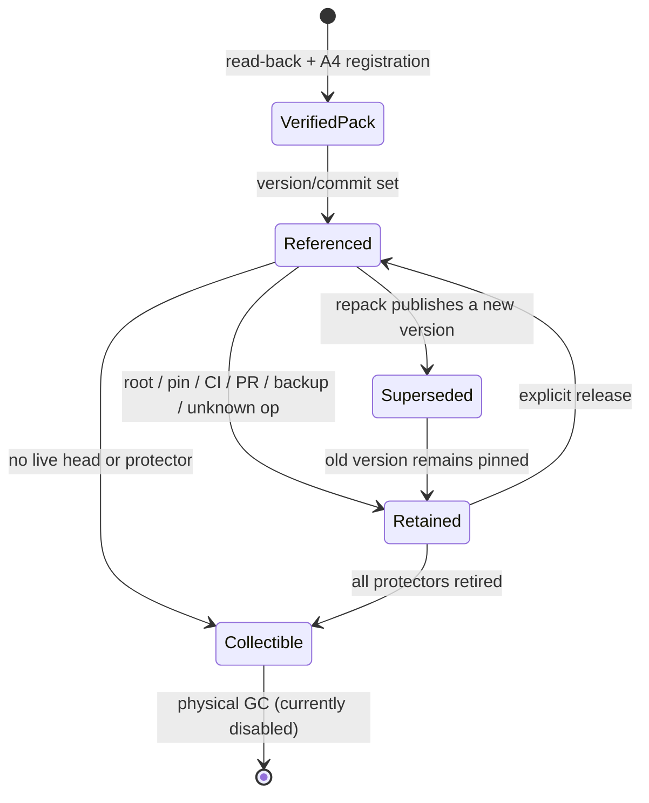

# Ref-version and pack-dependency causal contract (proposal for #180)

Status: **proposal only; no causal implementation exists.** This checkpoint does
not close #180 and does not edit production, migrations, Cargo or workflows. It
extends the read/session boundary of #172/#174/#175 with a Git-data causal unit:
a per-ref version whose exact object representation and server-proven
dependencies are recorded by the authority. A session cursor, cache entry or
pack layout is not a Git causal dependency.

Legend: **[CURRENT]** means behavior in this tree, including the candidate
`serve-blob` path (the repository default entry is unchanged and `serve-blob`
is not a completed standalone cutover). **[PROPOSED]** means contract/checkpoint
only: no production code, migration, route or passing test exists.
**[PROPOSED/RAFT]** means no Raft Ref-CAS runtime exists: `AuthorityKind::RaftRefStore`
is a wire/realm value and `crates/refcas-log` is an independent experimental log
slice, not a state machine.

Public Pando material is used only for the stated product goals (pack-level
storage, verified immutable content, causal publication). It is not evidence of
vendor internals, database choice, performance or an implemented algorithm:
<https://openai.com/index/scaling-git-at-openai/>.

## 1. Current baseline and its exact fallback

### 1.1 What is actually implemented

| Area | Current code owner | Current fact |
| --- | --- | --- |
| Authority/gate | `src/ref_store/core/contract.rs`; `migrations/139_ref_store_core.sql`; `migrations/145_ref_store_serving.sql` | One PG gate per repository with `tenant_id`, object format, `history_incarnation`, `authority_epoch`, `group_epoch`, `head_ref`, repo-wide `revision`. Serving binding fixes a single `pg_refstore` authority and Blob backend. |
| Operation identity | `src/ref_store/contract.rs`; `src/ref_store/pg.rs`; `migrations/138_ref_store_operation_identity.sql` | Repository + issuer + lane + sequence + operation UUID + request digest; pending/committed/rejected/cancelled terminal; cancel-before-register tombstone; exact terminal replay; ambiguous commit is unknown. |
| Ref mutation | `src/ref_store/core/pack_commit/plan.rs`, `closure.rs`, `proof.rs`, `pg_commit.rs` | Plan binds expected gate revision/digest, old refs/HEAD and old membership; closure captures old refs plus **all** old active packs and the new packs; a private native proof is required; refs, gate, membership, terminal, event and history are written in one short PG transaction. |
| Pack identity | `src/ref_store/core/pack_commit/artifact.rs`; `migrations/142_ref_store_core_packs.sql` | Exactly one `.pack` and one `.idx` per registered pack; full locator (tenant/authority/generation/attempt/namespace/SHA-256/length), provider, backend identity, verified length/digest and `ArtifactSetDigest` over artifact fields. Pack/registration identity and append-only ledger rows are separate bindings; membership is repository-wide and append-only. |
| Bytes/holds | `src/ref_store/core/artifact_hold/*`; `src/blob_store/protected.rs`; `src/blob_store/readback.rs` | Durable acquire/consume holds; upload only after consume; full provider read-back of length and SHA-256; no receipt on unknown upload; physical Blob delete is disabled. |
| Strong read | `src/ref_store/core/pack_snapshot/serving_read.rs`; `materialize.rs`; `src/blob_git_gateway/snapshot.rs` | One capture under the core gate lock contains every ref, HEAD and every active registered pack; a transient pin protects exactly that capture; the materializer verifies every locator, SHA-256/length, pack/idx pair and native connectivity outside PG, then rechecks pin/generation/scope and cluster incarnation at T2. |
| Roots/decisions | `src/ref_store/core/retention_root/*`; `src/ref_store/core/publication_decision/*`; `migrations/144_ref_store_core_roots_decisions.sql` | Durable roots retain a captured snapshot/ref set and exact pack locators; authorized publication installs a single-use decision and writes its effects with the terminal. These are library/serving components, not a general version DAG. |
| Raft | `src/ref_store/serving/authority.rs`; `src/blob_git_gateway/repo_session/*` | Only authority-kind/realm encoding and cross-realm rejection exist. No Ref-CAS, materialized state machine, ReadIndex, PG projection or distributed serving path. |

Within the Blob-only RefStore boundary, **PG is the only implemented ref
authority; Raft is not implemented; PG projection is not a fallback.** The
strong read path is a full repository capture, not a per-ref version read. No
current row stores per-ref version identity, base/OBJECT dependency IDs or
commit-set IDs; `ref_store_core_pack_history` is pack audit, not a version DAG.

### 1.2 The current strong-snapshot fallback [CURRENT]

1. `PgServingReads::capture` locks the ready serving realm and core gate, then captures the complete refs/HEAD and active membership set into one transient pin (migration 146), bounded at 4096 refs and 16 packs (`src/ref_store/core/snapshot_contract.rs`).
2. `PgPackSnapshotMaterializer` verifies the exact Blob backend and every pack/idx locator/SHA-256/length, runs native exact-refs/HEAD/branch/connectivity checks, and rechecks pin generation, history/epochs and cluster incarnation at T2.
3. The result is one repository-consistent point for that request: the safe default and fallback for this proposal.

This does **not** provide a cross-request Smart HTTP pin, a per-ref history, a
version DAG, or common time across independent reads. The session token in
`src/blob_git_gateway/repo_session.rs` is a repo-wide lower bound, not a pack pin
or version ID. A `VERSION_CLOSURE` read is never silently replaced by another
snapshot; only `fallback=strong_snapshot` may return the stronger mode, and the
response must label it.

## 2. Version identity and causal records [PROPOSED]

### 2.1 Realm, ref, generation and operation

A ref version is addressed by the complete realm below, never by OID or ref name
alone.

| Field | Rule |
| --- | --- |
| `tenant_id` | The gate/serving tenant; a dependency from another tenant is refused. |
| `repository_id` | Non-nil; same repository only. README links and UI names cannot substitute. |
| `history_incarnation` | Current gate/binding value. A restore creates a new incarnation; old version IDs are not reinterpreted. |
| `authority_kind` | `pg_refstore` or `raft_refstore`, fixed at provision. |
| `authority_epoch`, `group_id`, `group_epoch`, `object_format` | Current realm; object format binds OID width and is part of the ID preimage. `group_id = 0` only for PG; a different realm is a different version namespace. |
| `ref_name` | Canonical Git ref name; same-ref base dependency only. |
| `ref_generation` | Positive per-ref sequence starting at 1; every successful publish/delete/repack advances exactly one. No reuse after tombstone or pruning. |
| `operation_id` + `operation_digest` | The exact operation identity/digest that produced the version; replay equality requires all of these fields. |

`VersionId = SHA-256(L("ry-ref-version-id-v1") || L(tenant) || L(repo) || L(history) || u8(authority) || u64(authority_epoch) || u64(group_id) || u64(group_epoch) || u8(object_format) || L(ref_name) || u64(ref_generation) || L(operation_id) || L(operation_digest))`; `L` and tag encoding are defined in §2.5. It excludes `CommitSetId` and `record_digest`.
The stored `VersionRecord` additionally binds `authority_seq` (the existing core gate revision), `kind` (`publish`, `delete`, `repack`), target or tombstone marker, own pack-set digest, sorted object-dependency VersionIds and `commit_set_id`.
`record_digest = SHA-256(L("ry-ref-version-record-v1") || L(VersionId) || u64(authority_seq) || u8(version_kind) || u8(target_tag) [|| L(target_oid)] || u8(base_tag) [|| L(base_version_id)] || dep-list || L(pack_set_digest) || L(commit_set_id))`; `dep-list = u32_be(count)||sorted(L(dep_version_id))` (entries unique); it never contains itself.
A `VersionId` is immutable: exactly one `record_digest` per VersionId. `VersionId` is the primary key, `(realm, ref_name, ref_generation)` and `(realm, operation_id, ref_name)` are unique, and version rows are insert-only; re-presenting any different record is `version_id_record_conflict`, never an upsert. Readers recompute both digests and reject mismatch. PG and Raft apply the same rule.
A bare `git_oid` is not a version ID.

Do not conflate namespaces: `pin_generation` is a lease generation; Blob locator
`authority_generation` is physical Blob state; `authority_epoch` is a
ref-authority fence; `authority_seq`/core gate `revision` is repository commit
order; `ref_generation` is the per-ref counter proposed here.

### 2.2 Head pointer, tombstones and same-OID ABA

The authority keeps a durable `RefHead` per realm/ref: current `VersionId`,
`ref_generation`, and current OID or tombstone marker. The current OID row is a
projection of that head, not the version history.

- Deletion creates a new version with `target = absent`, `kind = delete`,
  `base = previous head`, `ref_generation + 1`. It removes the current Git ref
  row in the same commit but never the head/generation high-water record.
- Recreating, force-updating, or moving back to a previously used OID creates a
  new generation and `VersionId`. Equality requires every identity field; same
  OID is not same version.
- A tombstone remains a first-class version for lineage/retention: it may have
  an empty own pack set and no object dependencies, but it still has a base and
  operation. The current tombstone returns `deleted`; a historical version ID
  that is no longer retained returns `version_retired`. Neither is an empty
  successful Git version.
- Generation exhaustion is a typed refusal, never a wrap/reset. Losing the head
  high-water row fails closed; the server may not mint generation 1 again under
  the same history.
- Stock Git sees OIDs, not version IDs. `force-with-lease` remains an old-OID
  lease and cannot detect an OID recreated by ABA. Internal/API callers needing
  version-level ABA safety send `base_version_id` in addition to the old OID.
  A server-side retry uses the original operation + base; a fresh request
  against the current same OID is a new operation, not a replay.

### 2.3 Immutable pack sets and compaction

A version's physical representation is an immutable **own pack set** referencing
existing registered packs. Each pack is exactly one pack + one idx with:

- `pack_id`, globally unique `registration_id`, two A3 hold ids;
- full Blob locator/provider/backend identity;
- exact verified SHA-256 and length for both artifacts;
- `ArtifactSetDigest` over exactly the artifact fields: role, slot, hold id,
  full locator/provider/backend and verified digest/length.
- Pack/registration identity is bound separately by `RegisteredPack::new` and
  `packs_digest`; append-only registration/history rows are separate immutable
  rows enforced by migration 142 constraints/triggers, not by this digest.

`PackSetDigest = SHA-256(L("ry-version-pack-set-v1") || u32_be(count) || sorted entries)`, unique entries sorted by `(pack_id, registration_id)`, where `entry = L(pack_id)||L(registration_id)||L(artifact_set_digest)`; `artifact_set_digest` is the current 32-byte `ArtifactSetDigest`, and `joined_revision` is not part of this version pack set. Locators and digests are never rewritten
in place. A changed locator/content is a different pack registration and a
different set digest. Version pack sets and their exact locators are
authoritative for version reads/roots; the current active membership is the
strong-snapshot set. A version commit attaches its own packs to active
membership. A future repack may detach an input from active membership only
after no current version/head needs it and every retained version/root has its
own exact locator/retention; registration rows are never deleted.

Compaction is **not** an in-place replacement. [PROPOSED] a successful compaction
publishes a new version with `kind = repack`, the same target OID, the prior head
version as `base`, a new `ref_generation`, and a new own pack set. It advances
the current head in one atomic commit set. The old version and old packs remain
readable while any root/pin/CI/PR/backup/unknown operation protects them. This is
why the same OID can legitimately have several versions; it is also why pack
deletion cannot be inferred from "current ref no longer names this pack".

[CURRENT] has no detach/compaction consumer: membership is append-only and
`BlobStore::delete` is disabled (`src/blob_store/readback.rs`).

### 2.4 Dependency edges, limits and closure

Each version has two deliberately different relationships:

- **BASE / lineage** — at most one direct predecessor of the *same ref*, exactly
  the current head version observed at commit; absent only for a first version.
  It is required for CAS, replay, history and ABA identity, and its generation is
  exactly `new.ref_generation - 1`. BASE is a direct lineage pointer, not an
  object-availability traversal. A request never recursively materializes the
  whole branch history to read the target version.
- **OBJECT / serving dependency** — zero or more older committed version IDs in
  the same realm whose immutable pack sets supply objects needed by this
  version's target. These edges are selected by the trusted verifier from
  actually verified bytes, never declared by a client. All edges point to
  strictly older `authority_seq`; a same-commit-set sibling is not an object
  dependency. A tombstone is not an object dependency. An older version on a
  different ref is allowed when it belongs to the same repository/history/
  authority realm.

The verifier computes `own packs ∪ object dependencies` (deduplicated), validates
the target ref's complete native connectivity against those bytes, and binds the
exact edge IDs and pack-set digests into the proof/plan. The authoritative commit
revalidates the exact edges against durable rows. Native Git, Blob I/O and
dependency selection never run inside Raft apply or inside a PG transaction.

| Bound | Value | Meaning |
| --- | --- | --- |
| `MAX_OBJECT_DEPS_PER_VERSION` | 8 | Direct OBJECT edges, matching the current max new packs per commit. |
| `MAX_OBJECT_DEPS_TOTAL` | 64 | Deduplicated OBJECT edges in one closure. |
| `MAX_OBJECT_DEP_DEPTH` | 16 | Longest OBJECT path, matching the current max active pack membership. |
| `MAX_CLOSURE_PACKS` | 16 | Unique pack pairs after resolving own packs and OBJECT edges. |
| `MAX_CLOSURE_ARTIFACTS` | 32 | Exactly two artifacts per pack. |
| `MAX_CLOSURE_VERIFIED_BYTES` | 64 MiB | Sum of verified pack+idx lengths, matching the current verifier total-byte bound. A larger closure is refused, not truncated. |
| `MAX_VERSION_REFS` | 4096 | Capacity of one strong snapshot; a single version still names one ref. |
| `MAX_COMMIT_SET_REFS` | 128 | Existing per-commit ref batch bound. |

Validation is all-or-nothing:

- reject self/duplicate edges; cross-tenant/repository/history/authority edges;
  same-`authority_seq` edges; absent/tombstone/uncommitted targets;
- reject cycles by full traversal before any version write (the strict
  `authority_seq` rule already prevents them, but corrupt/replayed rows still
  need the explicit check);
- reject missing, retired, corrupted or mixed-backend dependency packs; never
  infer dependency existence from a client claim, OID hash or pack filename;
- refuse depth/fanout/edge/pack/byte overflow before any durable version row.

BASE edges require same ref, exact current head and generation continuity.
Because they do not expand for object closure, a long-lived branch is not made
unreadable by an arbitrary history-depth limit; history APIs page lineage
separately and are not an unbounded request-time closure.

### 2.5 Commit sets and atomic visibility

Every committed version batch has one `CommitSet`. Canonical encoding: `L(x)=u64_be(len(x))||x`; integers are `u8/u32_be/u64_be`; UUID/OID/VersionId/digest fields are raw bytes (OID width from `object_format`); lists are `u32_be(count)||entries`, versions and results have unique ref names, versions are sorted by `(ref_name, VersionId)`, results by `ref_name`. Tags: authority 1=pg/2=raft; format 1=sha1/2=sha256; version kind 1=publish/2=delete/3=repack (publish/delete may mix; repack only in an all-repack maintenance set; delete uses target_tag=0, publish/repack target_tag=1); target/head/base/old/new tags 0=absent/1=present; `commit_set_tag` 0=absent/1=present; terminal kind 1=committed/2=rejected/3=cancelled; outcome 1=applied/2=not_applied; `reason` is UTF-8 (empty for applied).

`CS = L("ry-version-commit-set-id-v1") || L(tenant) || L(repo) || L(history) || u8(authority) || u64(authority_epoch) || u64(group_id) || u64(group_epoch) || u8(object_format) || u64(authority_seq) || L(operation_id) || L(operation_digest) || version-list || head_tag [|| L(head_ref) || target_tag [|| L(head_oid)]]`.
`version-entry = L(ref_name)||L(VersionId)||u8(version_kind)||u8(target_tag)||[L(target_oid)]`; `CommitSetId = SHA-256(CS)`. `CS` excludes every terminal byte/digest and every version-record digest; `VersionId` excludes `CommitSetId`.

`T = L("ry-version-terminal-v1") || u8(commit_set_tag) [|| L(CommitSetId)] || L(tenant) || L(repo) || L(history) || u8(authority) || u64(authority_epoch) || u64(group_id) || u64(group_epoch) || u8(object_format) || u64(authority_seq) || L(operation_id) || L(operation_digest) || u8(terminal_kind) || result-list`.
`result-entry = L(ref_name)||u8(outcome)||u8(old_tag)||[L(old_oid)]||u8(new_tag)||[L(new_oid)]||L(reason)`; `TerminalDigest = SHA-256(T)`. `T` is the exact ACK/replay body; a JSON wrapper may store it as base64 but must not re-encode it. `T` contains CommitSetId when `commit_set_tag=1`; it never contains TerminalDigest. A commit-set row may store TerminalDigest as an integrity column, but CommitSetId does not hash it. Order: versions/head -> CS/CommitSetId -> T/TerminalDigest -> rows+terminal -> ACK. The graph is acyclic.

Fixed vector (`11*32` means 32 bytes of 0x11; `33*20` means 20 bytes of 0x33; VersionId bytes are fixed synthetic inputs here, with derivation in a separate checkpoint): `tenant=00000000-0000-0000-0000-000000000001`, `repo=00000000-0000-0000-0000-000000000002`, `history=00000000-0000-0000-0000-000000000003`, `authority=1`, `authority_epoch=7`, `group_id=0`, `group_epoch=9`, `object_format=1`, `authority_seq=42`, `operation_id=00000000-0000-0000-0000-000000000004`, `operation_digest=11*32`, one version `(refs/heads/main, VersionId=22*32, kind=1, target_tag=1, target_oid=33*20)`, `head_tag=1`, `head_ref=refs/heads/main`, head `target_tag=1`, `head_oid=33*20`, `commit_set_tag=1`, `terminal_kind=1`, one result `(refs/heads/main, outcome=1, old_tag=1, old_oid=44*20, new_tag=1, new_oid=33*20, reason="")`. Expected: `CS` length 355; `CommitSetId=00fee34e0745b3b5557cd40620d276b623a63a3cdcbd469fbea796968e53f7e5`; `T` length 336; `TerminalDigest=081d960f2ce44a95fa19866189f83a604de5b6f78d9dfeac941ca7efddb92ab9`.
Mixed delete/publish vector (same realm, fixed VersionId inputs, committed, `commit_set_tag=1`): versions `[(refs/heads/main, 22*32, kind=1, target_tag=1, target_oid=33*20), (refs/heads/topic, 66*32, kind=2, target_tag=0)]`, HEAD `refs/heads/main` -> `33*20`, results `[main applied old=44*20 new=33*20 reason="", topic applied old=77*20 new=absent reason=""]`; expected `CS` length 421, `CommitSetId=ffcd8426b98ee6724cffc3c2918ec6450c86a33203c0cc10f2c3820c0fddd6ad`, `T` length 399, `TerminalDigest=24d30b09e01477656e53d93703cd968d1820f43edd5a985f77b684962fbfe37a`.
Identity-chain vector (same realm and operation as the fixed vector, `authority_seq=42`, ref main, generation 1, kind=1, target=33*20, base absent, deps empty, pack set one entry `(pack_id=99*16, registration_id=aa*16, artifact_set_digest=bb*32)`, committed, `commit_set_tag=1`, result applied old=44*20 new=33*20): `VersionId=7ed6b0d771d7133059718f42fa2dab89fb50003d57128536ffb908d11816c373`; `PackSetDigest=fd3461afbd34e518f8bf1d6c677f2a023346733925ec9cd6eb7ca76f3c1a4c22`; with that VersionId the single-version `CS` is 355 bytes and `CommitSetId=9ffcf9731fb04dd56ceac420d7707c1b2b792deaa431d0bd35e3f53bee721932`, `record_digest=01ef64d5effb40e4ee835437e78eeb31a9b7781500767ce9255cfb8e5e238da9`, `T` is 336 bytes and `TerminalDigest=25de02843735a28ec5b4fd178cb06d12de16e71a46915acb4a3cd99ee572da19`.

Commit set, versions, edges, ref-heads, membership and terminal are one authority-atomic unit: readers see all or none; a rejected ref gets no version. A committed set has at least one version and `commit_set_tag=1`; rejected/cancelled terminals use `commit_set_tag=0`.

## 3. Publication ordering and operation states [PROPOSED]

```mermaid
stateDiagram-v2
    state "Unknown (client observation)" as Unknown
    [*] --> Pending: prepare exact operation + base/head
    Pending --> Staged: durable Blob read-back + durable holds
    Staged --> Verified: native closure + exact dependency proof
    Verified --> Committed: authority commit (versions + deps + refs + terminal)
    Verified --> Rejected: deterministic pre-write refusal
    Pending --> Cancelled: cancel wins before commit
    Staged --> Cancelled: cancel wins before authority commit
    Verified --> Cancelled: cancel wins before authority commit
    Pending --> Unknown: timeout / lost reply
    Staged --> Unknown: timeout / lost reply
    Verified --> Unknown: commit reply lost or ambiguous
    Unknown --> Committed: query same operation
    Unknown --> Rejected: query same operation
    Unknown --> Cancelled: query same operation
    Unknown --> [*]: retained unknown; explicit reconciliation required
```

`Unknown` is a client/API observation, not a fifth durable authority state. The
durable operation remains `pending`, or is already `committed`/`rejected`/
`cancelled`. ACK is not a state and not an authority write; it is rendered from a
persisted terminal. A lost ACK therefore cannot become a second commit.

The required order is:

1. **Prepare.** Authorize the real actor, create/replay the exact pending operation, capture the current `RefHead`/gate revision and expected base, and freeze the old-OID/lease expectation. No ref/version is written. A changed gate/base makes the operation stale; do not mint a silent second operation.
2. **Durable bytes + holds.** A3 acquire/consume durable Blob holds before upload; upload each pack/idx to a unique attempt locator; fully read back length, SHA-256 and the actually opened backend. A4 registration binds the exact pair, both holds, planned content and parent digest. A missing/failed registration leaves retained holds and no publishable version; provider success is not a byte proof.
3. **Proof + decisions.** Capture the authoritative base and candidate dependency versions/packs; pin/hold old packs through proof and commit. Verify full native connectivity, exact ref/HEAD result, exact accepted set, dependency realms and all bounds. The verifier selects exact OBJECT dependencies; the plan/proof binds them. A PG single-use decision or [PROPOSED/RAFT] signed grant binds operation, realm, base, selection, proof and deps. No ref mutation precedes this step.
4. **Authoritative atomic commit.** PG: one short transaction takes the 138 operation/lane prefix, repository/usage/gate locks, rechecks base/dependencies, writes ref heads/current refs + version rows + commit set + edges + membership + terminal + event, and consumes the decision. Raft: one deterministic applied command validates local head/realm/grant/dependency indexes and writes the same logical records; no PG query, Blob read or native child in apply.
5. **ACK and replay.** Only an acknowledged authority commit produces the ACK/report-status, carrying the exact commit set and per-ref terminal (version IDs after commit). Identical replay returns stored terminal bytes. `COMMIT`/apply ambiguity returns unknown with the operation identity; query the same operation. Do not retry with a new identity or convert unknown to `ng`/failure.

Cancellation shares the same operation prefix. PG cancel/commit has exactly one
winner in the gate/operation transaction. Raft cancel must be a command in the
same replicated log; a PG tombstone or projection update alone cannot declare a
Raft operation cancelled. After commit, cancellation can record a tombstone but
must never rewrite the terminal or versions. An unknown cancel is resolved by
querying the original operation.

### 3.1 Atomic, accepted subset, HEAD and protection

- **Atomic** (`CommitMode::Atomic`): all requested updates and all their versions
  apply or none do. A failure at any ref yields no version/ref/HEAD effect for the
  batch, one rejected terminal, and an unchanged gate revision.
- **Accepted subset** (`CommitMode::AcceptedSubset`): the sealed selection fixes
  every original ref verdict in original request order. Only accepted refs get
  versions and a commit set; rejected refs retain their prior heads and are
  reported in the terminal. Shared pack/old-base corruption fails the whole
  operation. Final proof/decision consumption cannot silently shrink the sealed
  accepted set. An all-rejected selection writes a rejected terminal and no
  commit set.
- Same old version/OID competition: the authority's current-head CAS permits
  exactly one new base from a given head. The loser must not produce a second
  version; if the same new OID is pushed, it is still a different future version
  from a different base.
- Existing Git rules remain authoritative and are rechecked at commit, not by a
  fast reader: ref-name prefix conflicts, branch/HEAD type checks,
  delete-without-retarget, force-with-lease/old-OID lease, protected branches,
  approvals/checks, and symbolic HEAD behavior. HEAD is an alias/pointer in the
  commit set, not a separately mutable version.
- Different refs may prepare Blob uploads and native proofs concurrently. That is
  not a claim of unbounded horizontal write scaling: the authority commit and
  retention providers remain bounded serialization points.

## 4. Read guarantees and API modes [PROPOSED]

The default is the existing full strong snapshot. Any fast read is explicit,
opt-in and never changes the default Git contract.

| Consumer/scenario | Default | Optional mode | Common time? |
| --- | --- | --- | --- |
| Smart HTTP clone/fetch advertisement | Strong repository snapshot | None in this proposal | Yes, per request only |
| Single-ref browse/history | Strong snapshot | `VERSION_CLOSURE` for the exact version | No cross-ref claim |
| Cross-ref UI compare/list | Strong snapshot | `VERSION_SET` with explicit versions | No; caller must accept and response labels it |
| PR merge, branch protection, force-with-lease | Strong/authority recheck | None for the decision itself | Yes |
| CI checkout pin | Durable root/pin of exact version(s) or strong snapshot | `VERSION_CLOSURE` per pinned version | Only if the pin names one commit set / strong snapshot |
| Backup/restore | Full captured refs + version/pack manifests | None | Yes |
| Durable compute cache | Verified strong snapshot | Verified `VERSION_CLOSURE` keyed by version ID | Must report the mode; no stale projection |
| Session/read-your-writes | Strong snapshot with bound >= session lower bound | Version read whose `authority_seq` is >= bound | Historical reads are a separate explicit mode |

Semantics:

- **Strong snapshot** captures all refs/HEAD and all active packs at one gate
  revision, pins them, verifies every byte and native connectivity, and returns
  one repository-consistent point. This is the current fallback and the only mode
  allowed to claim repository consistency by default.
- **`VERSION_CLOSURE`** authorizes the realm and exact `VersionId`, loads the
  version + OBJECT dependency closure, pins/verifies every pack and native
  target, and returns the target ref's verified version. It must not advertise
  unrelated refs, infer them from the target OID, or claim a repository point.
  A session bound is satisfied only if the version's `authority_seq` is at least
  the bound; otherwise the request is `behind_session` unless it explicitly asks
  for historical/pinned mode, which does not claim read-your-writes.
- **`VERSION_SET`** is only for callers that provide exact versions and accept
  non-common-time. The response must carry `common_time=false`, each version ID
  and each dependency/retention state. It must not be used for atomic
  multi-ref merge decisions, default fetch, backup, or CI unless the job
  explicitly declares the weaker mode and pins each version.
- A fast read failure is not silently repaired by reopening a different
  snapshot. If a caller sends `fallback=strong_snapshot`, only then may the
  server retry the strong snapshot and it must return `mode=strong_snapshot`.
- Every mode still enforces current authorization, tenant/repo/realm, live
  serving binding, exact Blob backend and retention. A stale PG projection,
  Redis cache or local Git view is never a ref authority.

Observable errors (proposal-level; wire mapping is a later checkpoint):
`version_not_found`, `version_retired`, `deleted`, `dependency_missing`,
`dependency_corrupt`, `dependency_realm_mismatch`,
`dependency_cycle_integrity`, `closure_too_large`, `behind_session`,
`not_common_time`, `authority_unavailable`, `unknown_operation`. None returns a
partial ref set, a fabricated empty repository, or unverified bytes.

## 5. Retention, backup, compaction and unknown operations

A retained object is a **version + exact own packs + recursively required OBJECT
dependencies**. BASE lineage metadata is retained for the history/audit records
that name it; a read of a current version does not require recursively
materializing BASE ancestors. The following protectors must be enumerated by
the authority, not inferred from a current ref alone:

| Protector | What it must protect | Release rule |
| --- | --- | --- |
| Live `RefHead` | current version + its own/OBJECT pack closure | Replaced only by a new authoritative version; old version remains if retained |
| Durable/transient snapshot pin | captured versions/refs + exact packs | Explicit release or bounded transient expiry; expired reads are not reissued |
| Retention root | version IDs/commit set + pack identities | One-way root release; no reopen/reuse |
| CI checkout pin / PR merge / in-flight finalizer | exact version(s), deps and packs | Terminal job/merge state or explicit revocation with authority recheck |
| Backup manifest | authority cut + all version/dep rows + Blob object closure | Backup retention policy; never TTL-only |
| Prepared/unknown operation + A3 holds | staged packs, planned base/deps, operation pending row | Only after exact terminal replay/cancel/reconciliation; no TTL |
| Compaction inputs | old version/pack set until every referencing version is retired | New version committed and all references/backup/root holders released |
| Quarantine/corruption hold | affected version/packs and recovery evidence | Explicit incident recovery; no automatic delete |

Rules:

- No TTL may delete a version, dependency, pack or staged object whose
  operation is pending/unknown, whose root/pin/backup is active, or whose
  dependency was declared by a retained version. "Delayed" and "unknown" mean
  retain and reconcile, not expire.
- Quota refusal rejects new writes; it never prunes retained roots, holds,
  versions or receipts. Exact replay charges zero.
- A root/pin release is not a claim that physical bytes were deleted. Physical GC
  remains a separate, default-off consumer. [CURRENT] `BlobStore::delete` is
  disabled and there is no GC consumer; this proposal does not change that.
- Backup captures one consistent authority cut plus every version/dependency/
  pack record and the complete Blob object set. Restore allocates a new history/
  authority incarnation; old version IDs, grants and pins are rejected rather
  than compared across incarnations. PG-only, Raft and Blob snapshots are not
  one cross-system transaction; an incomplete manifest opens no service.
- Compaction is a new version (`repack`) with a new commit set and exact new
  packs. It must not rewrite an old version's locator or silently make an old
  retained version unreadable. Failure leaves the old version/head unchanged.
- Unknown operation retention is explicit. There is no "operation older than N
  days" deletion rule; an operator may resolve it only with the authority's
  recorded terminal/cancel evidence and an audited retention decision.

## 6. PG-single and Raft-distributed equivalence [PROPOSED]

| Contract point | PG single | Raft distributed |
| --- | --- | --- |
| Authority | `PgRefStore` gate/ref/version rows in one PG transaction | Same logical records in the repository's Ref-CAS state machine |
| Prepare/base capture | PG read transaction under the operation/gate lock prefix | Authority command/read-index capture; PG is not the ref authority |
| Byte + dependency proof | Outside PG; pins/holds; then commit revalidates exact metadata/bindings | Outside apply; proof/grant binds exact bytes/deps; deterministic apply revalidates |
| Ref/version/terminal atomicity | One PG `COMMIT` | One replicated command applied once; committed log entry + state-machine result |
| Strong read | Full capture/pin/T2 current path | ReadIndex or equivalent authority barrier + same logical capture/pin contract |
| Fast read | Load version/deps from PG authority | Read exact version/deps from Ref-CAS/ReadIndex; projection is never read |
| Cancel/unknown | Operation prefix + PG terminal; unknown resolves by query | Same operation command in the log; only log order decides; PG tombstone is intent |
| Retention | PG roots/pins/holds | Ref-CAS roots/pins + PG global hold bridge; no PG-only pin claim |
| Event/projection | Same transaction or durable outbox | Projection is derived; lag never overwrites or supplies refs |
| Authority failure | No ref authority → fail; no local fallback | No authority/quorum → fail; never fall back to PG projection/local view |

Both implementations must return the same canonical `VersionRecord`,
`CommitSet`, dependency closure and immutable terminal bytes for the same logical
operation. The shared tests below run the same contract against an adapter, not
two unrelated test suites.

No false transaction is allowed:

- PG decision/hold + Blob upload + Raft apply are separate systems. A grant
  records the decision and proof; it is not proof that PG and Raft committed
  atomically.
- Raft applied but PG projection missing means the ref commit exists; the
  projector retries and the API reports unknown/queued until evidence is
  available. It must not roll back Raft or invent a second authority.
- PG decision installed but Raft apply missing/failed leaves an unknown/pending
  operation and retained holds; it is reconciled by the same operation ID, not
  by writing PG refs as a fallback.
- Raft cancel must be applied by the authority; a PG tombstone alone is not a
  distributed cancellation.

## 7. Narrow implementation checkpoints

Each checkpoint is independently reviewable and must leave the default Git path
unchanged until its exit criteria pass. [CURRENT] C0 is this document only.

| # | Scope | Likely files | Exit check |
| --- | --- | --- | --- |
| C0 | This contract and state diagram | `docs/ref-version-pack-contract.md`, design index | Docs/link checks pass; no production/migration/Cargo changes |
| C1 | Pure identity/edge/limit types and canonical digests; no schema/route | `src/ref_store/core/ref_version/{mod,contract,digest,limits}.rs` | VersionId/PackSetDigest/CommitSetId/record_digest/T vectors fixed before C2/C7; no PG/Blob/native |
| C2 | PG version/head/commit-set/edge tables and authoritative insert under the existing 138/gate lock prefix | next safe migration; `core/ref_version/pg*.rs`; existing `pack_commit/pg_commit.rs` extension point | Real-PG tests for CAS, atomic/subset, tombstone/ABA, replay/unknown; no read route |
| C3 | Bind current A4 registered pack identities and verifier-selected OBJECT deps; prove dependency pinning through commit | `core/ref_version/*`, `pack_commit/{plan,closure,proof,artifact}.rs` extension points | Cross-tenant/missing/corrupt/depth/byte/cycle tests; no default serving change |
| C4 | Strong snapshot records/binds version heads/deps without weakening the current fallback | `core/pack_snapshot/*` extension; current strong tests | Full-snapshot tests remain green; version IDs optional until enabled |
| C5 | Explicit `VERSION_CLOSURE`/`VERSION_SET` API, session-bound and fallback labeling | `blob_git_gateway` read adapter + ref-version reader | Mode matrix, errors, no silent downgrade; Git Smart HTTP still strong |
| C6 | Root/pin/CI/PR/backup/compaction/unknown-operation protection for versions | roots/pins/backup extension points; no GC delete | Protector matrix and backup/restore tests; TTL cannot collect unknown |
| C7 | Raft Ref-CAS state machine + shared contract suite; ReadIndex and projection lag | distributed authority crate/runtime; not root PG refs | Same shared tests pass on Raft; PG fallback/partition tests fail closed |

C1-C7 are not implemented by this checkpoint. C2/C7 require Linux native/Postgres/
real multi-host test execution by the root runner; macOS local work is limited to
offline Python/docs checks. No performance claim is made by any checkpoint.

## 8. Concrete shared tests (not executed by this checkpoint)

The tests must be written only with C1+; this document does not claim they exist
or pass. All synthetic dependency/edge tests are pure. PG/Raft suites are
ignored integration tests with explicit real dependencies.

Pure contract (`tests/ref_version_contract.rs` proposal): `version_id_binds_tenant_repo_history_authority_ref_operation`;
`same_oid_new_generation_is_not_aba`; `tombstone_generation_survives_delete`;
`client_supplied_dependency_is_not_authority`; `base_must_be_exact_current_head`;
`dependency_cycle_self_same_commit_set_and_cross_realm_are_refused`;
`depth_fanout_edges_packs_bytes_bounds_are_exact_and_fail_closed`;
`closed_closure_is_ordered_and_digest_stable`;
`mixed_publish_delete_commit_set_is_canonical`; `per_version_kind_is_not_inferred_from_target`;
`version_id_record_binding_is_immutable`; `record_digest_exact_preimage`; `pack_set_digest_exact_preimage`.

PG authority (`tests/ref_version_pg.rs` proposal, ignored, real PG):
`same_old_version_only_one_writer_wins` (a competing same-new-OID push still
cannot produce a second version from the same base);
`different_refs_prepare_in_parallel_but_authority_commit_is_bounded`;
`atomic_batch_all_or_none`; `subset_records_only_sealed_accepted_versions`;
`delete_then_recreate_same_oid_is_new_version_and_old_pin_still_reads`;
`commit_unknown_replays_exactly_one_terminal`; `cancel_race_has_one_winner`;
`missing_or_corrupt_dependency_blocks_read`;
`cross_tenant_history_authority_dependency_rejected`;
`root_pin_backup_unknown_operation_protect_versions_and_packs`;
`unknown_operation_is_not_collected_by_ttl`;
`head_protection_prefix_and_force_with_lease_remain_authoritative`.

Raft/distributed (`tests/ref_version_raft.rs` proposal, ignored, real quorum):
the same logical contract suite through the Raft adapter;
`read_index_not_pg_projection`; `partition_fails_closed_without_pg_ref_fallback`;
`apply_replay_is_idempotent`; `projection_lag_does_not_rewrite_terminal`;
`raft_cancel_and_commit_have_one_log_order`; `grant_replay_cannot_install_twice`.

Regression inputs for the matrix (existing targets, not run here):
`tests/ref_store_packs.rs`, `tests/ref_store_operations.rs`,
`tests/ref_store_serving_reads.rs`, `tests/ref_store_materialized_reads.rs`,
`tests/ref_store_retention_roots.rs`, `tests/ref_store_decision_subset.rs`,
`tests/blob_git_gateway.rs`.

## 9. Acceptance mapping and non-claims

The acceptance areas map to: this document/C0 (review before implementation);
§2.2/§3.1 and C2 (same-old-OID single winner, different-ref prep, atomic/subset/
HEAD/protection); §2.4 and C1/C2 (old-history and forged/cross-tenant
dependency rejection); §3/§4/§5 and C2/C7 (missing/corrupt pack/base,
partition, restore, lost ACK); §5 and C6 (roots/pins/CI/PR/backup/validation/
compaction/unknown retention); §4 and C5 (cross-ref matrix, compatibility,
errors); this status and §4/§9 (no causal-consistency claim).

Non-claims: no causal implementation, no closed #180, no Raft runtime, no
cross-PG/Raft/Blob transaction, no cross-request Smart HTTP pin, no physical GC,
no production qualification, no performance result, and no assertion about
OpenAI's unpublished implementation. The full strong snapshot remains the
default safety fallback until the checkpoints above are implemented and
independently accepted.
